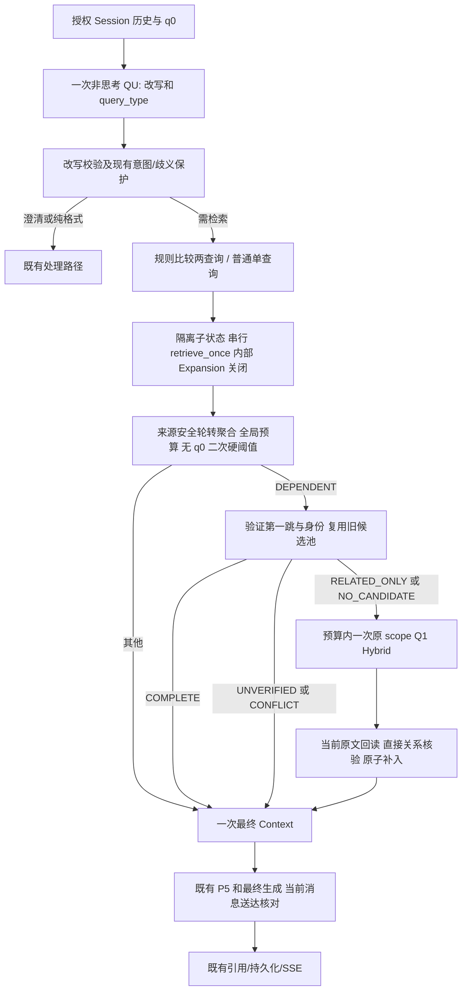

# S8.6：查询理解分流、规则子问题与有界迭代检索 V1

日期：2026-10-21。合法基线：`08ebd90b1c39965d1974de0717c5c6a66f36869a`。独立分支：`codex/s8-6-adaptive-retrieval-20261021`。

## 1. 实施状态与范围

A、B 已实施，并完成受影响模块的离线合同测试及冻结记录回放。新增实际 Provider 调用、实际 Token、未知发送均为 0。真实模型分类质量、检索收益、延迟和 Token 收益、正式 API 部署验收均为 `NOT_RUN`。复杂规划、HyDE、通用事实覆盖检查器为 `NOT_IMPLEMENTED`。

候选功能默认关闭。P5 路由及升级、模型绑定、最终生成 Prompt、全局 Rerank 阈值、Weighted RRF、全局 TopK 配置、数据库 Schema 和索引保持基线。`bridge_rescue_mode` 的默认值仍为 `off`。原先的 `cheap_bridge_v1` 合同通过兼容包装保留。

## 2. 配置和 QU v2

沿现有链路传递服务器白名单字段：

`SessionCreate → ApplicationRuntime.create_session → context_config.conversation → resolve_saved_conversation → ApplicationRuntime._configuration → PipelineState`

`retrieval_strategy_mode=off|query_structure_v1`，省略为 `off`。候选模式必须显式搭配 `source_evidence_mode=bounded_source_v1`；非法值或组合在 Registry/lease/发送之前拒绝。新增 dataclass 选项使用 keyword-only；不新增数据库列，也不接受客户端指定权限、模型秘密、预算或来源事实。

| 项目 | off / 不适用输入 | 适用的 query_structure_v1 |
|---|---|---|
| QU 调用 | 现有一次调用 | 同一次现有调用，无额外分类器 |
| 输出合同 | 原三字段 | `rewrite_query,intent,image_description,query_type` |
| thinking | False | False |
| 输出上限 | 文本 150、图像 500 | 文本 256 |
| Prompt | 原配置/自定义模板 | 专用版本化四字段 wrapper，复用原字面改写保护正文 |

原三字段 guard 的求值结果与基线逐字节相同。候选 wrapper 不再叠加旧模板中的三字段限制，避免互相冲突；这是一项明确的 QU profile 变化，不能据此声称 Token 成本不变。q0、有限历史和语言作为有边界的数据输入。

先运行原有 `validate_rewrite`，再接纳 `query_type`。改写回退时类型变为 UNKNOWN；合法三字段旧响应或非法类型保留已验证改写，类型变为 UNKNOWN；JSON 非法、截断或改写违反数字/否定/条件保护时回到 q0。类型只是建议，`resolve_intent`、歧义澄清和纯格式转换仍有优先权。

支持类型：DIRECT、SIMPLE_COMPARE、JOINT、PARALLEL、DEPENDENT、MIXED、UNKNOWN。图像、独立附件/引用内容、Web、Graph 组合保留原路径，记录 `STRATEGY_NOT_APPLICABLE`，不会悄悄忽略输入或扩大 scope。

## 3. A：计划、单轮检索与聚合

### 3.1 闭合比较规则

`strategy.py` 提供不可变 `QueryPlan/SubQuery`、枚举和模式校验。仅对 SIMPLE_COMPARE 建议应用完整匹配：

- 中文：`比较/对比 A 和/与 B 的 X`。
- 英文：`Compare A and B in terms of X`。

恰好两个不同对象和一个完整共同维度，返回有效改写中的原始 span，生成两条查询。中文示例中的“持久化与并发能力”整体保留，不拆成四条。数字/日期、否定、条件、OR、嵌套所有格、源限制、额外尾部等保守拒绝。该规则不证明任意自然语言等价。

DIRECT/JOINT/UNKNOWN 使用一个有效问题；JOINT 不被拆散。PARALLEL/MIXED 记录 `MODEL_PLAN_NOT_ENABLED` 并普通检索；比较规则失败记录 `RULE_NOT_APPLICABLE` 并普通检索。根 q0、有效改写、历史、授权目标、语言和最终 P5 输入不被子状态覆盖。

### 3.2 retrieve_once 与串行执行

`RetrievalPipeline.retrieve_once` 仅包含：

`Search → Rerank → memory affinity → Merge → 单轮 TopK → scoped source evidence`

不含 QU、完整 bridge、最终 Context、持久化或答案生成，不递归调用 `run`。返回独立 `RoundResult`，保留 Search 池、结构化原始分数、阈值接纳 ID、原文及失败原因。

每个子状态深度隔离可变结果；request ID 使用 `strategy/sq-N/...`，追加轮使用 `strategy/round-1/...`。候选内部关闭 Query Expansion，串行执行子查询、KB/模型分组、scope 桶和模型身份读取；不在同一 PG 连接上并发事务。原 off 路径保留调度和 Expansion。候选 Rerank 的第二次阈值尝试也使用不同 operation ID。

每次请求最多开始三个检索单元。现有账本、预留及 12-call 限制仍是发送上界；检索单元不等于 Provider 调用数，跨 KB 模型分组、Rerank 分批和辅助调用均需独立结算。

EMPTY、基础设施 ERROR、BUDGET_OMITTED 分开记录。只有 `LOCAL_EXECUTION_LIMIT_DENIED` 且明确 `sent=False` 的本地调用上限拒绝可停止可选新分支并保留已有事实；权限、scope、取消、截止、UNKNOWN 和可能已发送失败按原合同传播。不会将它们变成“无结果”。

### 3.3 原文聚合、预算和送达

子查询按各自问题重排后，确定性轮转选取各可用分支原文，再补余量，遵守现有最终 TopK；`TopK=0` 继续表示不增加该上限。聚合后不按 q0 再执行统一重排/硬阈值，不跨查询比较分数，也不用近似文本去重抹掉不同数字/日期事实。

同 Chunk/版本可合并覆盖标签；同 ID 的版本、正文或 locator 冲突拒绝准入。已有 scoped source reader 负责真实原文、权限和当前版本。最终 Context 使用当前字符预算，含引用包装同时检查检索和生成编码器；超限从尾部裁剪并记录缺口，完全为空时拒绝无证据自由生成。

`source_validity`、`semantic_support`、delivery 分开。比较命中只证明来源及需求绑定，语义仍为 NOT_CHECKED。只有实际 `GenerationCoordinator` 已准备的当前 system/user 消息中存在对应引用注册项和精确原文正文，才记录 DELIVERED；历史消息、预览、父块句柄、抽取 JSON 不作为送达证明。服务端观察回调在实际 `prepare_generation` 后执行，不改变最终 Prompt 或 P5。Mock 送达也不证明真实答案质量。

## 4. B：由已验证原文驱动一次新召回

`bridge_rescue.prepare_verified_bridge` 复用 sentence-id/v2、current-source reader、`validate_extraction`、`prove_identity` 和 `admit_identity_context`。`bridge_strategy.py` 接管候选模式的结构化决策；不通过解析 trace 文案控制执行。

| 状态 | 含义与后续 |
|---|---|
| COMPLETE | 完整对象的所求直接关系已识别；停止新增检索 |
| RELATED_ONLY | 例如机构地址，仅支持该线索；预算内可追加一次 |
| NO_CANDIDATE | 当前所见没有对应内容；预算内可追加一次 |
| UNVERIFIED | 身份、主体、问题绑定或复杂表达无法可靠证明；不猜测扩大 |
| CONFLICT | 跨普通来源、旧池或新来源发现冲突；停止追加 |

仅适用候选 DEPENDENT 路径。每请求最多一次 Cheap 第一跳抽取、一次旧池 BGE，并缓存本次请求的结构化结果。已经存在完整直接证据时不执行新 Search；旧池 COMPLETE 也停止。RELATED_ONLY/NO_CANDIDATE 才可调用一次 `retrieve_once(Q1)`。重复 Q1、单元/调用上限、预算缺口在开始新轮前终止追加。

Q1 的具体对象必须来自已验证第一跳完整原文，并先验证 q0 所问对象/关系确实对应该第一跳。located 问题构造 `Where is <complete object> located?`；显式 held 问题构造 `Where was <complete event> held?`。任职年份不被改成活动年份。当前问题绑定只覆盖窄的闭合英文表达；其他表达保留 UNVERIFIED。

新轮沿原 scope、授权、deadline、取消和账本，Embedding、BM25、Rerank 都使用 Q1，可取得旧池不存在的新 ID；不运行 QU、Expansion、中间答案生成或完整 Pipeline。候选返回后重新读取当前原文，复核身份前驱链，原第一跳、姓名锚点、原合法普通证据及原始分数保留。

地点验证器只支持有限直接句式：完整实体为主体的 located/位于，以及显式 held-at/in/举行。主体转换、否定、模态、历史位置、多实体歧义及复杂句不被通用字符串包含规则认定为完整支持。名称前缀仅是线索，不是别名。跨阶段累计所见来源检查冲突。

补入采用原子预算预览，同时检查 TopK 和两套 Context 编码；超限保留已有来源并明确未准入。`context_admitted/source_chain_supported` 与真实消息 `delivered/final_answer_supported` 分开。后者表示有限证据链支持状态，**不表示生成答案已经语义评分通过**。所需原始子块若只以父块合并形式出现，当前送达检查保守不计原子块已送达。

## 5. 实际执行流程

冻结 Frost B3/GB3 回放：已验证人物和任职第一跳；姓名原文与机构地点原文均送达实际 Mock final-model 消息；新召回为 EMPTY Mock。结果保持 RELATED_ONLY、`final_answer_supported=false`、`EVENT_VENUE_UNVERIFIED`。旧 GB3 PARTIAL 不变。历史中错误强化时间的 rewrite 只作为固定历史输入回放，不能当作本轮新 QU 已接受该改写。

## 6. C：后续接法，本轮无运行实现

复杂 PARALLEL/MIXED 或不能安全规则拆分的比较，未来可独立验证一次规划调用，最多三个有向无环节点，未知实体使用变量，并校验条件映射、scope、实体和无环性后复用 A 执行器。thinking 只属于独立规划实验；角色/Adapter/预算需另验证。不能把当前普通检索回退称作复杂规划已实现。

HyDE 未来应是独立实验：候选条件不能只用“少于 N 条”；确认索引/scope 正常、无精确限制或已知桥接缺口后，才考虑有界假设。假设只产生 Embedding 向量，关键词与 Rerank 仍使用有效原问题，保留原查询召回；假设不入 Chunk、引用或事实来源。本轮没有 HyDE 开关、调用、占位输出或 PASS。

后续真实验证须分开：同输入 QU 分类；固定 QU/第一跳的检索策略；正式 API 端到端。候选策略对照均关闭 Expansion，legacy 另列。Gold 仅给评分器，保留完整输入输出供独立语义审查。真实发送需要新的 Owner 授权，并先满足 S8.5.1 的正式 profile、引用、聚合预算、合法第二用户和安全隔离前提。

## 7. 参考实现边界

[LlamaIndex 子问题执行](https://github.com/run-llama/llama_index/blob/main/llama-index-core/llama_index/core/query_engine/sub_question_query_engine.py) 仅用于计划/执行分离的参考；[FlashRAG pipeline](https://github.com/RUC-NLPIR/FlashRAG/blob/main/flashrag/pipeline/pipeline.py) 仅用于类型与执行器分离的参考；[Haystack query decomposition](https://haystack.deepset.ai/blog/query-decomposition) 仅用于子问题与文档成对记录的参考。本项目没有引入其框架、分类器或逐子答案生成，也没有引用其研究结果证明本项目收益。

具体离线命令、失败保留、16 项矩阵、原文审计轨迹和真实验证限制见 `docs/evaluation/S8_6_OFFLINE_IMPLEMENTATION.md` 及同名 `.results.json`。
