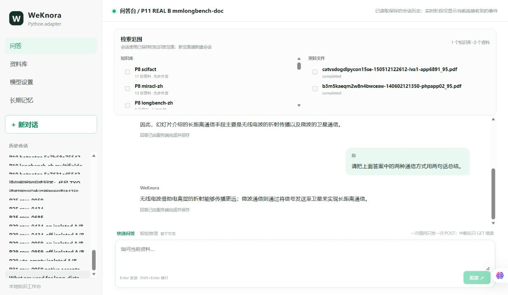
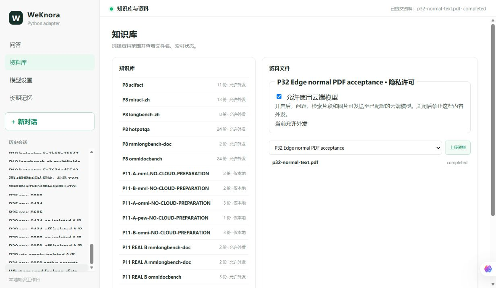

# P32 — 真实浏览器与六套数据集统一 RAG 首轮评测

## 结论

**P32_COMPLETE**：真实用户 Edge、React、FastAPI、PostgreSQL/pgvector、Redis、SiliconFlow 已完成基础闭环；六套各执行2个冻结样本，共12个当前源码 RAG 评测单元，12/12 SSE complete 且与持久化答案一致。没有 Mock，没有重复选优。完成链路不代表答案全部正确。

测量源码：`9ab83b3ddf560d0141d5d5d33437bfac294ecd1f`；固定上游：`3e8b0bfc80b845b2d4b2ed683994748741450a97`。本轮未修改生产代码、模型、Prompt、Rerank阈值、路由或索引。新增的两个脚本是当前正常链路执行及既有评分函数的文件适配器。

## A. 真实 Edge 验收

使用用户已有 Edge 的扩展连接，独立测试标签页；未使用管理员模式、另起自动化浏览器或关闭沙箱。React `127.0.0.1:56426` 正常代理本轮源码 API `127.0.0.1:56425`。

| 操作 | 结果 | 实际证据与边界 |
|---|---|---|
| 加载 React、查看知识库/文档 | PASS | 页面运行身份正常，P11 MinerU B知识库文档可见 |
| 正常知识库问答 row-0959 | PASS | 实际 Search→Rerank→Context→DYNAMIC Cheap；无线电波/电离层与微波/卫星事实进入真实模型请求 |
| 同会话追问 | PASS | Provider消息包含前一轮问题、真实回答及新问题；两种方式均保留。要求“两句话”，实际一句分号句，记录模型格式偏差 |
| SSE进度及完成 | PASS，附限制 | 每个浏览器run记录16个progress事件、1个非空answer事件。当前DYNAMIC先缓冲最终答案；观察到处理进度逐步更新，**未观察到逐Token答案展示** |
| 刷新历史回读 | PASS，附限制 | 刷新后先显示新会话视图；点击侧栏原历史可恢复4条问题/回答，内容相同且没有重新生成。不是自动恢复当前选中会话 |
| 关闭公开引用 | PASS | 页面无引用按钮、切块卡片；SSE、历史及本轮12题最终正文无内部ref标签 |
| Markdown | PASS（基本列表/粗体） | 0959列表、粗体正常。新PDF回答自身产生带空格的星号，忠实显示，未归咎渲染器 |
| 正常PDF上传→完成→可检索 | PASS | UI新建隔离KB，上传3046字节单页合成文字PDF，正常入口完成。原文与summary进入最终请求，回答cedar green |
| Worker | NOT RUN / 不需要 | 本次普通文字PDF由现有API入库路径处理；没有图像任务，不声称启动或验证Worker |
| 图片/代码块回答、SSE断线重连 | NOT RUN | 本轮输出未包含图片或代码；未进行额外断线实验 |
| console错误/警告 | PASS | 保存的warn/error列表为空，无应用404/500或永久加载 |
| 所选KB边界 | PASS（限定） | 当前capture全部来源KB等于请求KB；未新增主动跨租户攻击测试，不把单租户显示当完整权限回归 |

首次自动化使用错误的checkbox名称未找到元素；实际开关为`role=switch`，名称“允许当前知识库使用云端模型”。保存首个失败截图后按实际DOM纠正，操作成功，**不是应用缺陷**。

新上传KB：`8bf66769-cc7f-4a15-bbc3-a5b7118eb6e5`。内容是重复的合成公开导入文字，不是历史Gold，不覆盖既有原件。





## B. 六套资产、索引与评价边界

748来源单元=648 raw+100 prepared，**不是748道QA**。原始冻结40 QID及24页解析Gold均保持不变。源文件、manifest、Gold与当前UUID通过文件哈希和已有上传回执关联，82/82文档绑定，无冲突或猜测。没有访问或修改ECS；本轮本地隔离索引已足够。

| 数据集 | 冻结来源单元 | 当前选定KB文档/Chunk/Embedding | 本轮单元 | Gold与适用指标 |
|---|---:|---:|---:|---|
| SciFact | 200 | 11/33/33 | 2 | qrels；来源文档Recall/MRR/nDCG，当前冻结映射无生成答案Gold，不计QA准确率 |
| MIRACL-ZH | 400 | 13/26/26 | 2 | passage级qrels；子集检索指标，无生成答案Gold |
| LongBench-ZH | 48 | 8/281/281 | 2 | dureader ROUGE-ZH与multifieldqa_zh QA F1分开 |
| HotpotQA | 73 | 24/59/59 | 2 | 答案EM/F1、来源文档qrels；句级support/joint NOT RUN |
| MMLongBench-Doc | 3原PDF | 2/88/88（MinerU B） | 2 | 原typed Gold；项目字符串EM/字符F1及独立人工事实核对，不声称官方LLM judge |
| OmniDocBench | 24页 | 24/66/66（既有OCR） | 2 | 两页可靠对齐全文NED诊断；无官方QA Gold，问答仅诊断 |

合计82文档/553 Chunk/553 Embedding。**这些均为子集，不是官方完整语料成绩。** 既有OCR/MinerU解析版本与本轮应用源码分别记录，未重新解析或入库数据集。新的PDF UI上传KB不参与这些范围。

全部KB Scope正确、`document_scope=[]`，通过正常KB向量检索。Stage A的0959原问题与冻结问题逐字相同，复用其本轮首次回答作为第12个样本，不再发送第二次，后续追问不混入该答案。

## C. 实际结果

### 指标

检索K=10，先投影去重到来源文档/原passage，再计算既有指标；不是前10个Chunk，也不是必要事实评分。

| 数据集 | 执行/计划 | 可相信的本轮成绩 | 语义/证据核对 |
|---|---:|---|---|
| SciFact | 2/2 | Search与Context来源Recall@10、MRR、nDCG均1.0 | 339核心结论与资料一致；247虽命中标注来源，但Context无化学损伤因果证据，回答明确不足。不能称2/2事实QA正确 |
| MIRACL-ZH | 2/2 | Search与Context Recall@10、MRR、nDCG均1.0 | 两题答案都受选中passage支持；无官方生成Gold，不给QA分数 |
| LongBench-ZH | 2/2 | dureader ROUGE-ZH=0.376812（1题）；multifieldqa_zh F1=0.083333（1题） | 培训题正确给出2.2万人，长回答使字符串F1低；节日题存在来源错误与回答自身排版/事实对应错误，不能按ROUGE认定正确 |
| HotpotQA | 2/2 | Search来源Recall@10=1.0，Context=0.5；平均EM=0，token F1=0.234483 | Zeffirelli题语义正确，完整句使EM=0/F1=0.4；地点题错误且缺少地点证据，F1=0.068966 |
| MML | 2/2 | Search来源Recall@10=1.0，Context=0.5；字符串EM均0；字符F1：0434=0.114068、0959=0.179641 | 0959两要素正确且有证据；0434走Fallback、未答Gold。不能把EM=0都当语义错误 |
| Omni | 2/2 | 已持久化全文NED：page012=0.12、page007=0.588235，均值0.354118（2/24）；非官方完整解析分 | pronunciation诊断正确；矩阵诊断错误。布局/表格/公式官方匹配分未运行，不计算QA准确率 |

### 逐题正常链路记录

所有最终角色均为**DYNAMIC选择cheap**，供应商均SiliconFlow。Expensive角色未完整配置，本轮未触发升级，不能据此宣称Expensive可用；未替换模型或修改路由。

| 样本 | Search | Rerank输入 | 保留 | Context Chunk/字符 | 实际Token（全链） | POST耗时 |
|---|---:|---:|---:|---:|---:|---:|
| scifact-247 | 30 | 30 | 2 | 2 / 2090 | 10,073 | 14.535s |
| scifact-339 | 30 | 30 | 3 | 2 / 2876 | 10,347 | 9.411s |
| miracl-91294 | 26 | 26 | 2 | 1 / 319 | 7,150 | 13.061s |
| miracl-7049630 | 26 | 26 | 2 | 1 / 588 | 7,185 | 10.251s |
| longbench-6770736a | 30 | 30 | 23 | 3 / 9776 | 19,110 | 18.780s |
| longbench-51abd206 | 30 | 30 | 1 | 1 / 767 | 12,583 | 4.695s |
| hotpot-5a7631 | 30 | 30 | 2 | 2 / 2632 | 7,473 | 4.614s |
| hotpot-5a8ad6 | 30 | 30 | 3 | 3 / 2226 | 8,022 | 3.800s |
| mml-0434 | 30 | 30 | 0 | 0 / 0 | 8,736 | 8.247s |
| mml-0959 | 30 | 30 | 2 | 2 / 1720 | 8,200 | NOT CAPTURED（Edge） |
| omni-page012 | 30 | 29 | 2 | 1 / 471 | 27,098 | 5.095s |
| omni-page007 | 30 | 30 | 1 | 1 / 295 | 32,533 | 9.437s |

0434因Rerank无保留而提前走原生model Fallback，阶段完成事件没有rerank completion字段，原始评分器保留null；人工对照其空rerank结果与Context后，本表明确记0，不伪造原字段。Rerank原始逐条分数未额外采集，P32不声称完成新的Rerank因果实验。

11个API样本POST中位数9.411s，范围3.800–18.780s；Edge0959未保存POST单调时钟时长，保持缺失，不用供应商单次延迟或整个会话时长替代。阶段B从11:59:02至12:04:01 UTC，少于40分钟。浏览器0959在同一P32源码阶段更早完成。

### 代表性失败与原因边界

1. **0434：检索后证据未进入Context。** Search30中第15个Chunk含Kaggle目标文字，但Rerank无保留，Context0，使用model Fallback。没有答出Cat vs Dog。不能由这次命中就证明“Coding time”跨页归属，也不将P29不同候选问题忽略。本次未改阈值。
2. **Hotpot地点：多跳第二来源丢失＋无依据补充。** Search能命中两个来源，Context仅保留人物资料，缺少The Frost Place地点来源。回答Portland, Maine，Gold为Franconia, New Hampshire。错误地点在本轮Context中无依据；不能进一步推断是模型记忆还是别的内部原因。
3. **Omni矩阵：已有OCR与最终Context脱节＋生成臆造数值。** 独立持久化OCR有系数/常数，但最终同run请求只有通用summary、`images=[]`。回答虚构6/10/12，与冻结原文诊断0/8/-9不符。不是“Cheap已看到正确数字仍推理错误”，也不把命中文档ID计为事实进入模型。
4. **LongBench节日：错误重叠。** “劳动节九月第一周一”“哥伦布日十月”等信息在Context，回答却放在八月/九月标题下，属于生成新增内部冲突。复活节约3月7日、老兵节十月第四周一等说法在原Context已有，记录为来源声明被复述；本轮没有额外外网核实，不改Gold。
5. **SciFact247：来源命中不等于证据充足。** TG2结构资料不能直接支持化学损伤因果命题；回答主体说明缺失，而标题机械复述问题，存在表达误导风险。无独立答案Gold，不强行给支持/反驳正确率。

人工逐项判断保存在`semantic-review.json`，与字符串指标分开；六题具有答案Gold的样本中，人工核心答案正确3题（培训、Zeffirelli、0959），节日混合错误1题、地点错误1题、0434未答1题。另两项Omni非官方诊断一对一错。以上只是本轮小样本人工核对，不组合成跨数据集官方准确率。

## D. 调用、Token与历史保护

- **62次真实供应商调用**：chat29、Embedding20、Rerank13；其中最终回答14次（12个计划样本+浏览器追问1+新PDF检索问答1）。chat其余包含Rewrite与入库summary。
- 总输入163,976、输出4,042、**总Token168,018**；供应商实际usage支持全部62次，无估算费用。
- 计划12题：50次调用、输入155,074、输出3,436、总158,510。
- 额外UI追问/新PDF问答：9次调用、8,217 Token。
- 新PDF正常入库：source-embedding、document-summary、summary-embedding共3次、1,291 Token。评分器原分类为UNASSIGNED_OTHER，本报告依据request_id后缀明确其归属，未修改原始记录。
- 62/62 RESPONSE_RECEIVED，新增UNKNOWN0，没有重发不确定调用。**历史UNKNOWN仍保留**。
- 五表`port_token_calls / port_token_budget_months / port_call_slots / send_calls / send_budget_months`前后行数与全表哈希相同。正常新调用记入迁移015的`port_provider_calls`，未恢复Token Authority/围栏/原文投影。
- 首次全DTO相等检查返回false，原因是内部DTO含空可选字段，原生wire省略空字段；保留初查文件。随后核对12/12实际wire的role/content逐项完全一致，没有非空images/multi_content被丢弃。该检查没有导致新模型调用。

## E. 环境、命令与测试

PG `127.0.0.1:56423 / weknora_python_port_20261013`，system identifier `7696088403504697382`，迁移015已存在，不重复迁移。Redis `127.0.0.1:56424 / DB15`，run id `dcff9d65a25725574ba0cfbc743d409fac211ef0`。本轮前缀`weknora-python-p32-20261017:332:8d49ea69aeca489ea04a5b27e9a5b05e`，未flush。

API launcher PID32288/监听子进程15524；前端launcher PID18644/监听Vite35972。收口调用stop核验命令身份后只结束自身进程树；PG/Redis两端口保留监听，API/React端口已释放。没有Worker、DeepSeek或ECS操作。

PowerShell实际公共环境：

```powershell
$env:PYTHONUTF8='1'
$env:PYTHONPATH='E:\RAG-Worktrees\weknora-python-port-20261013;E:\WK\deps\reader;E:\RAG-Worktrees\weknora-python-port-20261013\var\weknora-port\runtime-deps'
& 'E:/RAG quention/.venv/Scripts/python.exe' -B scripts/p32_real_acceptance.py prepare
& 'E:/RAG quention/.venv/Scripts/python.exe' -B scripts/p32_real_acceptance.py start
```

服务实际入口复用`python.exe -B scripts/p31_native_acceptance.py service`现有plain native assembly；frontend实际为`npm.cmd run dev -- --host 127.0.0.1 --port 56426 --strictPort`，`VITE_API_PROXY_TARGET=http://127.0.0.1:56425`。所有退出码0/启动成功，见start.stdout和进程身份。没有修改旧P31执行器。

以下每个query-case只执行一次，**各退出码0**：

```powershell
& 'E:/RAG quention/.venv/Scripts/python.exe' -B scripts/p32_real_acceptance.py query-case scifact-247
& 'E:/RAG quention/.venv/Scripts/python.exe' -B scripts/p32_real_acceptance.py query-case scifact-339
& 'E:/RAG quention/.venv/Scripts/python.exe' -B scripts/p32_real_acceptance.py query-case miracl-91294
& 'E:/RAG quention/.venv/Scripts/python.exe' -B scripts/p32_real_acceptance.py query-case miracl-7049630
& 'E:/RAG quention/.venv/Scripts/python.exe' -B scripts/p32_real_acceptance.py query-case longbench-6770736a
& 'E:/RAG quention/.venv/Scripts/python.exe' -B scripts/p32_real_acceptance.py query-case longbench-51abd206
& 'E:/RAG quention/.venv/Scripts/python.exe' -B scripts/p32_real_acceptance.py query-case hotpot-5a7631
& 'E:/RAG quention/.venv/Scripts/python.exe' -B scripts/p32_real_acceptance.py query-case hotpot-5a8ad6
& 'E:/RAG quention/.venv/Scripts/python.exe' -B scripts/p32_real_acceptance.py query-case mml-0434
& 'E:/RAG quention/.venv/Scripts/python.exe' -B scripts/p32_real_acceptance.py query-case omni-page012
& 'E:/RAG quention/.venv/Scripts/python.exe' -B scripts/p32_real_acceptance.py query-case omni-page007
& 'E:/RAG quention/.venv/Scripts/python.exe' -B scripts/p32_real_acceptance.py snapshot
& 'E:/RAG quention/.venv/Scripts/python.exe' -B scripts/p32_score_results.py --root E:/WK/run/p32-20261017
& 'E:/RAG quention/.venv/Scripts/python.exe' -B scripts/p32_real_acceptance.py stop
```

上述snapshot、score、stop退出码0；评分12 COMPLETED，SSE/持久化一致。Edge三次提问及上传通过浏览器实际操作，不将其伪写为CLI测试。

既有纯评分定向测试（退出码0，23 passed）：

```powershell
& 'E:/RAG quention/.venv/Scripts/python.exe' -B -m pytest --noconftest --basetemp=E:/WK/run/p32-20261017/scoring-tests/temp-01 tests/weknora_port/test_p19_score.py eval_center/tests/test_metrics.py eval_center/tests/test_scoring_mappers.py -q --junitxml=E:/WK/run/p32-20261017/scoring-tests/run-01.xml
```

另执行两个新脚本AST解析、82项绑定、usage/billed_units负例、服务端run精确关联、UTC耗时、7个历史评分回放的离线检查，均成功；这些是评分器验证，不计为本轮新增真实样本。未修改生产代码，因此未重复全项目回归或前端build。**未实现的命令不得报告通过。**

## F. 文件、证据与下一步

本轮仅提交：`scripts/p32_real_acceptance.py`、`scripts/p32_score_results.py`、本报告与results JSON、专属evidence目录。无共享迁移、依赖、生产源码变更。

- 机器结果：[P32_BROWSER_AND_SIX_DATASET_RAG.results.json](P32_BROWSER_AND_SIX_DATASET_RAG.results.json)
- 原始SSE、持久化消息、实际模型请求、阶段快照、PG只读映射、usage、console及截图：[raw-evidence.zip](evidence/p32-browser-six-dataset-20261017/raw-evidence.zip)
- 各文件SHA/大小：[evidence-manifest.json](evidence/p32-browser-six-dataset-20261017/evidence-manifest.json)
- 原始运行目录：`E:\WK\run\p32-20261017`。

保留原有`.serena/project.yml`、`progress.md`修改和六个旧未跟踪交接/证据文件，不暂存。本轮报告提交SHA可用`git log -1 -- docs/evaluation/P32_BROWSER_AND_SIX_DATASET_RAG.md`回查；测量源码SHA固定为上文P31提交，避免将交付提交与实测源码混淆。

下一轮优先建议（未自动实施）：

1. **必要事实经过Rerank/Merge/Context的保留。** Hotpot第二跳来源丢失、Omni只选summary、0434空Context都提供实际失败证据；先限定已存在模块做对照，不新增审计或动态放行系统。
2. **区分来源错误、生成新增错误与评分格式惩罚。** 节日题、培训题、Zeffirelli题证明需要分别报告；不篡改Gold，不根据EM单独下结论。
3. **补齐现有Expensive配置后再声称动态升级可用。** 本轮仅观测Cheap选择，不证明升级链路。

已有其余有效冻结文本题可以继续分批扩大，不需重建当前索引；官方全语料指标仍缺完整语料索引，视觉计数/图示题仍需既有解析证据覆盖，Omni官方结构指标和Hotpot句级映射另需明确准备。逐Token展示、刷新自动选中会话是可记录的产品体验技术债，未将其擅自批准延期或改动。

完成后停止，未Push、部署、合并或打Tag。
