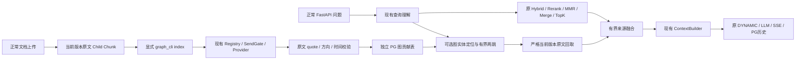

# S6：可关闭的来源绑定 GraphRAG

## 当前结论

**PARTIAL，等待本轮新外发授权。** 已实现正常 RAG 主链中的默认关闭图增强、来源绑定 PostgreSQL 存储、真实模型抽取入口及有界两跳检索。离线测试及真实 PostgreSQL 隔离合同已通过；尚未发送真实建图或 Graph-on 问答，不能宣布 S6 PASS。

Owner 最新决定：**暂不处理 PPT 渐进式展示的解决方案**。本轮不开发页面视觉关联，不将该项作为文本图闭环的前置条件。此前有限只读观察不能证明跨页语义关联。

- 起点：`78bf9839d2030749f715a9395ce355209d8f52ff`。
- 实现提交：`df271a98b01ac2f63e0a315f30f4ada8097daab0`。
- 分支：`codex/weknora-python-port-integrate-image-20261014`。
- 只读远端：`2c21bbcc68384224b5d4a29d1300adf404c1f9b2`，比本地起点旧；没有回退、合并或推送。
- 原有 18 个未提交路径逐个 SHA-256 核对保持一致；未混入提交。

## 1. 官方源码考察及选择

实际读取固定提交的源码；克隆保存在 `E:/WK/run/s6-graphrag-20261019/references/`。四个项目均核对为 MIT，不整体安装或引入其运行依赖。

| 项目与固定提交 | 实际相关源码及结论 | 本轮采用／不采用 |
| --- | --- | --- |
| HippoRAG `d5c8329422e0a0b834a15874545cb6a74b4f9b26` | OpenIE 分别抽实体及关系；检索使用全局无向图 PPR，并有额外 embedding、识别记忆调用。 | 学习原文 passage 绑定及关系发现；采用简单有向两跳，不迁入 PPR、模糊同义实体合并及额外在线 LLM。 |
| LightRAG `aaebfe1bb8d55deb6a4304d357a3bf4c92fcd40a` | Local/Global/Hybrid、来源贡献及增量维护；其 PGGraphStorage 实际依赖 AGE/Cypher。 | 使用来源贡献及原文回取思路；采用普通 PG 独立表，不安装 AGE，不把生成的图描述当原文。 |
| RAG-Anything `da6e2d87a7d3f2746c4541f59953b8764213f6a2` | 页面和内容来源映射；多模态节点的 source_id 也可能指向模型 Caption Chunk。 | 保留真实页面／版本身份原则；不把 Caption 变成已验证原文，不复制其入库框架。 |
| SlideRAG `6eb788d13bdbbd5604745bea37d64878ea7b2db7` | 页面主题、图片描述与主题余弦关系；不能由主题相似证明渐进展示。 | 仅完成源码考察。按 Owner 最新决定不实施 PPT 解决方案。 |

主要源码链接：[Hippo OpenIE](https://github.com/OSU-NLP-Group/HippoRAG/blob/d5c8329422e0a0b834a15874545cb6a74b4f9b26/src/hipporag/information_extraction/openie_openai.py)、[HippoRAG 检索](https://github.com/OSU-NLP-Group/HippoRAG/blob/d5c8329422e0a0b834a15874545cb6a74b4f9b26/src/hipporag/HippoRAG.py)、[LightRAG 查询与来源回取](https://github.com/HKUDS/LightRAG/blob/aaebfe1bb8d55deb6a4304d357a3bf4c92fcd40a/lightrag/operate.py)、[LightRAG PG](https://github.com/HKUDS/LightRAG/blob/aaebfe1bb8d55deb6a4304d357a3bf4c92fcd40a/lightrag/kg/postgres_impl.py)、[RAG-Anything 多模态](https://github.com/HKUDS/RAG-Anything/blob/da6e2d87a7d3f2746c4541f59953b8764213f6a2/raganything/modalprocessors.py)、[SlideRAG 页面主题](https://github.com/iLearn-Lab/SlideRAG/blob/6eb788d13bdbbd5604745bea37d64878ea7b2db7/raganything/processor.py)。

## 2. 数据模型与完整调用链



三张独立表，不改变原 Chunk、Embedding、账本的 Schema 合同：

- `port_graph_evidence`：tenant、owner、KB、document、source_version、chunk、原文 SHA、原文快照、原 offset、可证明页码、抽取操作及 producer。
- `port_graph_nodes`：每个来源贡献内独立节点、实体类型、原始名称、原文别名、文档主题锚点、原文 qualifier。没有跨文档静默合并节点。
- `port_graph_edges`：有方向的源／目标、原文 predicate、唯一精确 quote 与相对 offset、时间限制、验证状态；复合 FK 防止边指向其他来源贡献的节点。

图抽取仅使用当前 `text/image_ocr` Child，不使用 Parent、Summary 或 Caption 冒充原文。明确保留图片 `0/0` offset，不补造普通文本区间。每个文档最多 12 个原文块／32768 字符，每块最多 16384 字符，超出时发送前拒绝，不能手选 Gold 块绕过。

抽取的严格 JSON 由模型生成；名称、别名、qualifier、predicate、quote 必须可回查。方向、否定、不确定及时间条件保守处理。**quote 与词序校验不是语义事实裁判**，无法证明的关系拒绝或保留拒绝原因，不报告完整建图成功。

跨文档引用只解析到同 KB 内唯一、同类型、名称或原文别名精确一致的文档主题锚点；同名多锚点、类型或 qualifier 冲突不强行连接。不扩展代词，不进行模糊实体匹配。

## 3. 与原 RAG 的边界

- 新开关：`WEKNORA_PORT_GRAPH_ENABLED=true`，**默认 false**。普通上传不会自动增加图抽取 LLM 调用；建图是显式操作。
- **不是**旧 `indexing_strategy.graph_enabled` 占位配置；该旧字段继续保持 false，避免将正常上传卡在未实现 fan-out。
- 普通 Rerank 的模型、0.3 阈值、Top1 保底、MMR、Merge、TopK 不变。
- 图路径最多 2 跳、3 条；每节点最多访问 12 条出边。原文融合放在普通 TopK 后：完整路径原子保留，最多补充 4 块／4096 字符，合并原文最多 14000 字符，渲染 Context 最多 16000 字符。
- 图证据保持原始 Chunk 内容、来源及版本；score=0 不冒充 BGE 分数，不向模型发送图生成描述作为证据。
- Rerank 全部过滤时，只可回取有验证路径的原文，不能复活其他普通低分候选。
- Graph 关闭不读图表、不增加模型调用。图表未安装／无图结果可继续普通 RAG；权限、来源 SHA／版本错误必须失败，不能用普通 fallback 隐藏。
- 文档禁用、删除或换版本后，旧图贡献不参与当前检索。旧版本行仍保留；当前原文被修改但 SHA 不符时拒绝。

## 4. 实际实现与必要修复

主要新增：`graph/types.py`、`extraction.py`、`service.py`、`retrieval.py`，`storage/graph.py`、`graph_migrate.py`、`migrations/016_graph.sql`、`graph_cli.py`。

局部接线：`development.py`、`runtime.py`、`retrieval/pipeline.py`、`retrieval/context.py`、`evidence_capture.py`。不改 Query Rewrite、生成 Prompt、模型角色、路由评分、OCR 或全局检索配置。

测试暴露并已修复：

1. 直接传入融合函数的伪 quote 原来未独立复核；现重新校验路径、scope、来源和 quote，保留原负例并通过。
2. 真实发送后本地结算异常可能带 `sent=False`，建图工具原统计可能误报 0；现标为需正式账本回查，无法确定时为 null，不释放或修改历史占用。
3. 现有 serializer 会省略 `temperature=0`。建图工具记录 requested options，并明确实际 wire 待被动回执核对；不声称温度 0 已发送，不为此修改全局 serializer。

另新增一次性 `scripts/s6_graph_acceptance.py` 及其合同测试：prepare 无授权也能零发送准备；run 必须取得匹配本轮来源 manifest 的新 Owner 授权。复用现有两个 LocalExecution 文件，串行总上限 20／200000，不自动续额、不覆盖 claim、不启动 Worker；只启动正式 entrypoint，不使用 runtime_factory。

## 5. 实际资源与数据库验证

- PG：`weknora_python_port_20261013`，system ID `7696088403504697382`。
- 日常 principal：tenant 1，subject SHA `4a8c5c959f9ffb8d0f621c5bfc29030ebd17f565b2512a920bbe61058451ff15`，未修改。
- Redis 实例通过正式 `verify_resources` 核对，DB 15；原来源存储不变。
- 显式应用 `016_graph`，SHA `77168a6b90480afab61944647004b15f56b3b8bbe27c044a2c50936e3347d132`，退出码 0。没有启动时自动 DDL。
- 实际 PG 测试使用合成来源／合成抽取，事务结束 ROLLBACK；验证写入、回读、跨 Scope、禁用、删除、换版本及 SHA 拒绝。**1 passed，exit 0**，不是模型真实建图。
- 当前真实图表计数：来源 0、节点 0、边 0，不能将已回滚的测试行当生产图。

## 6. 已冻结的真实验收材料（尚未发送）

新隔离 KB：`63266207-95cf-42a6-8e5b-6b3ae18f0819`，tenant 1，云许可 false、文档 0。正常 API 创建，没有移动或复制历史 KB。

两份完整原件来自已有 P19 HotpotQA 公开素材，原件 SHA 均与旧来源记录一致：

| 原件 | SHA-256 | 当前纯切块预计 |
| --- | --- | --- |
| `b6cc805398afebfa8327.txt`，Franklin bells | `b6cc805398afebfa83279756fe543d11bb420511ef585f8260fee513485313e8` | 1 Parent、2 Child |
| `decbe8d51474b802a881.txt`，Leyden jar | `decbe8d51474b802a881e06db02901c98b31e03bd88b0dcd254b043c9eb7f00a` | 1 Parent、2 Child |

原文存在 `Franklin bells ... designed to work with a Leyden jar` 与 `A Leyden jar ... "stores" static electricity`。拟用新问题：`Franklin bells 配合使用的装置储存的是什么电？请依据知识库回答。`

这是两个公开原文的**工程两跳诊断**，不是官方 Hotpot QA 分数；源记录没有单独标题或上游 URL，不补造。整份原件正常上传，不注入 Gold、指定目标 Chunk 或人工边。

TXT 经正常 API 的文本处理流程，不触发 OCR/Caption。正式 entrypoint 不自动启动后台 Worker；真实阶段也不启动 Worker，以免混入其他租户的旧图片任务。云开关及默认角色保持原状。

## 7. 实际测试与退出码

```powershell
& 'E:/RAG quention/.venv/Scripts/python.exe' -B -m pytest --noconftest -p no:cacheprovider -q --tb=short tests/weknora_port/test_graph_extraction.py tests/weknora_port/test_graph_retrieval.py tests/weknora_port/test_graph_service.py tests/weknora_port/test_graph_storage_pg.py tests/weknora_port/test_pipeline.py tests/weknora_port/test_development_entry.py tests/weknora_port/test_evidence_capture.py tests/weknora_port/test_filter_top_k.py tests/weknora_port/test_merge_source_retention.py
```

**220 passed、1 skipped，2.87s，exit 0**。该命令未提供真实 PG DSN，所以 PG 项明确跳过。独立命令在内部加载已核实 DSN、不打印密码后真实执行：

```text
python -B -m pytest --noconftest -p no:cacheprovider -q --tb=short tests/weknora_port/test_graph_storage_pg.py::test_actual_pg_graph_source_lifecycle_and_scope_rollback
```

**1 passed，0.82s，exit 0**。日志 `E:/WK/run/s6-graphrag-20261019/graph-pg-test.txt`。

```text
python -m backend.weknora_port.graph_cli --help
git diff --cached --check
```

均 exit 0。CLI 的 migrate/index 命令真实存在。开发期间一次错误 pytest 文件名导致 exit4（无测试），以及两次定向失败均保留为调试记录，没有算成通过。

覆盖的负例：同名不同实体、方向、类型／qualifier 冲突、缺少第二跳、伪 quote、跨租户／owner／KB／文档范围、旧版本、原文变化、整路径预算、原流程关闭回归。上述多为合成离线合同，不能替代真实模型和 API。

执行器合同另测：

```text
python -B -m pytest --noconftest -p no:cacheprovider -q --tb=short tests/weknora_port/test_s6_graph_acceptance.py
python -B scripts/s6_graph_acceptance.py prepare --config E:/WK/run/s4-quality-20261019/local.json --authorization E:/WK/run/s6-graphrag-20261019/owner-authorization.json --manifest E:/WK/run/s6-graphrag-20261019/text-sources.json --output E:/WK/run/s6-graphrag-20261019/acceptance
```

分别 **21 passed／0.36s／exit0**、**ZERO_SEND_PREPARED／BLOCKED_AUTHORIZATION_NO_SEND／Provider0／exit0**。没有为了 prepare 创建 Owner 批准文件，也没有执行 run。

可复核零云证据包：`docs/evaluation/evidence/s6-graphrag-20261019/zero-send-evidence.zip`，SHA 见同名 results JSON。包含迁移、实际 PG 测试、公开原件 manifest、源码固定提交、原文件 SHA 清单及测试命令，不包含 local.json、密钥或密码。

## 8. 使用方式与待授权项

```powershell
python -m backend.weknora_port.graph_cli --config E:/approved/local.json --output E:/new/graph-migration.json migrate
python -m backend.weknora_port.graph_cli --config E:/approved/local.json --output E:/new/graph-index.json index --kb <真实KB> --document <真实文档> --model-id <已有RegistryID> --request-id <新的获授权操作ID>
```

输出文件必须为 D/E 盘新绝对路径；不得覆盖首次结果。index 使用正常 Registry、Provider Adapter、原 Gate 和可选 LocalExecution，不自签授权、不启云、不自动重发。模型图抽取以 `enable_thinking=false`、wire 输出上界 2048 通过现有合同。

旧 S5 外发授权 CLOSED。本轮已提出一次有限授权申请：两份正常上传、最多 4 次 Qwen 图抽取、最多 1 次正常 Graph-on 问答；所有辅助及失败合计最多 20 Provider／200000 Token，分批遵守现有每份 LocalExecution ≤12／100000，UNKNOWN 即停。不新增账户／月度预算系统，不以历史许可替代本轮批准。

**本轮新增 Provider=0、报告 Token=0、新 UNKNOWN=0；历史 UNKNOWN=8，原记录与未知用量保持不变，不按零结算。** Provider 延迟、真实边校验数量、真实两跳路径、实际 Context／答案／SSE／历史回读均 **NOT RUN**。

## 9. 未解决问题与停止边界

| 项目 | 状态 | 处理 |
| --- | --- | --- |
| 真实建图及 Graph-on FastAPI 闭环 | BLOCKED_AUTHORIZATION | 新授权到位后执行已冻结小样本；未取得前不外发、不宣称 PASS。 |
| Frost Place Advanced Seminar 与机构身份 | 质量缺口 | 现有原文未证明所属关系，不以名称相似补边；不重发历史问题。 |
| OpenIE 语义及隐含／代词关系 | 实现局限 | 精确 quote 只能证明来源，不证明推断必然成立；保守拒绝可能降低召回。 |
| PPT 渐进式展示 | Owner 已排除 | 不再处理，不注入 Coding time 标题或视觉关系。 |
| 大语料图谱、管理 UI、PPR、图质量 A/B | 不属 S6 | 保持有界构建／读取，留待后续单独决定，不自动进入 S7/S8。 |
| S5 Summary 扩展、Site/Unit 混淆 | 原有技术债 | 不声称由图谱解决。 |

本次只本地提交；不 Push、合并、部署或打 Tag。待授权步骤完成后才可根据真实回执更新 S6 结论。
