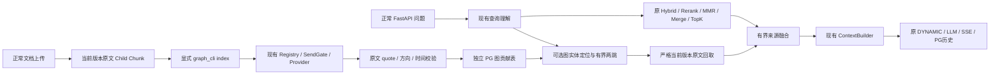

# S6：可关闭的来源绑定 GraphRAG

## 当前结论

**PASS（限两份真实公开原文及一个正常 FastAPI 两跳样本）。** 正常上传、真实抽取、来源绑定 PG 图存储、有界两跳、原文回取、Context、Cheap、SSE 与历史回读均完成。失败的 Qwen 抽取、DeepSeek 不完整 quote 和两次零发送工具错误全部保留，未通过重复问答选优。

- S5 起点：`78bf9839d2030749f715a9395ce355209d8f52ff`。
- 初始实现：`df271a98b01ac2f63e0a315f30f4ada8097daab0`；已实测代码：`030f0e3d65fe0cd5b667ef2b1ba4a94e3e3d8f47`。
- 分支：`codex/weknora-python-port-integrate-image-20261014`；最终报告提交 SHA 由 `git rev-parse HEAD` 及交付回复提供，避免自引用 SHA。
- 原有18个未提交路径逐个 SHA 验证不变。Graph 默认关闭、日常 cloud=false、模型角色与检索参数不变。
- Owner 明确排除 PPT 渐进展示；未实施、不以该项阻断文本图闭环。不自动进入 S7/S8。

## 1. 官方源码考察及选择

实际读取固定提交的源码；克隆保存在 `E:/WK/run/s6-graphrag-20261019/references/`。四个项目均核对为 MIT，不整体安装或引入其运行依赖。

| 项目与固定提交 | 实际相关源码及结论 | 本轮采用／不采用 |
| --- | --- | --- |
| HippoRAG `d5c8329422e0a0b834a15874545cb6a74b4f9b26` | OpenIE 分别抽实体及关系；检索使用全局无向图 PPR，并有额外 embedding、识别记忆调用。 | 学习原文 passage 绑定及关系发现；采用简单有向两跳，不迁入 PPR、模糊同义实体合并及额外在线 LLM。 |
| LightRAG `aaebfe1bb8d55deb6a4304d357a3bf4c92fcd40a` | Local/Global/Hybrid、来源贡献及增量维护；其 PGGraphStorage 实际依赖 AGE/Cypher。 | 使用来源贡献及原文回取思路；采用普通 PG 独立表，不安装 AGE，不把生成的图描述当原文。 |
| RAG-Anything `da6e2d87a7d3f2746c4541f59953b8764213f6a2` | 页面和内容来源映射；多模态节点的 source_id 也可能指向模型 Caption Chunk。 | 保留真实页面／版本身份原则；不把 Caption 变成已验证原文，不复制其入库框架。 |
| SlideRAG `6eb788d13bdbbd5604745bea37d64878ea7b2db7` | 页面主题、图片描述与主题余弦关系；不能由主题相似证明渐进展示。 | 仅完成源码考察。按 Owner 最新决定不实施 PPT 解决方案。 |

主要源码链接：[Hippo OpenIE](https://github.com/OSU-NLP-Group/HippoRAG/blob/d5c8329422e0a0b834a15874545cb6a74b4f9b26/src/hipporag/information_extraction/openie_openai.py)、[HippoRAG 检索](https://github.com/OSU-NLP-Group/HippoRAG/blob/d5c8329422e0a0b834a15874545cb6a74b4f9b26/src/hipporag/HippoRAG.py)、[LightRAG 查询与来源回取](https://github.com/HKUDS/LightRAG/blob/aaebfe1bb8d55deb6a4304d357a3bf4c92fcd40a/lightrag/operate.py)、[LightRAG PG](https://github.com/HKUDS/LightRAG/blob/aaebfe1bb8d55deb6a4304d357a3bf4c92fcd40a/lightrag/kg/postgres_impl.py)、[RAG-Anything 多模态](https://github.com/HKUDS/RAG-Anything/blob/da6e2d87a7d3f2746c4541f59953b8764213f6a2/raganything/modalprocessors.py)、[SlideRAG 页面主题](https://github.com/iLearn-Lab/SlideRAG/blob/6eb788d13bdbbd5604745bea37d64878ea7b2db7/raganything/processor.py)。

## 2. 数据模型与完整调用链



三张独立表，不改变原 Chunk、Embedding、账本的 Schema 合同：

- `port_graph_evidence`：tenant、owner、KB、document、source_version、chunk、原文 SHA、原文快照、原 offset、可证明页码、抽取操作及 producer。
- `port_graph_nodes`：每个来源贡献内独立节点、实体类型、原始名称、原文别名、文档主题锚点、原文 qualifier。没有跨文档静默合并节点。
- `port_graph_edges`：有方向的源／目标、原文 predicate、唯一精确 quote 与相对 offset、时间限制、验证状态；复合 FK 防止边指向其他来源贡献的节点。

图抽取仅使用当前 `text/image_ocr` Child，不使用 Parent、Summary 或 Caption 冒充原文。明确保留图片 `0/0` offset，不补造普通文本区间。每个文档最多 12 个原文块／32768 字符，每块最多 16384 字符，超出时发送前拒绝，不能手选 Gold 块绕过。

抽取的严格 JSON 由模型生成；名称、别名、qualifier、predicate、quote 必须可回查。方向、否定、不确定及时间条件保守处理。**quote 与词序校验不是语义事实裁判**，无法证明的关系拒绝或保留拒绝原因，不报告完整建图成功。

跨文档引用只解析到同 KB 内唯一、同类型、名称或原文别名精确一致的文档主题锚点；同名多锚点、类型或 qualifier 冲突不强行连接。不扩展代词，不进行模糊实体匹配。

## 3. 与原 RAG 的边界

- 新开关：`WEKNORA_PORT_GRAPH_ENABLED=true`，**默认 false**。普通上传不会自动增加图抽取 LLM 调用；建图是显式操作。
- **不是**旧 `indexing_strategy.graph_enabled` 占位配置；该旧字段继续保持 false，避免将正常上传卡在未实现 fan-out。
- 普通 Rerank 的模型、0.3 阈值、Top1 保底、MMR、Merge、TopK 不变。
- 图路径最多 2 跳、3 条；每节点最多访问 12 条出边。原文融合放在普通 TopK 后：完整路径原子保留，最多补充 4 块／4096 字符，合并原文最多 14000 字符，渲染 Context 最多 16000 字符。
- 图证据保持原始 Chunk 内容、来源及版本；score=0 不冒充 BGE 分数，不向模型发送图生成描述作为证据。
- Rerank 全部过滤时，只可回取有验证路径的原文，不能复活其他普通低分候选。
- Graph 关闭不读图表、不增加模型调用。图表未安装／无图结果可继续普通 RAG；权限、来源 SHA／版本错误必须失败，不能用普通 fallback 隐藏。
- 文档禁用、删除或换版本后，旧图贡献不参与当前检索。旧版本行仍保留；当前原文被修改但 SHA 不符时拒绝。

## 4. 真实建图与最小修复

tenant1 新 KB：`63266207-95cf-42a6-8e5b-6b3ae18f0819`。PG `weknora_python_port_20261013` / system ID `7696088403504697382`；Redis DB15；principal 未改。迁移 `016_graph` 显式执行退出0，SHA `77168a6b90480afab61944647004b15f56b3b8bbe27c044a2c50936e3347d132`。

| 正常上传原文 | document / source_version | 实际原文 Child / 向量 |
| --- | --- | --- |
| Franklin bells，SHA `b6cc805398afebfa83279756fe543d11bb420511ef585f8260fee513485313e8` | `4d35e306-4a19-470b-bf68-93731539439d` / `9bce2280-59e7-4d9d-97d5-98820b8adfb3` | 500字，1原文Child＋1Summary，各1024维 |
| Leyden jar，SHA `decbe8d51474b802a881e06db02901c98b31e03bd88b0dcd254b043c9eb7f00a` | `734d37f7-40bc-4b75-a44b-e7ce30562c0f` / `bc43d6be-015b-4f86-b333-8dcbe356136b` | 429字，1原文Child＋1Summary，各1024维 |

冻结前纯切块预估每份2 Child；正常产品实际每份1原文Child，以实际持久化为准。两份各上传1次，不重传、不复制历史索引。

四次真实图抽取：Qwen两次均拒绝（原文字面不符／JSON结构和端点错误），没有放宽校验。Owner另行批准DeepSeek用途后，两份分别抽取1次：9节点5边、7节点3边；12个关系建议中8个通过、4个拒绝。实际wire为 `thinking:{type:disabled}`、`max_tokens:2048`。serializer未发送temperature=0，不把requested=0当成实际参数。

DeepSeek关键关系的短quote缺少主语：`electric charge designed to work with a Leyden jar`。新增 `graph/quote_completion.py` 仅对已验证文档主题anchor、唯一原文quote、同一短句、恰缺一个端点的情况做有界原文回取，再通过原严格解析器复验。禁止跨句、含否定／不确定／时间、错误方向等补全，不改实体／predicate／模型原回执。producer保存原回执SHA、原quote `[95,145)` 和派生原句 `[0,145)`，标记 `SOURCE_SENTENCE_EXTENSION_NOT_LLM_QUOTE`。

复用这两份已结算真实响应离线重放，新增1条有原文证明的边；**不是新增模型抽取**。实际PG回读：2贡献、16节点、9边、3路径。关键路径为 Franklin bells → Leyden jar → static electricity；跨文档仅用精确同名同类型到唯一已验证文档anchor的引用，不合并模糊同名实体。

## 5. 正常 FastAPI 真实验收

原问题：**Franklin bells 配合使用的装置储存的是什么电？请依据知识库回答。** 这是公开来源工程诊断，不是官方Hotpot题目准确率。

- session：`dff86ebf-6dda-46cd-af9f-4cff8c40f5ab`。
- run：`15ced6a3-fc3e-4c6a-810e-311b4965b08b`；client request：`bcdf8310-b0df-4f44-91ac-ed713a621913`。
- 正式 `entrypoint`、正式principal／Registry／SendGate／限额与PG，非runtime_factory，不启动评测Worker。

| 阶段 | 真实结果 |
| --- | --- |
| Query Understanding | SiliconFlow Qwen3.5-4B，kb_search，实际改写和4个查询Embedding均保留 |
| Search | 4候选，命中两文档 |
| Rerank / Merge | 保留2项：Franklin原文＋Summary；Leyden原文模型分数0.0038456118而被过滤 |
| Graph / 融合 | 3条可追溯路径，回取Leyden 429字原文，added_chunks=1 |
| Context / 实际生成wire | 3项，两份500／429字原文逐字完整送达，来源版本一致 |
| DYNAMIC / 模型 | Cheap Qwen3.5-4B一次，enable_thinking=false、temp0.3、max_tokens1024；无升级／fallback／截断，finish_reason=stop |
| 答案事实 | 回答“莱顿瓶储存静电（静态电荷）”，且电极说明有原文支持；来源为实际两文件名，无内部句柄 |
| SSE / PG / 历史 | Provider原答案＝SSE最终答案＝PG答案；两次GET只读data相等，未新增调用 |

Graph-on中普通分支到图融合的前后快照，直接显示必要第二来源由图路径补回。**没有另跑Graph-off真实问答**，关闭开关的无图读／无新增调用由离线回归验证，不能把两者混为真实A/B。

## 6. 调用、Token、耗时及授权关闭

| 操作 | Provider次数 | 输入Token | 输出Token | 总Token |
| --- | ---: | ---: | ---: | ---: |
| 两次上传＋两次失败Qwen图抽取 | 8 | 3083 | 401 | 3484 |
| 两次DeepSeek图抽取 | 2 | 1203 | 1032 | 2235 |
| 正常API问答 | 7 | 3682 | 152 | 3834 |
| **本轮新增合计** | **17** | **7968** | **1585** | **9553** |

实际模型共8次BGE-M3、1次BGE Rerank、6次Qwen、2次DeepSeek。API整次44.7141秒；其中查询理解2348入／42出，transport完整25.6487秒；最终生成834入／110出，headers11.4929秒、完整读取15.3024秒。记录包含Gate／网络／模型等待，不能拆分DNS/TCP/TLS或供应商排队。不估算现金费用；cash cost未定不等于Provider UNKNOWN。

17次均SETTLED，新增UNKNOWN0；历史8项UNKNOWN及其未知用量原样保留，不作0结算。两次Owner批准共同20次／200000 Token上限，所有失败消耗计入。授权及各执行文件均CLOSED、临时KB外发关闭、未用临时空间撤回。日常wk按原local.json恢复，cloud=false、Graph默认false；API／Worker／UI及PG／Redis运行正常。

## 7. 工具缺陷与实际测试

两次发送前失败完整保留：首次工具无Origin导致consent PATCH403，Provider0；随后client request_id45字超过正式repo36字限制导致POST422，port_turns／messages均空、Provider0。修工具后才进行唯一一次被接纳的问答，不重发UNKNOWN、不增加总授权。另修历史比较只对data，避免每次GET的meta.request_id不同造成误报。生产鉴权／Turn接口未放宽。

```powershell
& 'E:/RAG quention/.venv/Scripts/python.exe' -B -m pytest --noconftest -p no:cacheprovider -q --tb=short tests/weknora_port/test_graph_quote_completion.py tests/weknora_port/test_graph_service.py tests/weknora_port/test_graph_extraction.py tests/weknora_port/test_graph_retrieval.py tests/weknora_port/test_graph_storage_pg.py tests/weknora_port/test_s6_graph_acceptance.py
```

**173 passed、1 skipped，2.23s，exit0**。此调用没设置真实PG DSN，故显式跳过；此前真实PG事务回滚测试1 passed／0.82s／exit0独立保留。原实现相关回归220 passed／1 skipped／exit0未冒充本次新增结果。方向、同名异实体、缺第二跳、伪quote、版本失效、跨tenant／KB、预算及Graph关闭回归均有对应离线合同。

```powershell
& 'E:/RAG quention/.venv/Scripts/python.exe' -B E:/WK/run/s6-graphrag-20261019/api_once_fixed.py
powershell.exe -NoProfile -NonInteractive -ExecutionPolicy Bypass -File wk.ps1 start -Config E:/WK/run/s4-quality-20261019/local.json
powershell.exe -NoProfile -NonInteractive -ExecutionPolicy Bypass -File wk.ps1 status -Config E:/WK/run/s4-quality-20261019/local.json
git diff --check
git diff --cached --check
```

均实际exit0。首次失败的工具run exit2／POST422等保留，未计通过。正常API用新执行文件，但累计先前10次／5719 Token；未续额。输入、回执、完整阶段、SSE、PG回读、授权关闭及独立审查可在机器结果及同目录 `evidence/s6-graphrag-20261019/real-acceptance-evidence.zip` 核对，ZIP SHA见JSON；不含local.json、DSN、密码或API Key。

主要新增实现：`graph/{types,extraction,quote_completion,service,retrieval}.py`、`storage/graph.py`、迁移016、`graph_cli.py`；局部接线development/runtime/pipeline/context/evidence_capture及一次性验收工具。最后局部修复为source句子证明映射及工具Origin／requestID／history比较；无全局Rerank、模型、Prompt、DYNAMIC或OCR改动。

## 8. 限制、使用及停止

显式 `python -m backend.weknora_port.graph_cli --help` 命令已执行exit0。先经授权配置运行 `graph_cli ... migrate`、`index --kb <真实KB> --document <真实文档> --model-id <已有模型ID> --request-id <新操作ID>`；仅在需要时设置 `WEKNORA_PORT_GRAPH_ENABLED=true`，不得沿用已关闭验收授权。普通上传不自动建图，旧KB graph占位开关不启用。

- Qwen两份图抽取失败保留，DeepSeek仍有拒绝关系；不能宣称抽取质量全面通过。
- quote／方向检查是来源证明，不是语义事实裁判；隐含关系、代词、同名冲突可被保守拒绝；该样本不证明所有多跳可用。
- Frost Seminar关系、PPT渐进展示、批量图管理／全局PPR、S5事实扩展等保持独立问题；不自动展开。
- 独立Top1实验从S5另建worktree和分支；其修改／结论不会合入当前S6，也不影响本次真实回执。

本轮到此停止，只本地提交；不Push、合并、部署、打Tag或进入S7/S8。
