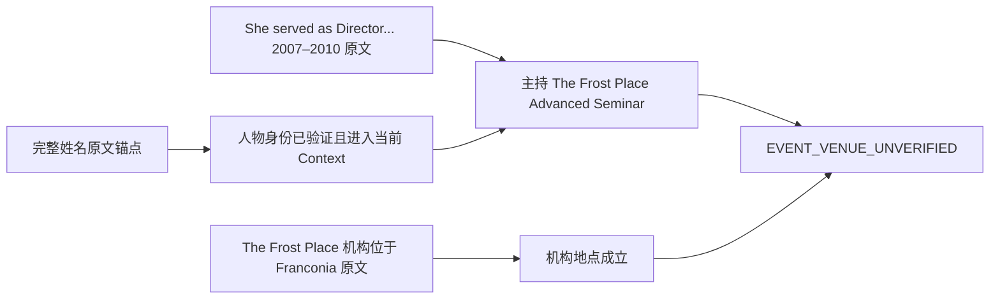

# S8.5.1 最终代码验收门

日期：2026-10-21。分支：`codex/s8-5-conversation-bridge-20261021`。

## 1. 结论与适用范围

**离线代码集成、生成完成合同、Frost B 身份 Context 修复通过本轮定向检查；最新正式 API 真实验收未执行。不能据此宣布生产可用。**

当前状态：`BLOCKED_REAL_API_PROFILE_PREFLIGHT_AND_OWNER_AUTHORIZATION`。剩余阻断是正式 API 测试配置预检和新的独立 Owner 外发/隔离环境授权；并非把离线修复标记失败。

| 验收项 | 状态 | 本轮证据及边界 |
|---|---|---|
| 代码集成 | PASS / OFFLINE | 实际 Git 祖先、当前 diff、来源与权限调用路径、定向回归；不等价于部署验收 |
| 生成流完成合同 | PASS / RECORDED_BYTES_OFFLINE_REPLAY | 最终源码重放 C3 T1/T3；Mock HTTP、脚本 SQL、内存 SSE；无真实 PG/Redis 新集成测试 |
| B 身份 Context | PASS / ORIGINAL_SOURCE_OFFLINE_REPLAY | 冻结原文、记录的 B3 提取/BGE 输出、GB3 普通来源投影进入当前真实生成编码器及 Mock 模型入口 |
| 歧义及格式转换 | PASS / OFFLINE_MOCK | 当前 `prepare_turn()` 的高/低 Rerank 分支、连续格式转换、主题重置、固定澄清清理 |
| Frost 研讨会举办地点 | EVENT_VENUE_UNVERIFIED | 人物身份、任职关系和机构所在地成立；仍不能推导活动场地；原 GB3 PARTIAL 保留 |
| 最新正式 API 真实验收 | NOT_RUN | 无新镜像构建、无临时服务、无六轮正式 API 模型调用 |
| 冻结证据及 UNKNOWN | PASS / FILE_INTEGRITY | 476 个保护文件一致；455 个旧收据文件/11 个 manifest 有独立核对；B2 UNKNOWN 6365 held 保留 |

本轮新增 Provider 尝试 **0**、真实结算 **0**、新 UNKNOWN **0**、真实输入/输出/总 Token **0 / 0 / 0**。Mock 计数、缓存输出重放和历史 Token 均未计为新用量。未估算费用。

## 2. Git 基线与代码集成

### 2.1 实际工作树

- S8.5 工作树：`C:/Users/22088/.codex/worktrees/s8-5-conversation-bridge/RAG quention`。
- 起始 HEAD：`cb7f08cde32bd41bb56e6e56b4f96d6f0428ecf1`，起始工作树干净；历史最后源码提交 `f9e8723b374e78de6a1a2ec9a44207035ad0d044`。
- 本轮歧义修复：`4d3af42f8236962a63f67048df490847cbf6576c`。
- 本轮最后源码提交：`46bfa329fd495cca98a361ba89c76a4eda6b9dc7`。本报告另行本地提交；其 SHA 由最终 Git 记录和交付消息提供，避免自引用哈希。
- 主工作树 `E:/RAG quention` 仍为 `0606063ad972c167de759f70137e9c1b07cd4b4f`；其既有 `.serena/project.yml` 修改保留。
- 无 reset、分支重建、Push、部署或 Tag。

### 2.2 祖先及保护路径

以下真实对象均经 `git merge-base --is-ancestor <SHA> cb7f08c...` 检查，退出码 0；两个新修复提交线性位于该基线上。

| 修复 | 提交 |
|---|---|
| S8.3 原文保留 | `edfaf83844c72de6bedffc4dcdf2297e17c6dfcb` |
| S8.3 来源有效性 | `e8c3097d1de3552ca91b7e2987159b73bc1907cb` |
| S8.3-F fallback catalog | `a5f85562b6aa11e4ec9a988c0c3fbde6fc856665` |
| S8.4 桥接实现 | `b10e2a07585ad51c65473ef6b02fc42dee51b16d` |
| S8.4 current-source 修复 | `4fb10233f922a47b2ddb058e79e9ec1389088c9e` |
| S8.4 报告 | `9931ffe0ad65b20dc68b8b93760fce75997965a3` |
| S8.5 集成 merge | `7e5fb4a1c584a3fe672b9342cd5ff8e99dd74803` |

该 merge 的两个实际父提交为主线 `0606063...` 与 S8.4 `9931ffe...`，不是仅在报告中提及 S8.4。

实际源码审查结果：

- Fallback catalog 仍限定当前 principal/Session/tenant/KB/document，查询 title/file_name/file_type 并限量；未恢复 generated Description 为兜底知识来源。
- `bounded_source_v1` 仍校验原文 KB/document/version、有效类型、偏移、长度及有界祖先；Summary 无法验证原文时走既有 SearchNothing。此结论限于显式启用的来源合同，`source_evidence_mode` 默认仍 off。
- 历史读取保留完整成功 user–assistant 轮次、tenant/subject/Session 范围、当前 request 排除及历史来源范围检查。旧回答作为对话材料，不直接补入本轮来源。
- `provider.py`、`stream.py` 相对 S8.4 Git blob 未变；S8.5 coordinator 的明确未结束保护仍在。本轮无 Provider/stream/coordinator/history/replay 生产修改。
- 当前与 S8.4 的 history/query/bridge/Context 差异逐模块记录；原文投影、身份范围、默认策略未被覆盖。CRLF 工作文件与 LF Git blob 分别记哈希，不把换行差异误报为代码缺失。

证据：`integration/integration-findings.{md,json}`、`integration/git-integration-evidence.json`；最终提交绑定见 results JSON。

## 3. 生成完成合同：原始字节与当前状态转换

重用 C3 的原始请求及响应字节，响应 SHA 与旧 manifest 一致。上游 T1/T3 含 `[DONE]`，但没有必要的非空 choice `finish_reason`。当前 Adapter 没有解析丢失一个实际存在的结束帧，也没有把 `[DONE]` 伪造为 `stop`。

| 记录 | 原始帧事实 | 最终源码执行结果 | 历史真实用量保留 |
|---|---|---|---|
| C3 T1 | 不完整回答；`[DONE]`；缺 choice finish | `FAILED / PROVIDER_STREAM_INCOMPLETE`；不提交成功答案 | input 1069、output 157、total 1226 |
| C3 T3 | `Jean`；`[DONE]`；缺 choice finish | 同上 | input 1298、output 1、total 1299 |
| 合成正常 stop | 有显式 `finish_reason=stop`、usage tail | COMPLETED，正常持久化及回放 | 仅 Mock 数值，不计真实 Token |
| 合成 length | 有显式 `finish_reason=length` | 保留既有 TRUNCATED 合同 | 不宣称回答事实完整 |

转换路径：Provider 先保留并结算已观测的真实 usage，StreamAssembler 最终事件为 `provider_answer_done=false`，coordinator 在成功提交前拒绝；当前真实 repository/lifecycle 方法在脚本 SQL 中写 FAILED/error/incomplete，SSE 为 error 与 `complete(status=failed)`。`process_history()` 排除失败轮次。重启后的 `validate_run()` 给出 `replay_only=true`，回放相同失败且新增 Mock HTTP 调用 0。

未确定上游为什么缺结束信号，不猜测网络故障或具体 Provider 内部原因。保留既有未标记 legacy EOF 兼容，不将新保护泛化到所有旧桩。

最终源码重放：`completion-final/completion-audit.json`，绑定 `46bfa329fd495cca98a361ba89c76a4eda6b9dc7`；旧基线检查和选定 21 项回归另存 `completion/`。测试使用 HTTPX MockTransport、封闭脚本 SQL 与内存 StreamStore，**不是新真实 PostgreSQL/Redis/API 验收**。旧 C3 COMPLETED 记录及 FAILED/UNKNOWN 均未重写。

## 4. B 身份 Context 最小修复

### 4.1 修改及可复现问题

| 文件 / 函数 | 修改前问题 | 最小修复 |
|---|---|---|
| `retrieval/bridge_identity.py::admit_identity_context` | B 的代词身份已验证，但完整姓名原文不在最终普通 Context | 在已有第二跳接纳后重读已验证链，重新证明相同身份，只补缺少的原始姓名 Chunk |
| `retrieval/bridge_rescue.py::rescue_bridge` | 当前证据通过后未投影身份锚点 | 接纳第二跳后调用上述投影函数 |
| `retrieval/types.py::SearchState/context_results/bridge_context_attributes` | 只有普通来源与地点补充来源 | 增加独立 `bridge_identity_evidence`，正常来源→身份→地点；标记仅支持 subject_identity；新字段 keyword-only 保留旧 PipelineState 位置参数合同 |
| `service.py::RuntimeService.prepare_turn` | 固定歧义澄清清空普通/地点证据后，新身份列表残留，与 facts_admitted=0 矛盾 | 同一清理分支清空身份列表；无最终模型调用泄露证据被证明 |
| `retrieval/query.py` 三个已有保护函数 | 比较问题后插入纯格式转换，被当作新主题，随后 it 可错误选对象 | 只跳过既有闭合集合 `_HISTORY_TRANSFORM`；连续转换保留原歧义；明确新主题仍重置 |

`retrieval/context.py` 与 `generation/context.py` 代码保持原样，实际调用两者的编码器验证预算和最终消息。新增测试为 `test_s851_bridge_identity_context.py`、`test_s851_history_transform_ambiguity.py`；旧 `test_bridge_pipeline.py` 只更新当前投影预期，保留冻结 B 的初始身份支持 false 断言。

### 4.2 来源、预算与模型实际可见内容

最多读取已验证的当前 Chunk 加 3 个真实前驱；仍使用现有 scoped current-source reader。重验 Tenant/owner、KB/document、内容版本、启用状态、index/指针/原文一致性；证明不同则拒绝。补入的是完整回读的原始 Chunk，清除该附加行的生成描述/自定义描述/header；不把 Cheap JSON 当文档。

两次实际编码预算检查：retrieval Context 及 `prepare_generation()`，后者使用 citations enabled 的较大包装。超限只跳过可选姓名证据并记 `IDENTITY_CONTEXT_SKIPPED`，不得标为最终身份已支持。既有首跳、地点补充和原始 Rerank 分数不变。初始 FIRST_HOP_VERIFIED trace 保留原值，另记 IDENTITY_CONTEXT_ADMITTED。

真实冻结来源与记录输出离线回放（`REPLAY_OF_RECORDED_REAL_OUTPUTS_CURRENT_CODE`）结果：

- 新增姓名来源 `abc3a6aa-5453-4f0a-b7b6-5270cc96067f`，document `a973df4a-0b4b-43f7-ad17-55265aac1556`，version `de3ec8ca-5496-4ecf-abcb-3b65423d1fe9`。
- 原文以 `Jeanne Marie Beaumont is an American poet` 开头，完整 Chunk 可见于真实 generation prepared messages；可引用 handle `c4` 对应真实 Chunk。
- 任职来源 `ec07a1fd-8a8e-4f23-a7d6-65d385d2343b` 和机构地点来源 `31417c7c-7abf-4723-956a-74bf7ee14683` 保留；normal order/rank/second-hop score 未改。
- 当前 `final_context_identity_supported=true`；`entity_bridge_verified=false`、`final_answer_supported=false`、`seminar_venue=unverified`。
- 没有调用新模型评价修复后的回答质量；原 GB3 的 PARTIAL 和完整姓名未进入旧 Context 的事实继续保留。

当前接纳点限于已有第二跳成功补回的 B 路径；没有增加首跳独立扩展、第二次全库 Hybrid Search、Graph、Agent 或多跳算法。未知复杂关系继续未验证。

## 5. Frost 事实边界



没有新来源直接证明研讨会举办场地。本轮不硬编码地点、不用 Expensive 猜测、不更改 Prompt 或评价规则使 PARTIAL 变 PASS。

## 6. 本轮离线执行证据

所有测试是受影响模块定向检查。没有重跑历史 922 项；下面包含重叠，**不相加为独立覆盖数**。本机 Windows 沙箱的 asyncio 内部 socketpair/accept 曾在创建事件循环时阻塞；保存堆栈后，仅为本地内部 loopback 获准执行离线测试。最后 RED/GREEN 使用正常 asyncio；该环境失败未冒充产品 RED。

| 检查 | 实际结果 | 退出码 / 原始输出 |
|---|---|---|
| 身份投影初始 RED | 9 failed / 1 passed | 1，`identity/red.txt` |
| 引用包装预算 RED | 1 failed / 11 deselected | 1，`identity/citation-budget-red.txt` |
| 身份/桥接/来源相关 GREEN | 242 passed，3.21s | 0，`identity/final-green.txt` |
| keyword-only 兼容窄回归 | 13 passed，0.79s | 0，`identity/kw-only-green.txt` |
| 固定澄清残留证据 RED | 1 failed / 13 deselected | 1，`identity/ambiguity-reset-red.txt` |
| 最后身份文件窄 GREEN | 14 passed，1.09s | 0，`identity/ambiguity-reset-green.txt` |
| 格式转换后歧义 RED | 7 failed / 1 passed | 1，`integration/after-format-red.stdout.txt` |
| query/pipeline/service/fallback GREEN | 186 passed，2.93s | 0，`integration/after-format-green.stdout.txt` |
| 完成/失败/持久化/回放选定用例 | 21 passed，1.99s | 0，`completion/targeted.stdout.txt` |
| 最终源码 T1/T3 字节与 stop/length 服务回放 | 2 raw coordinator + 4 service/SQL cases PASS | 0，`completion-final/` |
| B3/GB3 当前 Context 投影回放 | PASS；新 Provider/DB 调用 0 | 0，`identity/recorded-replay.json` |
| 冻结文件前后核对 | 476/476 一致；B2 UNKNOWN 6365 held | 0，`protected-after.json` |
| 最终 Git diff 空白检查 | PASS | 0，最终 Git 证据 |

核心命令如下；完整原样 argv、cwd、退出码、输出路径及 SHA 见同名 `.results.json` 的 commands/artifacts。路径均是本机现有证据目录。

```powershell
D:\Drivers\python\python.exe -B -m pytest -q -p no:reporter -p no:cacheprovider tests/weknora_port/test_s851_bridge_identity_context.py tests/weknora_port/test_s85_bridge_identity.py tests/weknora_port/test_bridge_pipeline.py tests/weknora_port/test_bridge_rescue.py tests/weknora_port/test_s8_5_bridge_answer_ecs.py tests/weknora_port/test_source_evidence.py tests/weknora_port/test_s85_bridge_normal_qualification.py
D:\Drivers\python\python.exe -B -m pytest -q -p no:reporter -p no:cacheprovider tests/weknora_port/test_s851_history_transform_ambiguity.py tests/weknora_port/test_s85_ambiguity_clarification.py tests/weknora_port/test_s8_5_conversation.py tests/weknora_port/test_s85_rewrite_prompt_contract.py tests/weknora_port/test_pipeline.py tests/weknora_port/test_service.py tests/weknora_port/test_fallback_evidence_contract.py
D:\Drivers\python\python.exe -B -m pytest -q -p no:reporter -p no:cacheprovider tests/weknora_port/test_s851_bridge_identity_context.py
D:\Drivers\python\python.exe -B "E:/RAG quention/var/reports/s8-5-1/identity/recorded-replay.py"
python -X utf8 -B "E:/RAG quention/var/reports/s8-5-1/protected_snapshot.py" after
git diff --check
```

覆盖的行为包括原始身份到 Mock 模型实际输入、引用注册、预算正负边界、非当前 tenant/owner/KB/document/version/指针和禁用原文拒绝、bridge off 零读取、T1/T3 失败与正常 stop 对照、歧义澄清不选择 Franklin bells、歧义后的连续格式转换不继承错误事实、明确新主题重置。断线真实浏览器、真实 PG/Redis 和新云模型均 NOT_RUN。

**未实现的命令不得报告通过。**

## 7. ECS 当前运行身份及回滚基线（只读实测）

只读命令 `python -X utf8 -B E:/RAG quention/var/reports/s8-5-1/ecs_readonly_inventory.py`，退出 0；SSH/inspect/文件 SHA/只读 PG identity/Redis INFO，无远端配置写入。关键证据在 `ecs-readonly.json`，命令与远端脚本 SHA 在 `ecs-readonly.command.json`。

| 项目 | 实际观测 |
|---|---|
| 当前 API / Worker | `rag-s8-api-1` / `rag-s8-worker-1` 均 running；未替换、未重启 |
| 镜像 ID / RepoDigest | `sha256:80e2f2d84bf67d7d22117d98676049aa9cd3101e69b20f780d5fd9eeaf931a36` |
| 镜像 revision | `29ecf2f5d3037eed99a4de783546dee272a761bd`，仍是旧源码 |
| 实际 API 文件 | `/app` 模块逐文件 SHA；bridge_identity.py / bridge_rescue.py 不存在，未运行 S8.5.1 |
| PG | `weknora_s8`，system_identifier `7698420805889187877`；只读 SELECT 退出 0 |
| Redis | 7.4.2，run_id `268d42dec48542084b1478eea849ecfb7d3f9b83`，现有 DB8 |
| 当前默认 | cloud_allowed=false、Graph=false、P5 DYNAMIC；本轮未改 |
| 配置基线 | `/opt/rag-s8/current/deploy/s8/compose.yml`、`/opt/rag-s8/config/loaded-images.json` 与 runtime.env 只记 SHA；不输出密钥 |

已有镜像、容器和数据全部保留。此快照足以标明当前版本与未来隔离服务的停止边界，**不是已做过部署回滚演练**。

## 8. 正式 API 最小真实验收预检与方案

### 8.1 尚未具备的条件

| 阻断 | 当前真实源码事实 | 下一步最小处理；本轮未实施 |
|---|---|---|
| CITATION_PROFILE | GenerationRequest.citations_enabled 默认 false；ApplicationRuntime 配置及公开 SessionCreate/MessageCreate 无启用入口 | 审查并离线验证隔离服务端 composition profile 启用引用；不改生产默认，不以单独 readback 冒充生成引用 |
| LOCAL_EXECUTION_AGGREGATION | 单 LocalExecution ledger 上限 12 calls，不能直接申请一个 24-call ledger | 不重置旧账本；采用不可变新 per-turn ledger 与 stage-wide <=24/45000 gate，或只重启临时 API 换新账本并保留同一 PG Session/Redis prefix；需先离线验证 |
| OTHER_USER_HTTP | 当前 private entrypoint 解析固定服务端 principal | 准备合法独立认证的只读第二用户测试入口；错误 Bearer 401 不能替代跨用户隔离证明；无合法身份则 BLOCKED |
| BUDGET_DRY_RUN | 正式默认 expansion/memory/output 配置与旧 C3 注入式诊断不同 | 冻结实际模型绑定、物理 key、输出限制、tokenizer、来源版本和每次发送预留；历史 40965 Token 不作为预测或额度 |
| FRESH_OWNER_AUTHORIZATION | 本轮要求新独立授权，现有历史授权不继承 | 以上条件就绪后提交最终源码/镜像/profile/问题/scope/调用及 Token 上界，再由 Owner 审批 |

因此当前不能报告 `READY_FOR_REAL_ACCEPTANCE` 而省略上述预检条件。没有安全隔离环境的实际构建/启动证明，本轮停在方案；未更新生产。

### 8.2 可追溯隔离构建与服务计划

1. 从 `46bfa329fd495cca98a361ba89c76a4eda6b9dc7`（随后仅文档提交允许）冻结源码清单；依赖使用现有固定 digest，不自动 pip install/pull/upgrade。新镜像将批准源码放入 `/opt/s851/app`，WORKDIR/PYTHONPATH 指向该目录，防止旧 `/app` 模块遮蔽。记录 OCI revision、镜像 ID、全部 source SHA 和实际 import `__file__`。本轮镜像构建 NOT_RUN。
2. 新 Compose project/container `s851-api-<fresh-stage>`，只绑定 `127.0.0.1:18851`；只读快照时端口未监听，未来启动前重新检查。复用已核实 `rag-s8_default` 网络、现有 PG/索引和 Redis DB8 的全新 prefix。临时环境无 Worker；现有 API/Worker 保持原状。
3. 原文存储与必要密钥只读挂载；新 stage execution/logs 目录；禁止 upload/DDL/migration/re-embedding/index rebuild。新 API token、Session、request_id、grant 与账本，不复用旧 UNKNOWN。
4. 先 cloud_allowed=false、Graph=false、bridge_rescue_mode=off 检查 HTTP/PG/Redis/SSE/Registry/SendGate；获独立授权后仅允许本次绑定模型。P5 DYNAMIC 保留；选择 Expensive/升级时 SendGate 拒绝并停止，不改路由强迫 Cheap。
5. 回滚仅停止新临时 API，保留证据；生产容器、镜像、配置与 PG/Redis 数据无需替换。不可安全隔离时停止并报告 BLOCKED。

详细计划 `formal-api-plan.json` 已冻结；本报告 JSON 内嵌其完整内容。以上是准备方案，未声称隔离环境已经验证可用。

### 8.3 冻结六轮和建议授权范围（不是已授权额度）

| 轮次 | 冻结问题 | 必须验证 |
|---|---|---|
| T1 | Who is Jeanne Marie Beaumont? | 事实、完整结束、来源回读 |
| T2 | What did she direct from 2007–2010? | 人物指代，实际 Search/Embedding/Rerank 查询一致，任职原文 |
| T3 | Compare a Leyden jar and Franklin bells. | 新话题、两对象、引用、完整结束 |
| T4 | What is it used for? | 固定澄清，无最终生成；前置调用用量保留 |
| T5 | Which original document describes the purpose of a Leyden jar? Provide evidence. | 重新检索，可回读出处 |
| T6 | Format the previous answer as a table. | 纯格式转换无新检索，不增加事实 |

六轮规范 JSON SHA-256：`ac0ac9187a1a6a787f6395d590a568fb0aa61acc758ba43317b705ec10ebb92a`。

建议独立上界仍是最多 **24 Provider attempts / 45,000 Token exposure**，包含预留；Expensive/额外桥接 BGE/重试均 0。冻结当前授权 tenant/KB/四文档范围与新 clean Session；精确模型绑定及输出上限须在预算预检后随授权一起冻结。

每轮验证真实 Provider 结束、PG messages/turns/attempts、历史和 SSE terminal 一致，引用原文可回读。断线带 cursor 恢复同一 durable run，不新增 Provider 发送；合法其他用户拒绝读取。两侧 `(request_id, capability)` 唯一且键集合完全一致，结算真实 Token；UNKNOWN、不完整响应、权限拒绝、未知发送或预算越界立即停止且不重试。

## 9. 遗留与停止状态

- Frost 活动地点仍缺直接来源，属于当前证据不足；不批准延期、不虚报多跳 QA 通过。下一步只能在独立任务获得真实新来源后评估。
- 旧 C3 曾保存的不完整/错误回答为历史事实，本轮不修订；正式验收必须新 Session。
- 身份补入覆盖已有 accepted-second-hop B 路径；未增加任意首跳身份扩展。
- 正式 API 的 profile、聚合账本、合法第二用户和预算 dry run 尚需完成；随后才能请求新的独立 Owner 授权。真实服务测试、镜像构建、部署、浏览器恢复均 NOT_RUN。
- 本轮已完成离线工作和本地提交；无 Push、部署、Tag 或生产验收宣告。

证据根目录：`E:/RAG quention/var/reports/s8-5-1/`。大体积原始回放与命令输出保存在本机该目录，不重新写入冻结 S8.4/S8.5 证据。results JSON 保存关键断言、提交、命令、来源和文件 SHA，模拟/重放/真实只读/未执行项分开标注。
