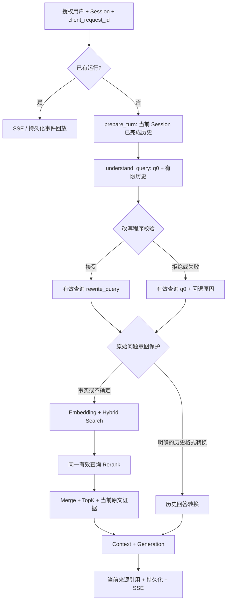
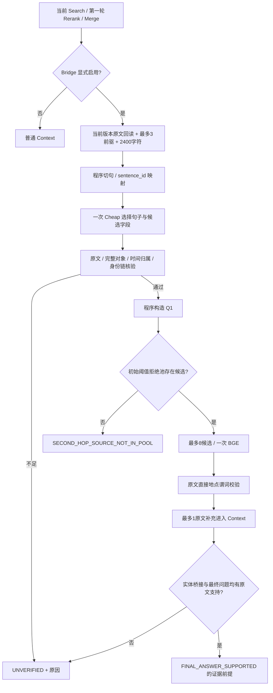

# S8.5 多轮对话检索与受控多跳检索

状态：阶段 0–4 的离线实现与对照完成，真实计划可审查。真实模型/ECS 本轮尚未执行，等待阶段 4.3 的精确范围授权。

## 基线与阶段 0

实际初始 HEAD 为 `main@0606063`，其尚不包含 `backend/weknora_port`。隔离分支 `codex/s8-5-conversation-bridge-20261021` 从它建立，合入已提交 S8.4 分支 `9931ffe`，集成提交 `7e5fb4a`。两个 ECS skill add/add 冲突保留当前 main 的增补案例；未改历史 S8.4 输入、Gold、收据、报告。主工作区原有 `.serena/project.yml` 保留。

实际调用链：服务端准入 → `prepare_turn()` 读取历史/记忆 → `understand_query()` → `resolve_intent()` → Search → Rerank → Merge → TopK → 可选来源扩展/Bridge → Context → Generation → 引用注册/持久化/SSE。恢复请求回放已有运行，跳过 `prepare_turn()`。

| 检查点 | 已实现 | 缺陷 | 缺少验证 |
|---|---|---|---|
| Session 历史 | `prepare_turn` 调用 `OrdinaryHistoryService.load`，SQL 和 `process_history` 均按 tenant/subject/session 过滤，按时间取 max_rounds | 未排除未完成、取消/错误和当前 request；异常大范围吞掉权限/超时 | 本轮隔离真实 PG/多用户测试未运行 |
| Query Understand | 收到历史并保留 `state.query=q0`，复用一个已有改写调用 | 仅非空字符串校验；不能阻止条件遗漏/歧义实体选择 | 当前模型在 S8.5 新合同上的真实输出未验证 |
| 检索查询 | Embedding、关键词和 Rerank 已用 `rewrite_query` | 需增加失败回退轨迹及对有效查询的断言 | 现有真实记录不替代新合同验收 |
| 意图保护 | 有知识库/来源约束规则、附件前提 | 任意有历史的 `follow_up` 可绕过检索；事实性追问被误放行 | 需模拟模型误分类回归 |
| Merge / Context | 当轮证据注册和来源映射已具备 | Merge 会注入历史引用内容，可能替代当前检索 | 需证明旧引用不进入最终 Context |
| Bridge | 默认 off、显式模式执行；单 Cheap/单有界 Rerank/当前原文回读 | 旧偏移合同、对象截断/时间归属/嵌套地点误判、并列谓词误拒、代词不全 | S8.4 真实仅 2 次 Cheap 拒绝，0 BGE，不能认作链成功 |
| 运行账本 | 双侧结算和原始收据保存 | `validate_settlements` 缺执行侧键唯一性及键集合相等检查 | 新反例需先 RED 再 GREEN |
| SSE 恢复 | replay_only / 已有 active 运行避免重入；持久化事件回放 | 暂未发现需重写的缺陷 | 本轮离线恢复断言待执行；不宣称浏览器真实验证 |

阶段 0 只读检查的相关模块包括 service、conversation/history/types/configuration、retrieval/query/search/rerank/pipeline/merge/bridge_rescue/context、generation/context 和 storage/memory/turns/history。未重构或新增主链。

## 阶段记录

后续逐阶段记录修改、RED→GREEN、命令退出码、离线与真实结果。未实现的命令不得报告通过。

### 阶段 1：多轮对话最小修复（OFFLINE_PASS）

修改 `conversation/history.py:process_history/load`、`conversation/types.py:StoredMessage`、`storage/memory.py:_message/recent_messages`、`service.py:prepare_turn`：复用原存储的完成/终态字段，筛选完整成功轮次，明确排除本轮 request，保留 tenant/subject/session 过滤和时间顺序。权限、Scope、取消、运行超时和读取超时传播；普通可选读取错误保留原降级合同。没有新增表。

修改 `retrieval/query.py` 与 `PipelineState`：保留 q0，只接受可核实的字面指代替换，保护当前问题的其余条件；未知/歧义/空值/解析或调用失败回到 q0。追问的模型 intent 仅作建议；完整匹配少量“上一条回答转表格/翻译/换说法”操作才免检索，其余事实性追问保守检索。请求内保留 q0/rewrite，诊断轨迹仅保存 hash、原因和历史轮次数，避免公开日志保存历史正文。

修改 `retrieval/merge.py:merge`，从活动链去掉 `inject_history` 调用；既有辅助函数保留，历史引用不再绕过当前 Search/Rerank 进入 Context。`generation/context.py` 增加历史回答的证据边界提示。Embedding/关键词/Rerank 原有有效查询传递逻辑未重写；离线验证检查实际实参。

改写有意采用窄合同：任意同义改写和只在历史回答中出现、无法唯一确认的先行词都保守回退；不宣称通用语义指代解析能力。需要真实模型验证其实际改写接受率。

同一 Session 的历史还须检查当轮原有 `knowledge_base_scope/document_scope`。双方消息快照不一致时抛出权限错误；缺失来源、跨当前 KB、当前限制文档而历史未限文档、或引用与原快照冲突的历史整轮排除，SSE 只记录排除数量和固定原因。当前门控继续检查当前 KB 的外发权限，不扩大 Scope。旧记录若没有可核查快照，将失去多轮补全能力并回退当前问题检索，这是保守的兼容限制。

RED：初始多轮新增套件 33 failed / 4 passed，exit 1（其中 SQL 测试初稿缺 identity-guard，不能计为实现缺陷；已另用实际基线方法 AST 做正确 RED）；补充符号/编号/歧义/部分响应/SSE 反例 7 failed；关闭历史反例 1 failed；历史外发来源反例 9 failed，均 exit 1。初始测试 import 拼写错误 exit 2 单独保存，不算功能 RED。

最终关联 GREEN 命令：

```powershell
python -B -m pytest -q -p no:reporter -p no:cacheprovider tests/weknora_port/test_s8_5_conversation.py tests/weknora_port/test_conversation.py tests/weknora_port/test_memory_storage.py tests/weknora_port/test_pipeline.py tests/weknora_port/test_p21_boundaries.py tests/weknora_port/test_m31_source_constraints.py tests/weknora_port/test_service.py tests/weknora_port/test_fallback_evidence_contract.py
```

**273 passed，exit 0，3.24 秒**，`var/reports/s8-5/stage1/history-origin-green.txt/.exit`。生成边界另行 RED 1 failed → GREEN **85 passed，exit 0**：`python -B -m pytest -q -p no:reporter -p no:cacheprovider tests/weknora_port/test_s85_generation_history_boundary.py tests/weknora_port/test_generation.py`，证据 `generation-{red,green}.txt/.exit`。重复过渡运行不累加为测试总量。

### 阶段 2：证据校验与账本修复（OFFLINE_PASS）

修改 `retrieval/bridge_rescue.py:validate_extraction/_relation_ending/_location_facts/PRONOUN`：完整对象后只允许直接属于该关系的时间短语与少量无新主体的并列谓词；对象后多出的 Annex/II/Foundation、后续 moving/另一个人物的时间均不准入。地点匹配从句首的完整实体开始，只允许直接地点谓词或窄范围的机构类别补语；rival-of、laboratory 嵌套主体、否定和不确定句拒绝。补全英语/中文第一、二、三人称代词。原文 span、关系句式、主体身份分开记录；Frost 原句已证明 span/form 有效而主体仍未验证。

修改 `scripts/s8_4_bridge_ecs.py:validate_settlements`：PG/执行两侧都按 `(request_id, capability)` 唯一建键，要求键集合完全相同，之后再逐项对比模型、wire 和真实 usage。仅修复校验函数，不改冻结收据和历史结果。

RED：新增语义/账本测试 **34 failed / 58 passed，exit 1**；GREEN（增加两个边界测试后）**183 passed，exit 0，1.63 秒**。

```powershell
python -B -m pytest -q -p no:reporter -p no:cacheprovider tests/weknora_port/test_s85_bridge_semantics.py tests/weknora_port/test_bridge_rescue.py tests/weknora_port/test_bridge_pipeline.py tests/weknora_port/test_s8_4_bridge_ecs.py
```

证据：`var/reports/s8-5/stage2/{red,green}.stdout.txt/.stderr.txt/.exit-code.txt/.command.json`。阶段 2 使用旧偏移合同隔离复现语义缺陷；阶段 3 随活动合同迁移工程测试，旧冻结 JSON 和真实响应保持原样。

### 阶段 3：句子 ID 与有界身份/第二跳（OFFLINE_PASS）

`bridge_rescue.py` 的活动合同统一改为 **`sentence-id/v2`**：程序从当前原文切句，建立稳定 ID、原始 Chunk/版本/Unicode 起止位置/逐字正文映射；Cheap 只返回选中 ID 和候选关系字段，程序派生偏移。旧偏移/quote/chunk ID 作为额外模型字段拒绝。切句保护 B.A./M.F.A./Ltd. 等源文缩写；重叠原文须逐字一致才去重。主来源仍最多 2 个，代词来源沿真实 pre 指针最多回溯 3 步，验证当前版本/Scope/连续 index/双向指针；去重后的句子正文总计 ≤2400 字符。

新增窄范围 `bridge_identity.py:prove_identity`，从原文明确姓名、唯一姓氏的句首重建与连续第三人称句式证明身份。第一/第二人称、同姓歧义、其他人物/引语/关系从句、缺链/版本或重叠冲突不准入。姓名只在问题中出现不能成为原文身份证据。不引入通用 NLP。身份证据在源文存在、以及原句在最终普通 Context 存在，分开校验；没有将缺失姓名原句拼进另一个文档或自动扩充第二跳配额。

程序继续仅从经过验证的 object/target_attribute 构造一个 Q1，重用首轮阈值淘汰池，最多 8 候选/一次 BGE/1 个 ≤1600 字符补充；无匹配候选记录 `SECOND_HOP_SOURCE_NOT_IN_POOL`，不增加全库 Search。首轮分数与三组普通排名数组不变。`retrieval/context.py` 与 `generation/context.py` 共用补充证据限定属性。预算预检不记录虚假的 Context 准入；生成编码超预算撤回补充并记录最终未验证。

独立审查补充了真实离线反例：time 字段吞入 `but not in 2012`、after/before 条件被年份集合忽略、Paris or Rome/画中/小说地点、headed for 的方向含义、机构 location 被当作活动 held 关系。均保存 RED 后修复为支持明确年月日/年份范围、直接对象语法和物理地点尾语；最终支持仅限少量可核实的字面 location 问法，陌生举办/建筑/地址等请求仍未验证。

Frost A/B 离线新合同均能证明姓名与首跳，Q1 为 `Where is The Frost Place Advanced Seminar located?`，初始池确有第二跳，Mock BGE 可补入原文。A 的姓名链在最终普通 Context 内完整，B 缺完整姓名原句。两臂第二跳都是 **机构所在地线索**；`ENTITY_BRIDGE_VERIFIED=false`、`FINAL_ANSWER_SUPPORTED=false`。这是程序/Mock 合同验证，不是本轮真实 Cheap/BGE 成功，也没有生成最终答案。

RED：句子 ID 初始 13 failed；身份模块最初缺模块 collection error 单独标注，不能算功能失败；随后身份反例 6 failed/57 passed；关系审查补充 4+3+2 个失败反例。最终一次关联命令：

```powershell
python -B -m pytest -q -p no:reporter -p no:cacheprovider tests/weknora_port/test_s85_bridge_sentence_ids.py tests/weknora_port/test_s85_bridge_identity.py tests/weknora_port/test_s85_bridge_semantics.py tests/weknora_port/test_bridge_rescue.py tests/weknora_port/test_bridge_pipeline.py tests/weknora_port/test_s8_4_bridge_ecs.py
```

**271 passed，exit 0，1.90 秒**，`var/reports/s8-5/stage3/final-green.txt/.exit`。身份独立验证 63 passed，输出位于 `stage3-identity/green.*`；重复子集不累加。活动工程测试跟随新合同迁移，冻结 S8.4 输入/Gold/收据/真实结果未改。

### 阶段 4：离线对照与真实运行器（OFFLINE_PASS / REAL NOT RUN）

一次跨阶段关联回归 **629 passed，exit 0，5.16 秒**，未把子集/重复运行累加。命令：

```powershell
python -B -m pytest -q -p no:reporter -p no:cacheprovider tests/weknora_port/test_s8_5_conversation.py tests/weknora_port/test_conversation.py tests/weknora_port/test_memory_storage.py tests/weknora_port/test_pipeline.py tests/weknora_port/test_p21_boundaries.py tests/weknora_port/test_m31_source_constraints.py tests/weknora_port/test_service.py tests/weknora_port/test_fallback_evidence_contract.py tests/weknora_port/test_s85_generation_history_boundary.py tests/weknora_port/test_generation.py tests/weknora_port/test_s85_bridge_sentence_ids.py tests/weknora_port/test_s85_bridge_identity.py tests/weknora_port/test_s85_bridge_semantics.py tests/weknora_port/test_bridge_rescue.py tests/weknora_port/test_bridge_pipeline.py tests/weknora_port/test_s8_4_bridge_ecs.py
```

输出与退出码：`var/reports/s8-5/stage4/affected-offline.txt/.exit`。额外缺池分支 **1 passed，exit 0**：`python -B -m pytest -q -p no:reporter -p no:cacheprovider tests/weknora_port/test_s85_bridge_missing_pool.py`，证明已验证 Q1 没有初始候选时停止，不运行第二次 Hybrid/Embedding。

可复现审计命令：

```powershell
python -B scripts/s8_5_offline_audit.py --output docs/evaluation/S8_5_IMPLEMENTATION_REPORT.results.json
```

**exit 0**，状态 `OFFLINE_CONTRACTS_PASS_FROST_FINAL_UNSUPPORTED`，产出 5 个多轮实参轨迹和 6 个冻结案例的独立 S8.5 轨迹。工具使用当前真实 Python 路径与 Mock 模型/存储，未调用数据库/云端/ECS，Mock usage 不计作真实 Token。4 个负控制均 0 Cheap/BGE/补充；Frost 两臂各 1 Mock Cheap/1 Mock BGE，均无最终活动地点支持。

| 离线多轮场景 | 实际验证 |
|---|---|
| 首轮 → 第二轮代词 → 第三轮代词 | 检查 Embedding/Hybrid 关键词/Rerank 的实际实参均为经过校验的独立问题 |
| 切换到逻辑回归后追问 | 使用新话题；不回扫越过新的独立问题 |
| 多实体比较、只在旧回答出现的指代 | 回退 q0；重新检索，不任意选择 |
| 格式转换/翻译、要求原文依据 | 前者严格免检索；事实与来源请求检索 |
| Tenant/user/Session、KB/document、完成/取消/当前轮 | 通过字段/SQL 录制与真实服务组合 Mock 检验隔离；真实 PG 历史仍 NOT RUN |
| 改写失败/空值/部分响应/条件改变 | q0 回退 + 固定原因/hash |
| 刷新/SSE/重启回放 | 同一 durable fixture 运行只调用一次改写/生成；浏览器与真实 Redis 仍 NOT RUN |

新运行器 `scripts/s8_5_bridge_ecs.py` 专用于本轮精确 Frost A 计划；复用正式 Registry/Gate/LocalExecution，不复用旧授权/fence/次数。58 个运行器安全测试通过，exit 0，1.47 秒：`python -B -m pytest -q -p no:reporter -p no:cacheprovider tests/weknora_port/test_s8_5_bridge_ecs.py`。独立审查发现“本地准入拒绝被算成实际调用/UNKNOWN”的报告缺陷，RED 8 failed 后修复；现在分别记录尝试、明确未发送、已结算和可能已发送未知，保留 STOP 与占用。证据 `runner-summary-{red,green}.*`。

真实计划见 [S8_5_REAL_EVALUATION_PLAN.md](S8_5_REAL_EVALUATION_PLAN.md)。用户已允许真实测评；尚未执行任何本轮模型调用或 ECS 操作，当前真实 Token 为 0。只有取得该精确 envelope 的授权才运行。

### 阶段 5：仅评估

Frost 必需第二跳已在首轮 30 候选中，因此没有依据增加第二次全库 Search。当前主要缺口是事件与机构地点的关系，以及 B 的完整身份 Context。缺池反例已可执行记录 `SECOND_HOP_SOURCE_NOT_IN_POOL`。后续如在真实新样本中证明缺池，另行提出一次受限 Hybrid Search 的延迟/Embedding/Rerank 上限方案；本轮不实现。

## 执行流程（实际代码路径，离线模型为 Mock）





两图对应当前实际代码调用点与离线实参轨迹。真实模型尚未执行；`FINAL_ANSWER_SUPPORTED` 只描述证据前提，不能代替对实际生成答案的验证。
