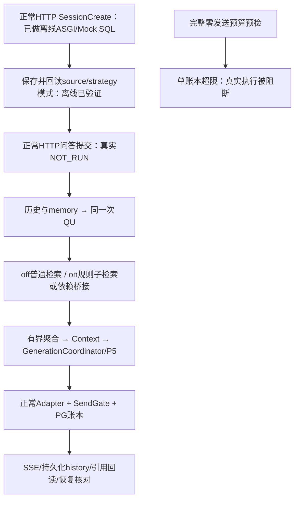

# S8.6.1 最小审查修复与正式 API 验收接线

日期：2026-10-21。结论：**源码最小修复与离线接线通过；正式 API 真实验收 `NOT_RUN`；完整预算 `BLOCKED_RESERVATION_BUDGET`。**

新增 Provider 尝试/结算/UNKNOWN/held/实际输入Token/输出Token/总Token均为 **0**。未估算费用。保守预留上界仅用于外发前预算门，不能当作实际用量。

## 1. 基线、版本与范围

- 工作树：`C:\Users\22088\.codex\worktrees\s8-6-adaptive-retrieval\RAG quention`；分支：`codex/s8-6-adaptive-retrieval-20261021`。
- 初始 HEAD `0c496c230add039283c80635d4e7d4776a4e373b`，初始该工作树干净；实际祖先关系核对成功。
- 源码修复提交：`f39d347ccefd8441c2b56dbaa4f5f455776ed77f`。
- 最后源码/验收脚本提交：`8ba0fcaf0ab665b28a04c006267e05ab10fd7e8f`。本文随后仅增加交付文档与progress；报告提交可用 `git log -1 --format=%H -- docs/evaluation/S8_6_1_API_ACCEPTANCE.md` 查询。
- 主工作树已有 `.serena/project.yml` 修改保留。其余工作树保留。AGENTS、progress、ADR索引、S8.6设计/报告以及Owner本轮附件均已读取。
- 生产源码相对基线仅有下面两项修复；其余新增内容为test-only脚本、测试、去敏配置快照及交付文档。

## 2. 两项最小源码修复

| 文件/函数 | 可复现缺陷 | 修复 | 证据 |
|---|---|---|---|
| `retrieval/pipeline.py::RetrievalPipeline.run` | mode off，旧Graph有路径，普通检索为空，融合没有原文时，局部导入使 `SearchNothing` 未绑定 | 既有 `SearchNothing/SearchError` 导入移至run无条件入口；其余路径保持 | RED `UnboundLocalError` → GREEN 正常 `SearchNothing` |
| `retrieval/strategy.py::try_rule_compare` | 英文比较生成 `What are ... ...?` | 改为 `What is known about {name} regarding {dimension}?` | RED旧文本 → GREEN；span、对象、维度、根q0和中文规则保持 |

`tests/weknora_port/test_s86_strategy.py` 仅更新两条英文预期；新增 `test_s861_review_fixes.py` 覆盖Mock旧Graph与模板合同。生产Graph仍off。未增加算法或模型调用。

## 3. test-only正式API profile

实现入口：`scripts/s8_6_1_api_acceptance.py`，命令 `profile / dry-run / api / collect`。导入和前两个命令均不发送Provider。

复用 `scripts.s8_ecs_runtime.create_application`、正常ApplicationRuntime、RuntimeService、Registry、SendGate、LocalExecution、HTTP与SSE。在既有 `ordinary.configuration` 依赖组合点等待正常配置，再复制 `generation_options`，设置 `citations_enabled=True`，在正常system prompt后追加Owner选择的精确B后缀。未替换Adapter或账本。

正式SessionCreate保存 `source_evidence_mode=bounded_source_v1`，strategy分别为off/query_structure_v1；配置回读决定生效模式。两臂均由服务端profile关闭内部Expansion，公共DTO不能注入QU类型、system prompt或generation options。P5、模型绑定与来源协议保留。

- profile：`s8.6.1-formal-api-prompt-b/v1`；SHA256：`ead97b230a9bf5a5a7b42976a9d9f2a2cac961fef5a9f49fb052d17fb871fbc8`。
- B后缀SHA256：`4501caef3b4b0d5b0de09e00e51d1ca9d50332637637e52ffc45ee90e2dc726b`。
- 脚本LF SHA256：`f8392f282127f5e0c8184dfe9ef45592734d79da466fa11d3e643170a211ea2c`。
- Prompt正文与原始/组合Prompt、QU及Context模板指纹在机器结果 `profile` 内完整冻结。
- 获批路径校验实际默认Prompt/模板、English语言、空附件、空历史及空memory背景；发生漂移先停止并重新预检，不覆盖实际配置。
- Fresh Owner授权需绑定source revision、实际新image ID、profile、完整预算文件SHA及脚本SHA、当前范围、模型、每批上限和新账本。当前超限预算无法通过该启用检查。
- 正常HTTP分配server UUID；保留独立短client request_id。新账本UUID前缀为 `*`，服务端用获批client ID + q0 + scope + saved mode约束；一个client不得绑定不同run。
- 每批独立新目录，API与collector分别独占创建一次性claim；不复用旧账本。服务为1 worker。

正常Fallback可能替换system prompt并移除B；已保留现有行为。将来必须从实际Provider原始请求证明B送达，单靠配置哈希不能宣告B臂验收通过。

## 4. 离线验证与失败记录

| 命令/范围 | 退出码 | 实际结果 |
|---|---:|---|
| 源码修复新增两条回归，修复前 | 1 | 2 failed；原始UnboundLocalError和旧模板保留 |
| 受影响Graph/strategy/Pipeline定向集 | 0 | 67 passed |
| `python -X utf8 -B -m pytest -q tests/weknora_port/test_s861_api_acceptance.py tests/weknora_port/test_s861_preflight.py -p no:cacheprovider --basetemp=E:/RAG quention/var/reports/s8-6-1/root/temp-final-profile-v2` | 0 | **76 passed**，含13项ASGI/profile和63项预算/准入测试 |
| 完整 `dry-run`（第5节） | 0 | 程序执行成功；业务状态 **BLOCKED_RESERVATION_BUDGET** |
| `profile --output .../root/profile-final.json` | 0 | 冻结profile；0发送 |
| `git diff --check`、保护文件SHA核对 | 0 | PASS |

精确绝对解释器、argv、cwd、输出SHA、exit与原始日志见 `.results.json` 的 `tests`、`dry_run_command`、`raw_evidence_manifest`。源码测试命令完整记录在 `review-fixes/review-fixes.results.json`，不以表中缩写代替原始记录。

离线覆盖包括：真实私有Guard下的ASGI SessionCreate与Mock SQL持久化/正常配置回读、非法mode组合和公共Prompt注入拒绝、实际prepare_generation可见B/来源协议/原文、UNKNOWN QU经实际Pipeline仅做普通检索、配置/范围/版本/物理Embedding组漂移、历史/memory/Prompt漂移、UUID与client ID分离、有效期限、UNKNOWN旧账本拒绝、一次性claim、真实agent_query形状解析。

测试中的SQL、Registry、生成或assembly相关外部依赖为Mock。没有真实PG/Redis/SSE/Provider联合验收。完整HTTP collector尚未真实执行。

保留的其他失败：初期profile缺模块；测试closure比较造成10pass/3fail；预检15fail/29pass揭示配置字段被忽略及Decimal哈希错误；直接Decimal回归1fail；Prompt/历史护栏缺失15fail/3pass。修复均限test-only脚本/测试。所有中间证据保留，最新76项为当前最终脚本结果。

两项旧配置测试 `test_dedicated_model_failure_falls_back_once_and_same_id_is_not_retried`、`test_exact_go_configuration_function_rows`：原S8.6已在完整08ebd90工作树复现失败，本Goal未重跑，未修改期望，单列为既有失败。未重复922项历史测试。

## 5. 当前真实配置与完整零发送dry-run

实际执行过一次只读ECS inventory：固定SSH主机身份，Docker inspect，PG `default_transaction_read_only=on` + SELECT；无新容器、镜像、模型发送或远端文件写入。该快照是本次真实读取，不是正式API真实验收。

现有API和Worker均仍运行旧镜像 `sha256:80e2f2d84bf67d7d22117d98676049aa9cd3101e69b20f780d5fd9eeaf931a36`，label revision `29ecf2f5d3037eed99a4de783546dee272a761bd`，linux/amd64，cloud=false/Graph=false/DYNAMIC。未更新现有服务。新镜像 **NOT_BUILT**。

| Role | Provider | 模型 | 当前model_id |
|---|---|---|---|
| cheap | siliconflow | Qwen/Qwen3.5-4B | `mdlf5350f8b80d8971c14ddaa8524f8a039d414e85c35a657e4271228473b25e` |
| embedding | siliconflow | BAAI/bge-m3 | `mdlebb9931ff609b45a70a6c29c6712caa66c6b657ce4d1f802ee114bed2e779` |
| expensive | deepseek | deepseek-flash | `mdlfc056bbbf8448d15f3d4f3cd954756be9a34bb7f104e137cde38dc360b749` |
| rerank | siliconflow | BAAI/bge-reranker-v2-m3 | `mdl3076be3c32a0a17f8e9cf5deef89452a9f8886163b0aebd8aa4d1130958e3` |

范围：Tenant332的既有Owner；KB `96a9eebd-ffb2-4bc6-9bea-3ed015845479`，四篇Jeanne/Leyden/Franklin/Frost文档ID见机器结果。当前11个可检索行，其中7个原始text、2,605字符。原冻结inputs的11个ID、内容SHA、文档/KB/版本逐一匹配当前只读快照后才用于预算；未读取Gold或注入运行Context。索引未改。

PG收据快照13,041行、UNKNOWN3、unfinished0；这是历史总量，不是本Goal新增。后续未重测远端指纹；本Goal远端仅SELECT。旧B2本地UNKNOWN1/held6365和476项历史证据哈希保持。

最终实际命令（在上述工作树，解释器为本机既有venv）：

```powershell
& 'E:/RAG quention/.venv/Scripts/python.exe' -X utf8 -B -m scripts.s8_6_1_api_acceptance dry-run --inventory 'E:/RAG quention/var/reports/s8-6-1/budget-audit/current-inventory.json' --sources tests/weknora_port/fixtures/s8_4_bridge/inputs.json --output 'E:/RAG quention/var/reports/s8-6-1/root/budget-preflight.json'
```

预检按物理Provider调用计数，包含QU、Embedding、BGE、桥接抽取、旧池BGE、新Hybrid Search对应Embedding/BGE以及正常最终生成/可能P5升级。当前一物理Embedding组、每池BGE一批、阈值0.3无自动降阈重排、memory origin-KB保护令memory调用0，两臂Expansion关闭。激活前必须重新核验这些条件。

每个物理请求使用最新真实body builder和已确认output contract：

`保守预留上界 = canonical_wire_bytes_upper + verified_output_upper + 1024`

QU off150/on256，桥接抽取256，最终每次2048、非思考；Embedding/BGE output0。有效改写可达2048字符，预检用未发送的JSON长度包络；比较子句2080、Q1 192。它们仅用于字节上界，绝不是原文、事实或Gold。正常原文与**无原文Fallback**均实际构造请求，最终按每个role更大的body上界计入。Cheap/Expensive Fallback分别32,030/32,036预留，高于普通原文生成12,143至12,156。

| 题目 | 策略 | 最多物理尝试 | 保守预留上界，非实际Token | 单账本12次/100,000 |
|---|---|---:|---:|---|
| compare | off | 5 | 109,805 | 超出100,000 |
| compare | query_structure_v1 | 7 | 132,474 | 超出100,000 |
| dependent | off | 5 | 109,798 | 超出100,000 |
| dependent | query_structure_v1 | 9 | 136,836 | 超出100,000 |

四轮总26次，上界488,913；比较off/on共12次/242,279，Frost共14次/246,634。即使缩为两个on单题，仍为7次/132,474、9次/136,836，均超单账本现有100,000。**没有合规的推荐Provider批次，recommended_max_calls=0。**

前两个dry-run曾给出7/92,714与9/97,062，漏计Fallback，已在新机器结果明确 `SUPERSEDED_UNDERBOUND_DO_NOT_AUTHORIZE`。旧文件保留，不能据其外发。退出0表示dry-run程序执行完成，不代表预算或问答通过。

## 6. 冻结输入、流程与评价

1. Compare：`Compare Leyden jar and Franklin bells in terms of operating principles and uses.`，strategy off/on。
2. Frost：`Where is the seminar Jeanne Marie Beaumont directed in 2007-2010 located?`，strategy off/on。

两臂均bounded_source_v1、citations、精确B、English、reasoning off、Expansion off、同范围和P5。四次真实提交均 **NOT_RUN**，真实classification、rule命中、各轮查询/来源、最终模型可见输入、首字/整答耗时、SSE/PG/history、引用回读、召回增益均 **NOT_RUN**，机器结果未填模拟值。



`final_answer_correct`为主指标；`evidence_support`、`presentation_consistency`、引用归属、new_recall_gain独立。最终明确更正后的正确答案可通过；未解决矛盾单列。Frost回答Franconia, New Hampshire可记最终答案正确，同时保持内部 `EVENT_VENUE_UNVERIFIED`/`final_answer_supported=false` 的事实边界；当前无新问答，不能填PASS。新召回无新证据但答对时记答案正确、召回增益0。旧Gold、回执、旧评分不改。

collector设计保留原始SSE、server run/client IDs、HTTP history、恢复帧、原文回读与LocalExecution原始请求/响应；比对重放前后账本无变化。未知发送、权限、缺完整结束、不完整结果均停止，不补发。引用缺失单列NO_CITATIONS，引用event/history不一致仍失败。合法第二用户验收BLOCKED，错误Bearer401不能替代。

## 7. 隔离运行方案（全部未执行）

- 从源码提交 `8ba0fcaf0ab665b28a04c006267e05ab10fd7e8f` 制作git archive并验证上述source manifest；目标镜像保留源码revision、profile及manifest标签。可复用已验证现有镜像依赖作增量基底，先核对requirements与实际import；不重新安装或变更依赖。镜像新ID在构建后记录，当前不能编造。
- 全新目录 `/opt/rag-s8/diagnostics/s861-<unique>/`，单独API-only服务/Compose project、1 Uvicorn worker、独立日志与loopback18861端口；不启动Worker。
- 正常启动命令：`python -B -m scripts.s8_6_1_api_acceptance api --port 8000`。若用旧镜像增量复制，工作目录及PYTHONPATH明确为 `/opt/s861/app`，用该目录的完整backend/eval_center/scripts，启动前核对所有关键 `module.__file__`，避免旧 `/app` 遮蔽。
- 连接既有已核验PG/Redis，正常私有secret/principal/tokenizer；原始storage只读。新Redis prefix `weknora-python-s8:s861:<unique>`。全局Graph/bridge默认off、P5 DYNAMIC。
- 每批独立 `/opt/rag-s8/state/executions/s861-<batch>/ledger.json` 与兄弟 `strategy-audit/`；仅挂载该新目录可写，其他历史executions不挂可写；授权文件只读。API和collector claim分别只创建一次。collector在同容器namespace访问 `http://127.0.0.1:8000`。
- cloud=false启动身份/readyz检查可用现有 `python -B -m scripts.s8_ecs_runtime check`；有模型时另需新Owner grant与完整预算通过，当前不能激活。
- 保留现有API/Worker容器ID、镜像ID、runtime.env/loaded-images/Compose SHA作为回滚身份。隔离测试回滚只停止本Goal临时API并保留目录证据，不恢复/删除数据库、Redis历史、生产容器或旧UNKNOWN。

## 8. 未完成项与下一步最小建议

**预算阻断是保守上界无法闭合，并非已发生高额用量。** 当前没有新Provider费用或发送。按本Goal“超限时减少范围或报告”要求报告阻断，未上调账本硬上限，也未为过关修改QU/生成上限或P5。

下一步仅建议Owner单独选择：给test-only验收增加明确的过长有效查询拒绝条件（拒绝时保留原输出、停止，不改写成q0），或提供可证明的QU序列化更紧上界；完成后在本Goal继续离线预检。该建议未实施、未占位PASS。当前不能以旧低报预算申请真实模型额度。

未解决质量问题包括QU真实分类、比较答案/文档引用、Frost最终答案及证据支持差异、B实际wire送达、真实恢复无重复发送；全部留待合法正式API真实验收。C、HyDE和全量数据集测评均未启动。

## 9. 一次性新Owner授权申请（未批准）

申请版本绑定源码 `8ba0fcaf0ab665b28a04c006267e05ab10fd7e8f`、profile `ead97b230a9bf5a5a7b42976a9d9f2a2cac961fef5a9f49fb052d17fb871fbc8`、基底镜像 `sha256:80e2f2d84bf67d7d22117d98676049aa9cd3101e69b20f780d5fd9eeaf931a36`。

**当前可审查的申请仅限隔离准备，Provider上限0、实际Token上限0、真实问答提交0：** 将精确源码传入全新ECS诊断目录，构建可追溯新镜像，启动一台cloud=false临时API，使用正常PG/Redis/私有Guard核对startup/readyz与模块身份，保存证据后停止临时服务。原正式API/Worker及所有索引保持。出现权限/身份不符、未知发送或需要覆盖现有资源即停止。

原四轮真实验收范围、四个模型、必要外发内容（冻结问题、经正常权限读取的四文档范围原文、验证Q1、实际最终Context）、次数和保守Token预算已完整列于第5–6节，但该部分申请状态 **BLOCKED_RESERVATION_BUDGET，不申请激活Provider额度**。当前Grant模板不会生成或签发；没有新Owner批准时不执行构建或临时API创建。此项授权需要来自Owner本Goal第5节，旧外发授权不适用。

完成交付后停止；本地提交，无Push、Tag或生产部署。


## 10. Owner批准后的零调用隔离准备实际结果

第7节和第9节的NOT_BUILT/未批准描述是首次预检时快照，现由本补充更新：Owner已明确批准仅零调用隔离准备，范围已完成并关闭。

- 精确源码 `8ba0fcaf0ab665b28a04c006267e05ab10fd7e8f`，新镜像 `sha256:c9b5c4b9c1d4f87d94e3109a22def827ea157c44e6800ac277a590a6544f0d43`，profile不变。
- 正常真实API鉴权readyz HTTP200/check exit0，13模块来源及520源码/资产、21依赖pin通过；临时API已停止。
- 两次工具失败、停止143的实际Uvicorn信号源码解释、只读恢复及前后完整账本/范围/索引保护证据均见新报告。
- Provider/Token/问答提交均0；正式四轮模型验收仍NOT_RUN，预算BLOCKED_RESERVATION_BUDGET保持。

详见 `S8_6_1_ZERO_PROVIDER_PREPARATION.md` 及其 `.results.json`。没有Push、Tag或生产服务更新。
