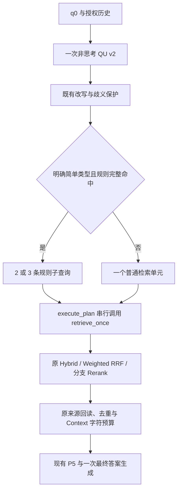

# S8.6.2：规则子问题覆盖与 QU 分类对齐

## 1. 结论与验收边界

本轮状态：**OFFLINE_IMPLEMENTED_WITH_VALIDATION_LIMITS**。最小源码修复、两条规则族和同次非思考 QU 的分类接线已实现；受影响离线测试 **322 passed，exit 0**。这不是正式 API、真实模型分类准确率或最终答案准确率验收。

新增真实 Provider 尝试、结算、输入/输出/总 Token、UNKNOWN 和 held 均为 **0**。未操作 ECS、重建索引、Push、部署或打 Tag。本轮完成后停止，不扩大规则族。

“未实现的命令不得报告通过。” Mock、离线语法匹配、既有冻结记录与真实服务结果分别标注。

## 2. 实际基线、S8.6.1 收尾与 Git

- 工作树：`C:/Users/22088/.codex/worktrees/s8-6-adaptive-retrieval/RAG quention`。
- 分支：`codex/s8-6-adaptive-retrieval-20261021`。
- 开始 HEAD：`352b1ba4dc70b2a748d6e70d8bb695bc29fd0ece`；实际包含要求的 `0c496c230add039283c80635d4e7d4776a4e373b`。
- 识别并保留其后的四个 S8.6.1 提交：`f39d347` 源码修复、`8ba0fca` 隔离 profile、`d282dbb` 预检报告、`352b1ba` 零调用准备记录。
- 本轮已读取 AGENTS、progress、ADR 索引及 S8.6 相关设计；开始时该工作树干净。主目录原有 `.serena/project.yml` 修改及所有其他工作树保留。
- S8.6.1 的零 Provider 隔离准备已结束，临时服务在其冻结记录中已停止；正式真实模型 API 验收仍 NOT_RUN/预算阻断。本轮没有远端复查，不将旧部署状态描述成新的实时观察。
- 本轮独立代码提交：`5c3f7d2db9fa832cc4c2ede070bb405a6ac96d4e`。包含 4 个生产文件（含新 Registry）及 5 个测试模块、1 个固定样例文件。
- 本报告提交可用 `git log -1 --format=%H -- docs/evaluation/S8_6_2_RULE_COVERAGE.md` 查询，避免自引用 SHA。

## 3. 已复现的误拆与具体修复

输入 `比较A和B在安全性方面的区别`，旧 `try_rule_compare()` 实际给出：

```text
对象/维度：[('A', '区别'), ('B在安全性方面', '区别')]
```

原缺陷测试先执行，**exit 1**。修复通过 Registry 中优先匹配闭合的 `在X方面的区别` / `在X方面有何区别` 句式，使对象为 `A`、`B`，共同维度为 `安全性`。对应半开字符位置为对象 `[2,3)`、`[4,5)`，维度 `[6,9)`。继续完整匹配；未移除保护或截掉未知尾部。

固定 v2 覆盖集第一次执行还有 4 个错误拆分，原结果保留：

| ID | 输入 | 采取的最小保护 |
|---|---|---|
| N15 | 比较A和B的价格差是多少 | 拒绝数量差值/聚合要求 |
| N27 | 比较A和B所主持会议的举办地点 | 拒绝吞入对象槽的依赖关系 |
| N29 | 比较它和B的价格 | 拒绝未绑定的代词对象 |
| N30 | 分别介绍A和它的价格 | 同一代词保护用于并列属性族 |

同一 v2 样例的预期、输入和标签未因这些失败改变；修复后 4 条均退回普通检索。

## 4. 两个版本化规则族

Registry 是纯 Python 冻结声明：`RuleDeclaration`、`RuleMatch`、`RULES`；无新运行依赖。每条声明包含 ID/版本/类型、语言/句式、最少/最多对象数、必需槽位、拒绝条件、正反例、解析器与模板。

| 规则 | QU 类型 | 语言 | 正例精确槽位/位置 | 负例错误拆分 |
|---|---|---|---:|---:|
| COMPARE_SHARED/v1 | SIMPLE_COMPARE | cn,en | 16/16 | 0/25 |
| PARALLEL_ATTRIBUTE/v1 | SIMPLE_PARALLEL | cn | 8/8 | 0/3 |

规则表中的负例分母按相应显式简单类型统计：比较 25 条、并列属性 3 条；总计 31 个反例另含 2 条 JOINT 和 1 条 DEPENDENT，其正确行为是保留原类型、走原链路。第 6 节整体分母覆盖这全部 31 条，不与另外 11 个分类门控案例合并。

第一版均为 v1，2–3 个不同对象；查询最多 400、对象最多 80、完整维度最多 160 个 Python 字符。返回 `objects`、`dimension`、半开字符位置、`full_match`（精确原始有效问题）、状态和拒绝原因；拒绝不返回猜测槽位。字符位置针对通过保护的有效改写，只有 q0=改写时才同时是 q0 的位置。

### COMPARE_SHARED

覆盖闭合句式：

- `比较/对比A和B的X`，亦支持连接词 `与`。
- `A与B在X方面有何区别`。
- `比较A和B在X方面的区别`。
- `比较A、B、C的X`。
- `Compare A and B in terms of X`。
- `Compare A with B on X`。
- `Compare A, B, and C in terms of X`。

### PARALLEL_ATTRIBUTE

覆盖 `分别介绍/说明/查询A和B的X`、相应三个顿号对象形式，以及 `A和B各自的X是什么`。英文并列属性句式本轮未实现。旧 `PARALLEL` 不等于 `SIMPLE_PARALLEL`。

两个族均按每个对象生成一条含**完整共同维度**的查询：中文 `{object}的{dimension}是什么？`；英文 `What is known about {object} regarding {dimension}?`。多个维度保留为整体，不产生对象数×维度数查询。数字仅准入带 Latin 字母的型号词法，例如 `Qwen3.5-4B`；该准入不证明产品存在。

三对象中文仅支持两个顿号；两对象仅支持一个 `和/与`。混合列表、对象名称含无法区分的连接词、安全条件无法绑定时拒绝。`同时满足A和B` 仍 JOINT，主持会议地点仍 DEPENDENT。时间/否定/来源/权限/数量差值、复杂嵌套、同名歧义、未明确维度和未绑定代词不强拆。

## 5. QU、规划和实际执行路径

`query.py` 的 v2 分类说明由 Registry 实时生成，句式、正反例和边界不另维护一份。输出仍恰好四字段 `rewrite_query/intent/image_description/query_type`，新增枚举 `SIMPLE_PARALLEL`；同一次非思考 QU，不增加分类器。v1 提示保持原样，输出上限仍 150；v2 仍 256。

紧凑合法并列 JSON 的离线长度为 119 字符/137 UTF-8 字节，小于既有可比示例最大 163/163。**这不是 Token 测量，不能证明任意改写均能在 256 Token 内完成**；实际 tokenizer/截断率未测量。原解析失败、非法类型、改写和歧义保护保留。

只有 QU 明确给出 `SIMPLE_COMPARE`/`SIMPLE_PARALLEL`，程序才尝试对应规则。命中证明由 Python 完整匹配和槽位验证产生；失败走一个普通检索单元。其他类型不在运行时提升，即使本地离线诊断可识别规则，也只纳入离线分析。



实际 Mock 集成检查 Embedding、关键词检索与 Rerank 接收同一条子查询；最多 3 单元、PG 模拟并发最高 1；子查询 Expansion 均关闭，未递归调用完整 Pipeline。保留 q0、父级配置和 Scope；只持久化一次 Context。Mock GenerationCoordinator 实际收到各分支回读原文，最终模型角色合计调用一次；这证明接线和送达，不证明真实语义支持或真实回答正确。

新私有 Trace 包含 `rule_id/rule_version/rule_status/reject_reason/subquery_count`、计划检索单元数、fullmatch 状态、槽位位置及 q0/改写 SHA256；不在新 Trace 中写用户原文。普通回退的规则子问题数为 0，实际计划检索单元数为 1。

## 6. 固定样例、分母与 RED→GREEN

固定集 v2 SHA256：`b2a1e8a299f78c692c87c40833317c56503c1049e5d48c6eaa124e8a69039d0a`。66 条为 24 个支持正例、31 个拒绝反例、11 个分类门控案例。

| 指标 | 首次覆盖执行 | 当前同一固定集 |
|---|---:|---:|
| 支持正例：对象/维度/位置/模板均精确 | 24/24 | 24/24 |
| 拒绝反例：错误拆分率 | 4/31（12.90%） | 0/31（0%） |
| 分类门控：未触发额外查询 | 11/11 | 11/11 |

这三个分母各自独立，**不是生产准确率**。11 条门控含其他类型、非法类型、族不匹配等；不能用它当作模型分类准确率。

来源分开记录：13 条用户字面样例（11 正/2 反），40 条按用户边界机械实例化（13 正/27 反），13 条代理扩展（2 反/11 门控）。**新增完整集合的 Owner 逐条人工确认 NOT_RUN**；两名代理审查不能冒充人工批准。后续 Owner 复核是样例预期的独立检查，不影响本轮如实保留结果。

固定集最初生成器将 P07 第三个对象 `C` 的位置误指向 `Compare` 首字母；在执行特性测试前独立复核纠正为 `[18,19)`，未改输入、对象、维度、分类或安全预期。v1 原字节、哈希及修正时点保留，未用解析器输出反填 Gold。

Registry 单测保留阶段性记录：缺模块 RED（exit 2）、72 初始通过、边界 RED（6 failed/74 passed，exit 1）、独立审查 RED（25 failed/74 passed，exit 1）、最终 99 passed（exit 0）。固定集首次 pytest 63 passed/4 failed（exit 1），最终 67 passed（exit 0）。初次覆盖未采集 Registry 源码哈希，报告明确留空，不把最终哈希倒填给 RED。

## 7. 执行命令与实际结果

最终组合命令工作目录为上述 C 工作树；实际 argv、stdout/stderr、退出码、JUnit 和 SHA 均嵌入机器结果。PowerShell 等价命令：

```powershell
& 'E:/RAG quention/.venv/Scripts/python.exe' -X utf8 -B -m pytest -q `
  'tests/weknora_port/test_s862_regression.py' `
  'tests/weknora_port/test_s862_rule_registry.py' `
  'tests/weknora_port/test_s862_query_alignment.py' `
  'tests/weknora_port/test_s862_coverage.py' `
  'tests/weknora_port/test_s862_pipeline.py' `
  'tests/weknora_port/test_s86_strategy.py' `
  'tests/weknora_port/test_s86_pipeline_integration.py' `
  'tests/weknora_port/test_s86_qu_configuration.py' `
  'tests/weknora_port/test_s85_rewrite_prompt_contract.py' `
  'tests/weknora_port/test_s86_b_pipeline.py' `
  'tests/weknora_port/test_s861_review_fixes.py' `
  '-p' `
  'no:cacheprovider' `
  '--basetemp=E:/RAG quention/var/reports/s8-6-2/final-temp' `
  '--junitxml=E:/RAG quention/var/reports/s8-6-2/final-affected.junit.xml'
```

退出码 **0**，关键原始输出 **`322 passed in 5.97s`**。这是同次组合执行，不将重复 RED/GREEN 数量相加。组成如下：

| 模块 | 本次通过数 |
|---|---:|
| `test_s85_rewrite_prompt_contract.py` | 10 |
| `test_s861_review_fixes.py` | 2 |
| `test_s862_coverage.py` | 67 |
| `test_s862_pipeline.py` | 10 |
| `test_s862_query_alignment.py` | 28 |
| `test_s862_regression.py` | 1 |
| `test_s862_rule_registry.py` | 99 |
| `test_s86_b_pipeline.py` | 6 |
| `test_s86_pipeline_integration.py` | 11 |
| `test_s86_qu_configuration.py` | 44 |
| `test_s86_strategy.py` | 44 |

原误拆 RED、82 项 QU/既有改写合同定向运行、Registry 全阶段以及固定集失败原始输出在机器结果内保留。日志原件目录为 `E:/RAG quention/var/reports/s8-6-2`。

曾有受限执行环境中的 `asyncio` 内部 socketpair 等待，记录为 NOT_COMPLETED，不算 PASS/FAIL；中断后同一范围在批准执行环境完成，没有更改应用事件循环策略。未执行历史 922 项全量测试。两项已知旧配置测试 `test_dedicated_model_failure_falls_back_once_and_same_id_is_not_retried`、`test_exact_go_configuration_function_rows` 本轮未跑、未改期望，不纳入通过数。

## 8. 来源、权限和冻结记录保护

`strategy_executor.py`、Hybrid/Search/Rerank、桥接与身份验证、Context、生成、Provider、历史/存储/引用等本轮受保护源码保持基线哈希。实际离线核对 112 个本轮受保护文件、91 个既有合同文件、476 个 S8.5 旧证据文件及 3 份 S8.6 旧报告：exit 0。旧 B2 UNKNOWN 的本地冻结记录仍 1 笔、held 6365；本轮未查询或改写远端账本。

默认新模式仍 off；无全局阈值、Weighted RRF、P5、模型选择、生成 Prompt、Schema/索引改动。未将 Gold、JSON 抽取、假设或中间答案登记为原文。Frost 机构地点与活动场地的边界未改，既有 `EVENT_VENUE_UNVERIFIED` 不升级为 PASS。

## 9. 已覆盖、拒绝支持、仍未验证

- **已覆盖**：上述闭合中英文比较、中文并列属性、2/3 对象、完整多维度、修饰语归属、合法型号数字、必要位置/哈希 Trace；既有比较与回退路径在受影响套件中检查。
- **拒绝支持**：任意自然语言列举、英文并列属性、混合连接符、对象边界不清、时间/否定/来源/权限/数量联合约束、未绑定代词、复杂依赖/嵌套、主观无维度判断。拒绝回普通检索，不追加模型。
- **已知误拒绝风险**：保守子串保护可能拒绝合法名称中含 `年/月/日/和/与/总/差` 等字符；这一有限规则不能充当通用中文分词或实体识别。
- **NOT_RUN**：真实 QU 分类、真实检索增益、最终答案正确率、正式 HTTP/PG/Redis/SSE 新验收、长 JSON 输出 Token 适配、扩展固定集逐条 Owner 确认。本轮没有新的 Provider request_id/响应/收据可报告。
- **后续最小建议**：另行批准后用同一固定输入对照 QU 建议类型与程序实际命中，分开量化分类、错误拆分、来源送达和最终答案；优先包含既有比较、三对象并列、型号数字、歧义/时间拒绝。此建议未执行，不借用旧 S8.6.1 外发授权、profile 预算或镜像证明新源码。

2026-10-22，经 Owner 明确要求，将分支推送至 GitHub `tiance002/personal-multimodal-rag`。推送前同名远端分支为 `0c496c230add039283c80635d4e7d4776a4e373b`；普通快进推送包含本地完整分支历史，代码提交 `5c3f7d2db9fa832cc4c2ede070bb405a6ac96d4e` 与报告提交 `1e70984eb43a6f15e04de393cf81d95c88dc1d13` 均已到达远端。远端 `ls-remote` 回读与本地提交 SHA 一致；无强推、部署或真实模型调用。
