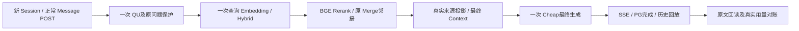

# S8.6.4 检索链路收敛、语言与范围修正、多模态精确提取

> 最终续执行状态（2026-10-22）：`IMPLEMENTED_REAL_RUNTIME_PASS_QUALITY_PARTIAL`。最新源码 `f96446742d1f32d7fa13635e43159b08fc3e2e0a`；正式隔离 HTTP 三题与四次 Caption 均真实完成，16 次 Provider 全部结算，实际 40,977 Token，0 UNKNOWN。答案、证据与 Caption 质量单列于第 12 节。以下第 1–11 节保留文档提交 `ed219dc` 的离线阶段记录，其中“等待授权/未构建/调用为0”仅为当时快照。

日期：2026-10-22。当前状态：`OFFLINE_IMPLEMENTED_KNOWN_BASELINE_FAILURES_REAL_NOT_RUN`。本报告是代理工程复核记录，不代表 Owner 验收。最终源码为 `a25af498ab3d2eb5614185f73d678a172e300d52`。Owner 追加 Top1 指令前，33 模块 715 passed/5 warnings；追加后配置/profile 300 passed/2 项旧基线失败单列，最终六模块联检 96 passed；通过命令均退出 0。真实服务和模型质量尚未验收，不能据本报告建立 Tag。

本轮删除额外 Source Unit 来源窗口及其超限清空机制，保留原有 Merge 和 TopK，补上 Rerank 全低分时的 Search 回退，并保留已在 S8.6.3 完成的引用身份修复。新增语言请求策略、会话文档范围更新与歧义澄清，接入精确提取优先的 VLM Caption Prompt，准备固定图片和固定文本的 Prompt 对照材料。

新增真实 Provider 调用、输入/输出 Token、UNKNOWN 占用、数据库写入、ECS 构建/部署均为 **0**。另按 Owner 追问完成一次 ECS 三块原文的只读回查，事务 `READ ONLY` 并以 `ROLLBACK` 结束。真实 HTTP 问答、真实 VLM 效果、新生成 Prompt 准确性均为 **NOT RUN**。本地浏览器配合模拟 API 的通过结果与真实服务验收分开记录。

机器结果入口：[S8_6_4_RETRIEVAL_CONVERGENCE.results.json](S8_6_4_RETRIEVAL_CONVERGENCE.results.json)。历史原始请求、失败、Gold、收据及 UNKNOWN 账本未改写。**未实现的命令不得报告通过。**

## 1. 基线、约束与上游源码

实际工作树为 `C:/Users/22088/.codex/worktrees/s8-6-adaptive-retrieval/RAG quention`，分支为 `codex/s8-6-adaptive-retrieval-20261021`。本轮起点为 **`3c081b657c9c768d4d1b81310e4dc59c711f195d`**，晚于任务文本所列 `d5b685046b7338250e011a518f924671439a0cd0`，并已包含 S8.6.3 增量。未回退到历史实现。S8.6.3 的三条引用修复是本轮起点能力；本轮继续回归并去除其与可选来源窗口的耦合，不将它重新记成首次修复。

已读取项目 `AGENTS.md`、`AGENTS.override.md`、进度及 ADR 索引和本轮 Owner 完整执行文本。P0 先通过必要回归后再实施 P1。P5 DYNAMIC、Weighted RRF、Embedding/Rerank 模型、全局阈值、生产模型绑定和历史账本保持既有边界；生成 Prompt 候选只用于新建离线包。

本机只读参考仓库 `E:/RAG-reference/WeKnora-3e8b0bfc` 的 HEAD 确认为 `3e8b0bfc80b845b2d4b2ed683994748741450a97`。以下是 `git ls-tree` 实际读取的 blob 身份：

| 上游文件 | blob SHA |
|---|---|
| `internal/application/service/chat_pipeline/merge.go` | `21263c8a1ec4b0332ab95bc18c44b3c4abafc459` |
| `internal/application/service/chat_pipeline/merge_expand.go` | `e459e96c5874361a49f9081fb606810f2ead6741` |
| `internal/application/service/chat_pipeline/rerank.go` | `659a0c6590b3d7bac0c71597a9ee4169b9b332df` |
| `internal/application/service/chat_pipeline/filter_top_k.go` | `6af579960922a81877f4114a234d3a7828f3741f` |

任务列出的 `internal/reranking/rerank.go` 在该固定提交中不存在，状态为 `NOT IMPLEMENTED / PATH ABSENT`；没有凭文件名臆造实现。参考行为以实际四个文件为准：Rerank 非空用 Rerank，空时用排序后的 Search 并先限制既有 TopK；继续进行父子块补充、连续块合并、短块邻接、二次合并与最终 TopK。上游不是权限、版本或模型发送授权的替代品。

## 2. 目标与实际改动

| 模块 | 修改前真实故障 / 首次失败层 | 本轮改动位置与行为 | 当前结果与证明边界 |
|---|---|---|---|
| 额外来源窗口 | 已过 Rerank 的来源因 Source Unit 超限被整轮清空，C 层 | `retrieval/source_evidence.py`、`pipeline.py`、`strategy_executor.py`：删除扩展和超限淘汰，仅对已选 ID 与记录的 Merge 成员核验原文 | 五个保存案例通过零模型边界回放；新答案未测 |
| Merge | 拼接正文可能借旧 ID，短邻接可能替换已经合并的正文 | `retrieval/merge.py`：保留父子块与连续合并，补全成员 ancestry，邻接围绕完整选中正文添加；父块保留完整原文，image 复合正文拆回自身来源 ID | 精确来源身份、父子与邻接回归通过；无跨 KB/document/version 拼接 |
| Rerank | Search 有候选但全低分，提前 `SearchNothing` 阻断 Merge | `retrieval/rerank.py`、`merge.py`：保留原阈值和现有 floor 语义，空 Rerank 时按既有 Search 排名进入 Merge | 三个历史全低分案例恢复可读原文；候选存在不等于语义充分 |
| 引用 | DSM 两条、MML0687 一条正文/offset 借用 anchor 身份 | 保留 S8.6.3 current scoped 回读和原块投影，解除 Source Unit 数量/字符限制 | 三条引用继续离线精确回放；真实 HTTP/PG 引用回读未重跑 |
| Context | 来源类别标记曾依赖人工字符上限开启 | `retrieval/context.py`、`generation/context.py`：独立 `classify_sources`，保留原文、Caption、OCR 等来源类别 | 移除 Source 字符限制后仍标记派生内容；图谱/bridge 预算独立保留 |
| 请求语言 | 测评脚本硬编码 `Accept-Language: en-US` | 两个现有 acceptance driver 与 `scripts/s8_6_4_language.py` 按明确语言和问题决定 Header、profile 检查及必要哈希 | 15 项离线语言测试通过；无新模型语言效果结果 |
| 文档范围 | 会话文档选择无完整锁定/切换闭环，歧义规范可能猜目标 | `http_api.py`、`runtime.py`、`service.py`、`storage/turns.py`、`documents.py`，前端范围面板与 API | 授权更新、冻结在途范围、澄清和跨用户隔离回归通过；本地模拟 API 浏览器流程通过 |
| VLM | 普通概述丢失图表数字、标签对应关系 | `image_multimodal.py` 与现有 `vlm_ocr_prompts.json` 接入精确提取优先模板；OCR/MinerU 与 vision 默认参数不变 | 请求构造、固定图片字节及参数离线通过；真实提取质量 `NOT RUN` |
| 生成误读 | 充分原文送达后单位、实体、术语被替换 | 新增 `scripts/s8_6_4_prompt_diagnostics.py` 和离线证据包 | 四个 D 案例与一个混合 C/D 案例独立保留；候选不进入生产默认配置 |

## 3. P0：窗口删除、Merge 与引用身份

旧 `expand_source_evidence()` 为额外来源窗口设置 `UNIT_CHARS=2048`、`UNIT_CHUNKS=6`、`ADDED_CHARS=4096`、`MAX_GROUPS=3`。窗口超限抛出 `SourceEvidenceBudgetError` 后，串行 `retrieve_once()` 捕获并执行 `state.merge_results=[]`，将整轮返回为 `BUDGET_OMITTED / SOURCE_UNIT_BUDGET_EXCEEDED`。这使原本合法、已经召回的来源一起消失。

正常链路现为 Search → Rerank → Parent/Child → 连续块合并 → 短块邻接 → 二次合并去重 → 既有 `filter_top_k()` → 原文身份核验 → Context。额外窗口、四个限制常量、对应异常与整轮清空分支均已删除；Source 模式的 `CONTEXT_CHARS=16000` 和策略选择中的同类字符淘汰也已删除。保存的 `bounded_source_v1` 值仅作为兼容配置和原文核验开关，不再表示另一个来源窗口。

`project_source_evidence()` 只读取最终已选条目与其记录的 Merge 成员 ID，复用 `get_chunks(..., current=True)`，不新增邻接来源召回。读取结果必须属于当前授权 KB/document、当前有效版本，且原文 ID、内容、类型和 locator 可以回读。拼接内容拆回独立原块；失效或未包含在实际合并正文中的成员单独记录 `omitted_ids`，其他有效原文继续保留。跨域、版本或权限错误仍作为安全失败拒绝。

父块不能把其他子块自动变成独立命中。连续合并保留各成员 ID 及 ancestry；短邻接保持 `<350` 触发和 `850` 目标上限，只围绕完整的选中正文补充合法 prev/next。选中正文已经超过 850 时不截断它；没有新增邻居时不改写标记。补充父块保留完整原文，避免删除图像 Markdown 后让精确投影误判为缺失；image_ocr/image_caption 与其补充原文分别绑定实际 ID，并继续标记为派生内容。

本轮审查还修正了四个关联边界：邻接不得用 anchor 原块替换已选合并正文；二次顺序合并不得丢掉右侧成员 ancestry；image grandparent 必须同域同版本；parent 原文不能先被裁写再冒充原始 locator。这些均由相关离线回归覆盖。

图谱、bridge 的独立 Context 预算、冲突配置及作用域护栏保留。`ContextBudgetError` 用于这些仍有效的预算，来源类别标记独立于字符限制。Provider 输出硬上限、实际 Token/费用预留、SendGate、取消、期限及 UNKNOWN 保护未删除；移除人工 Source 窗口不代表模型输入没有真实上限。

三条历史引用继续按保存的原块身份回放：DSM 的 `1400dc3d-f641-4193-8218-0483ab6b528e` 与 `072ced3a-cc3d-4260-ae9f-f73b49fd3a0b`，以及 MML0687 的 `834f3910-246d-4c81-8285-87afb311005b`。三条恢复原始正文与 offset，扩大部分使用自己的真实 ID；不修改历史数据库、旧答案或旧收据。DSM 和 median 历史核心答案正确，引用修复不将它们反向标成错答，也不声称已执行新版真实模型答案。

## 4. 保存 Search/BGE 边界的八例回放

固定输入为 `tests/fixtures/s8_6_4/retrieval_replays.json`。`scripts/s8_6_4_replay.py` 恢复保存的 post-Hybrid Search 与原始 BGE 返回值，再经过真实的 Rerank 选择、Merge、来源投影和 Context 编码。repository 和模型边界为离线保存资料；没有新的 Embedding、BGE、数据库查询或 Provider 发送。独立历史 Merge 实时快照未保存，不能将这次重建说成旧运行逐阶段抓包。

| 类别 | 案例 | 历史原始 Search / BGE 返回 / 阈值后保留 | 本轮离线结果 |
|---|---|---|---|
| Source Budget | SciFact621 | 30 / 30 / 5 | 已选原文保留，不调用 Source Unit |
| Source Budget | LongBench 转氨酶 | 30 / 30 / 19 | 同上 |
| Source Budget | LongBench 辐射避难所 | 30 / 30 / 11 | 同上 |
| Source Budget | LongBench 美国节日 | 30 / 30 / 29 | 同上 |
| Source Budget | LongBench UTC 转换 | 30 / 30 / 10 | 同上；使用已保存 q0 轮次，不混入后续轮次 |
| Rerank 全低分 | MML0434 | 30 / 30 / 0 | 记录 Search fallback，原文进入 Merge/Context |
| Rerank 全低分 | MML0431 | 30 / 30 / 0 | 同上 |
| Rerank 全低分 | SciFact1304 | 30 / 30 / 0 | 同上 |

回放断言最终已选每条正文、范围和 ID 等于保存的原块，并确实进入新准备的消息。它证明传递机制，不证明充分语义或新答案正确。SciFact621 仍保留人群条件不匹配的 F 层限制；MML0431 的必要图示输入未因 fallback 自动出现。真正无关的负例由独立定向 Rerank 测试覆盖，不能把有候选自动写成有支持答案。

MML0434 本次 ECS40 真实 run UUID 为 **`eef866a0-c0c5-4267-be92-2dba551b57ce`**。原始池实际为 30 个 Search 输入、30 个 BGE 返回、0 个阈值后候选；此前描述中的“29”不覆盖已恢复的原始边界记录。原链首次可证实清空发生在 Rerank 选择，本轮离线回放的回退恢复了池内已有正文。保存池内有 `Coding time`、`CATS`、`DOGS` 等片段，最初仅用这 30 条快照的回放未出现完整数据集句。随后按 Owner 指出的问题回读真实邻块，已找到同版本原文，并用生产链路离线证明完整句子送达最终消息，详见下文；旧 ECS40 答案仍不改写，新版真实答案未运行。

指定历史 S8.2 UUID `1ae3c1da-a22e-45d6-b6de-ac49e294920b` 在本轮已搜索的本地资料中没有找到对应完整运行证据。不能据此声称它从未执行，也不能把其他 B0434 OOM、S7 或本地成功记录冒充该 UUID。其真实 Query Understanding、Embedding 输入、source_version、Merge 和最终 Provider 消息缺少可逐项绑定的证据，故“指定 S8.2 为何成功”的精确因果对照仍为 `BLOCKED_EVIDENCE_MISSING`。没有为此重开发 Cat vs Dog OCR/VLM。

### Coding time 与邻接的精确边界

`Coding time!` 原块 `10ff171b-a054-4cbc-9ab4-4c52b8c3022f` 位于 Search 第 4 位，Search 分数 `0.013155858226280761`，BGE 分数 `0.022454602643847466`（该批最高），仍低于 `0.3`，因此历史上没有通过 Rerank。新 fallback 的离线回放已将它送入 Context。该块 133 字符、无 parent，满足 `<350` 邻接条件；回放确实请求了 prev `fa5675e3-e769-4f3a-8cd0-267b3d35a386` 和 next `084c5bee-f7be-4718-9c0b-510e61cb401a`。

**保存的 30 条 Search 快照没有这两个邻块的正文。** 所以此前“未恢复”仅指该快照回放；不能据此断定 ECS 来源也缺失，或新版真实邻接一定失败。若真实同域同版本邻块包含数据集句并通过现有邻接规则，能够补给模型；仍需核对实际原文及最终消息，不能在未读邻块时断言答案必然正确。保存边界见 [frozen neighbor observation](evidence/s8_6_4/mml0434_frozen_neighbor_observation.json)。

**后续只读回查已消除存储层疑点：** ECS 当前同一来源版本的 next 块 `084c5bee-f7be-4718-9c0b-510e61cb401a` 正文为 `Kaggle's Cat vs Dog dataset (25k dog/cat pictures)` 加原图署名，共 69 字符。prev/anchor/next 的 index 为 56/57/58，页码 32/33/34，长度 35/133/69；指针双向一致、同 tenant/KB/document/version、文档 enabled/completed，三块以原分隔拼接共 241 字符，符合 350/850。故此前快照结论不能解释成 ECS 缺少原文。原始回查和计数元数据勘误均保存在 [只读证据](evidence/s8_6_4/mml0434_neighbor_readback/observation.json)，未修改保存的原始 stdout。此回查不是问答模型调用。

Owner 随后明确要求 `rerank_top1_floorless=true`；本轮在既有选项上启用 Top1，并同步服务端和验收接线。该新指令覆盖先前同一选项默认 off 的限制，不改变阈值、RRF、P5 或来源规则。已用以上真实三块补充独立来源回读缓存，完成 floorless=true 和显式 false 的实际生产下游回放；历史 30 条 Search/BGE 输入保持不变，邻块没有被塞入 Search 或 BGE 输入。

**最终送达证明：** `rerank_top1_floorless=true` 时，仅选中 `Coding time`，原始 BGE 仍为 `0.022454602643847466`，阈值仍为 `0.3`；这是现有 Top1 策略保留，不是分数跨过阈值。既有融合分数 `0.1174195190541927` 没有改算法。Merge 邻接后，原文核验将三个块以自己的 ID/偏移/版本进入引用 Registry，最终生成用户消息 946 字符，包含完整的 69 字符 next 正文。准备的完整消息哈希 `a84d628ca6f01b81c7d548eb038381fc93e267149c3158436c7bea03b66a3411`，见 [实际下游回放](evidence/s8_6_4/mml0434_current_neighbor_replay/verification.json)。`false` 路径的 Search fallback 也送达同句。以上是离线生成准备的真实代码路径；没有新的 Provider 生成调用，不能替代新版答案正确性验证。

服务默认值、环境默认值和正式启动适配已设为 `true`；可信服务端显式 `false` 可关闭。Session/Message 不能由模型或客户端任意覆盖。内部裸 `PipelineState` 的中性默认 `false` 保留，正常服务通过已测试的配置链传入 `true`。原 ECS 运行环境与正式 API/Worker 未更新；未来隔离验收需显式带 `WEKNORA_PORT_RERANK_TOP1_FLOORLESS=true`，profile 校验实际值。Graph 仍强制关闭，已有 Graph/bridge 冲突保护不变。

## 5. P1：语言、合法范围与澄清锁定

两个 acceptance driver 现在为每题确定 `Accept-Language`。优先顺序是明确的 `answer_language`、问题内支持的明确语言指令、问题字符默认值；包含汉字默认 `zh-CN`，其他默认 `en-US`。这是有限脚本规则，支持范围及不支持的显式 locale 会明确记录/拒绝，不伪称通用语言识别。原 q0、冻结 Gold、证据正文和专业标识符均不因语言修复改写。相关测试 profile 检查与哈希随请求语言调整；生产生成 Prompt 和模型绑定未因此修改。

指定文档和多文档 scope 复用现有 Session 存储。最小授权更新能力核对 Session owner/tenant、document 与当前 KB 归属；在途和已完成 Turn 保持其创建时范围，后续新请求继承更新。前端范围面板可选择、切换或清空文档，刷新后保留状态。多文档比较保留显式文档集合，普通多文档命中不触发逐题强制选择。

依赖“这份文档/这个 PPT/这份规范”等唯一文档指代而没有合法唯一目标时，服务端先返回真实有权限的文档标题、文件名与 ID 供选择，避免模型猜目标。明确文档 title/filename 的唯一匹配仅按 trim/casefold 的字面相等处理；模糊别名不冒充确定匹配。这个唯一匹配可绕过澄清，但不会静默持久化文档锁定。实际锁定必须由用户在范围面板选择并应用；原问题需重新发送，不自动重复模型请求。

后端定向验证覆盖单 KB、单/多文档、越权拒绝、歧义澄清、选择后的追问、切换、清空、在途范围冻结及其他用户无法读取/继承。真实浏览器使用系统 Chrome 和模拟 API，验证 `doc-a → doc-b → []` 更新、消息 POST 使用当前 scope、刷新持久化和零页面错误；这是前端合同验证，不能代替真实 ECS/数据库/Provider 全链路验收。

## 6. VLM 与固定生成诊断

Caption Prompt 已从同一 JSON 资源读取，强调可辨认的原文、数字、百分比、单位、标题/轴/图例、类别和值关系以及显式图示关系优先；普通无文字照片才简要描述；不确定内容明示，不能从问题或期望答案补数据。输出简洁 Markdown，无新增 JSON Schema。业务指令不得覆盖精确提取和事实规则。OCR/MinerU 职责、vision 默认值和原始/派生内容区分保持原合同。

P27 原始 request 已保存两张实际输入图片的完整 base64。离线对照复用同一字节，不通过 Gold 重新制作图片：

| 案例 | 原图 SHA256 | 固定模型 / 参数 | 历史输入 / 输出 Token |
|---|---|---|---|
| MML0958 | `58e2d7521ffa57e1a937993b39ce4a79204b7d0143cc2ea22c7eb905dc95fea9` | `deepseek-flash`，temperature `0.10000000149011612`，`max_tokens=5000`，detail `auto`，无显式 thinking 参数 | 1,018 / 840，仅历史 |
| MML0684 | `2647fbabb967e083ca98308bf643cfb3f875107694c83e4485a69e8ae3d1a0a2` | 同上 | 1,032 / 1,161，仅历史 |

新旧完整 Provider body 经现有 DeepSeek adapter 离线渲染，除 Caption 文本外相等。旧原始响应、usage 与 PDF 身份保留；新 Prompt 不包含 `81%`、`78%`、`shiny object` 或 `mirror` 这些答案事实。不能声称新模型已经恢复了任何数字或标签。

[固定对照包](evidence/s8_6_4/prompt_diagnostics/README.md) 的 `render_image_pair()` 校验不可变图片请求/图片字节哈希并返回完整可复用请求体；生成 old/candidate 文件则保持历史用户消息、来源顺序、Context、参数、Prompt B 及当时英文 locale 不变，仅向 System 追加测试专用有限约束。语言变化必须独立比较。`scoring_only.json` 与请求加载隔离；破坏评分文件不影响请求构造，篡改请求或越界路径会失败。不得复用历史 request_id、CLOSED 授权或 UNKNOWN 占用。

| 固定文本案例 | 已确认输入及失败层 | Retrieval Context 字符 / Chunk / 完全重复正文次数 |
|---|---|---|
| MIRACL5721594 | D：完整公司清单与 430/600 冲突均送达；英文别名未经来源绑定 | 2,128 / 4 / 0 |
| MIRACL704170 | D：原文“双键”送达后变成 triple bond，醇盐/醇术语混同；源文自身不规范措辞保留 | 1,153 / 3 / 0 |
| MIRACL91294 | D：方位与原始星座名完整送达；摩羯座改为 Aquarius，蛇夫/巨蛇混同 | 1,029 / 3 / 0 |
| LongBench 培训人数 | D：2005 条件与 `2.2万人` 送达后被回答为 22,000 training sessions | 9,267 / 14 / 3 |
| MIRACL692002 | 主 C、伴 D：乔治·斯蒂格勒已送达后被替换；必要 Romer 原文在 Rerank 丢失，整题不算充分输入 D | 474 / 1 / 0 |

五例历史 System 均为 3,108 字符。以上为字符统计，不是实测 Token；短 Context 也出现实体/术语误读，不能预设“输入多导致误读”。MML0684 是缺少必要男女图表值的 A 层，不归为充分文本输入后的 D 层。新生成 Prompt、模型升级或压缩方案的收益均没有真实比较结果。

## 7. 执行命令与结果

日志根目录为 `E:/RAG quention/var/reports/s8-6-4/`。除特别说明外，工作目录为本轮 worktree。各阶段计数是不同受影响测试集合，不能相加冒充独立样本数或准确率；715 项对应追加指令前的 `8b75820`；追加 Top1 后已分别运行最新配置/profile 集及最终六模块联检。精确 argv、退出码和原始日志均已归档，不将阶段次数相加。

| 实际命令 / 范围 | 退出码、关键输出 | 证据 |
|---|---|---|
| `& 'E:/RAG quention/.venv/Scripts/python.exe' -m pytest -q --tb=short tests/weknora_port/test_s864_rerank.py` | RED 1：12 failed/7 passed；GREEN 0：19 passed | `rerank-red.log`、`rerank-green.log`、`rerank-offline.json` |
| P0 集成定向 pytest（阶段日志；完整最终覆盖命令见下方） | 0：261 passed；不是全仓库回归 | `p0-integration-attempt1.txt` |
| 保存边界与引用定向 pytest（阶段日志；完整最终覆盖命令见下方） | 0：12 passed；八个 Search/BGE 案例与关联回放 | `frozen-replay-attempt2.txt` |
| `python -m pytest -q tests/weknora_port/test_s864_request_language.py` | 0：15 passed | `language-offline-verification.txt` |
| `& 'E:/RAG quention/.venv/Scripts/python.exe' -m pytest -q --tb=short tests/weknora_port/test_s864_document_scope.py tests/weknora_port/test_turn_storage.py tests/weknora_port/test_service.py tests/weknora_port/test_http_api.py tests/weknora_port/test_s85_ambiguity_clarification.py` | 0：110 passed，包含 23 项新 scope 测试 | `scope-final.log` |
| `& 'E:/RAG quention/.venv/Scripts/python.exe' -m pytest -q --tb=short tests/weknora_port/test_s86_qu_configuration.py tests/weknora_port/test_service_task_cleanup.py tests/weknora_port/test_document_assets.py tests/weknora_port/test_documents.py` | 0：82 passed，5 个既有 SWIG 警告 | `scope-configuration-documents.log` |
| `npm.cmd run build`，cwd `frontend` | 0：tsc / Vite，274 modules | `scope-frontend-build.log` |
| `& 'E:/RAG quention/.venv/Scripts/python.exe' 'C:/Users/22088/.agents/skills/webapp-testing/scripts/with_server.py' --server 'npm.cmd run dev -- --host 127.0.0.1 --port 5196 --strictPort' --port 5196 -- 'E:/RAG quention/.venv/Scripts/python.exe' tests/weknora-port/s864_scope_ui.py`，cwd `frontend`，`VITE_WEKNORA_API_BASE=/api/v1` | 0：模拟 API 浏览器 PASS | `scope-ui.log`、`scope-ui.results.json`、三张 scope-ui PNG |
| `npm.cmd test -- --grep 'composer scope picker defaults closed'`，cwd `frontend`，系统 Chrome 与 `/api/v1` 环境配置 | 0：1 passed | `scope-adapter-ui.log` |
| `python -m pytest tests/weknora_port/test_image_multimodal.py -k prioritizes -q --tb=short -p no:cacheprovider`，实现前 | 1：旧概述 Prompt 不满足 extraction 断言 | `vlm-caption-red.*` |
| `python -m pytest tests/weknora_port/test_image_multimodal.py tests/weknora_port/test_s864_prompt_diagnostics.py tests/weknora_port/test_s863_fixed_evidence.py -q --tb=short -p no:cacheprovider` | 0：16 passed | `vlm-final.command.txt`、`.exitcode.txt`、`.output.txt` |
| `python -m scripts.s8_6_4_prompt_diagnostics --prepare`；随后 `python -m scripts.s8_6_4_prompt_diagnostics` | 各 0：2 image / 5 generation pairs，`OFFLINE_RENDER_PASS`，真实调用 0 | `vlm-prepare.*`、`vlm-render-final.*` |
| VLM 三个已跟踪文件的 `git diff --check`（完整命令见 `.command.txt`） | 0 | `vlm-diff-check.*` |
| 追加 Top1 前 33 模块综合 pytest（8b75820），命令见下 | 0：715 passed，5 个既有 SWIG 警告，20.45s；无 skip | `offline/targeted-integration-final.txt`、`.run.json` |
| Owner Top1 配置/profile 定向集（精确 argv 见 owner_top1_true/affected-green.run.json） | 0：300 passed/2 deselected；排除的仅为下面已知旧意图失败 | `owner_top1_true/verification.results.json` |
| 该集首次未排除旧断言的实际运行 | 1：2 failed/300 passed；与完整 08ebd90 基线的两个错误一致，未修改断言/生产 QU | `owner_top1_true/related-attempt1.log`、`baseline-known-fails.json` |
| Top1/邻接/来源/正式启动/旧实验合同最终六模块联检 | 0：96 passed，4.03s；无 skip | `owner_top1_true/owner-top1-integration-green.log`、`.run.json` |
| 新版真实 HTTP/SSE/数据库/模型问答；真实 VLM 新旧质量对照 | `NOT RUN` | 需当前有效 Owner 授权和既有 SendGate；准备材料不是授权 |

RED 记录原样保留。VLM 首次新模块尚未建立时的 collection error 为 `vlm-red.*`，不把它当作独立业务断言失败。Scope RED 为 13 failed/1 passed；部分存储/HTTP 能力在该 RED 前已加入，不能声称所有路径都取得了独立修改前 RED。浏览器首次尝试因没有等待异步 PATCH 完成而失败，后续只调整测试等待；初始日志没有删除。

## 8. Owner 九项专项回答

1. **原来源预算为何清空候选，如何避免重现？** 旧窗口异常被 `retrieve_once()` 捕获后直接清空 `merge_results`。本轮删除整个可选窗口、对应阈值/异常及清空分支，只核验已选来源；五个保存预算案例已零调用回放。
2. **原父块、连续块、邻接和 TopK 是否保留？** 保留既有顺序、350/850 规则及 `filter_top_k()`。补齐已选正文、父块完整性和 Merge 成员身份边界，未增加第二套窗口/TopK，未修改全局 `rerank_top_k` 默认值。
3. **MML0434 为何曾成功又失败，必要原文是否恢复？** ECS40 有实际 30/30/0 阻断证据；当前只读回查找到同版本 next 原文，Top1=true 与显式 false 的 Search fallback 均已离线送达完整句。此前保存池漏了两个邻块正文，不能等同于 ECS 缺原文。Owner 说明过去启用 Top1 并答对；本轮证实该保留最高分→邻接补证据的机制，但指定旧 S8.2 UUID 的完整原始消息仍未找到，新版真实答案也未运行。
4. **Rerank 全排除时实际回退做了什么？** Owner 最新默认 Top1=true 时先按既有策略保留真实最高分；显式 false 或合法空 Rerank 时按原 Search score、TopK 进入正常 Merge/核验，记录 `RERANK_ALL_BELOW_THRESHOLD_SEARCH_FALLBACK`。Search 真空、正常接受和模型异常分别记录 `SEARCH_EMPTY`、`RERANK_ACCEPTED`、`RERANK_MODEL_ERROR`，不把回退当高置信 Rerank 命中。
5. **中文问题是否仍被 en-US 覆盖？** 测评驱动已按每题语言生成 Header，中文默认 `zh-CN`，显式语言优先。已通过请求/profile 合同测试；新模型真实中文回答质量尚未执行。专业术语与冻结原文不被翻译改写。
6. **文档范围如何限制、澄清和锁定？** 授权 Session 更新持久化实际 document_scope；新 Turn 冻结当前范围；歧义先列真实有权限候选，用户在范围面板确认后锁定，后续追问继承。可切换/取消，跨用户/租户拒绝。前后端离线及模拟 API 浏览器通过，真实 ECS 闭环未运行。
7. **固定两图具体恢复哪些数字、标签、关系？** **尚无新模型提取结果，不能声称恢复了任何一项。** 新 Prompt 已接线，原图/模型/参数和新旧请求差异已核验；81/78、shiny object/mirror 的效果必须由后续有效授权的真实对照证明。
8. **哪些确属生成误读，哪些缺证据？** 四个充分输入 D 案例是公司别名/冲突、双键术语、星座实体、人数单位。Stiglitz 是主 C/伴 D；MML0684 缺图表值属 A，MML0434 的旧 ECS40 输入缺必要句，而新版同版本邻接送达已离线证明；指定 S8.2 的精确历史输入仍缺档案；拒答、相关文本或审查者看到 PDF 都不等于模型收到充分证据。
9. **是否产生退化？** 已执行受影响模块回归、边界回放、构建和模拟 API 浏览器检查，覆盖发现的四项 Merge 关联问题。最终六模块联检 96 项通过，另 300 项配置/profile 通过；两个已记录的 08ebd90 意图基线失败原样复现并单列，不属于新回归通过分母。没有运行全量回归或新版真实 Provider 问答，不能宣称所有功能无退化或准确率已提升。

## 9. 风险、遗留与版本下一步

| 遗留 | 状态 / 影响 | 下一项最小动作 |
|---|---|---|
| 指定 S8.2 MML0434 成功记录缺少可绑定快照 | `BLOCKED_EVIDENCE_MISSING`；限制历史因果解释，不等于历史从未运行 | 提供该 UUID 原始 Search/QU/输入等资料后再核对，不借用其他运行 |
| MML0434 保存池缺邻块正文 | 当前同版本邻块已只读找到必要句；保存回放的缺项已定位，非 ECS 原文缺失 | 已离线证明 Top1/邻接/原文投影送达；真实答案尚未运行，不重新解析或补 Gold |
| 两图 VLM、生成候选及真实 HTTP 效果 | `NOT RUN`；离线不能证明质量提升 | 已冻结一次合并授权提案，见第 10 节；复用已有隔离 ECS HTTP 后台入口与收据对账 |
| 文档 title/filename 仅有限字面唯一识别 | 模糊别名仍需用户选择；不扩大为通用实体解析 | 保持真实候选选择流程，不根据 Gold 挑文档 |
| 全量回归/发布 | `NOT RUN`；不能代替受影响模块结果 | Owner 复核当前证据后决定真实验收范围；不自动部署、Push、Tag |

本轮没有自行批准延期或 Owner 验收。任何真实发送均需覆盖新版请求、实际 KB/document 范围和费用的当前授权；旧测试合同不自动续期。本地源码提交：`528b19f7e5b76a3e8a9d05ee533dcb3d2dea69be`（P0）、`b9654bf09e922deff83f51ea13760d01b8f1a92c`（语言与范围）、`8b75820866176a02e97618c08d4d627e6ba6a8e1`（VLM）、`a25af498ab3d2eb5614185f73d678a172e300d52`（Owner 追加 Top1 与真实邻块回放）。本轮状态为离线实现完成、等待新授权；未 Push、部署或发布。

环境记录：前端测试复用既有 `node_modules` junction，无依赖安装；另有忽略目录下冗余 junction 保留。自动审批审查以 `blocked by policy` 拒绝了针对该 junction 的清理命令，执行代理没有换方式绕过，未删除其指向的依赖目录内容。这不影响已记录构建/浏览器结果。


## 10. 最终命令、证据与一次合并授权提案

以下为追加 Top1 指令前（8b75820）的 33 模块综合回归，工作目录为第 1 节 worktree。原样参数（PowerShell）：

```powershell
& 'E:\RAG quention\.venv\Scripts\python.exe' '-X' 'utf8' '-B' '-m' 'pytest' 'tests/weknora_port/test_s864_source_convergence.py' 'tests/weknora_port/test_s864_frozen_replay.py' 'tests/weknora_port/test_s864_rerank.py' 'tests/weknora_port/test_source_identity.py' 'tests/weknora_port/test_source_evidence.py' 'tests/weknora_port/test_source_reliability_wire.py' 'tests/weknora_port/test_pipeline.py' 'tests/weknora_port/test_s86_strategy.py' 'tests/weknora_port/test_s86_pipeline_integration.py' 'tests/weknora_port/test_s86_bridge_strategy.py' 'tests/weknora_port/test_s851_bridge_identity_context.py' 'tests/weknora_port/test_knowledge_storage.py' 'tests/weknora_port/test_s864_document_scope.py' 'tests/weknora_port/test_turn_storage.py' 'tests/weknora_port/test_service.py' 'tests/weknora_port/test_http_api.py' 'tests/weknora_port/test_s85_ambiguity_clarification.py' 'tests/weknora_port/test_s86_qu_configuration.py' 'tests/weknora_port/test_service_task_cleanup.py' 'tests/weknora_port/test_document_assets.py' 'tests/weknora_port/test_documents.py' 'tests/weknora_port/test_image_multimodal.py' 'tests/weknora_port/test_s864_prompt_diagnostics.py' 'tests/weknora_port/test_s863_fixed_evidence.py' 'tests/weknora_port/test_s864_request_language.py' 'tests/weknora_port/test_s861_api_acceptance.py' 'tests/weknora_port/test_s861_preflight.py' 'tests/weknora_port/test_s862r_preflight.py' 'tests/weknora_port/test_s862r3_http_preflight.py' 'tests/weknora_port/test_s862r3_40_acceptance.py' 'tests/weknora_port/test_generation_wire.py' 'tests/weknora_port/test_history_storage.py' 'tests/weknora_port/test_send_gate.py' '-q' '--tb=short' '--basetemp' 'E:/RAG quention/var/reports/s8-6-4/pytest-final'
```

退出码 **0**，输出 **`715 passed, 5 warnings in 20.45s`**。日志 SHA256：`6a06ae385cf7044ee1cc2901c4e6e7aae1327ab317c3e1ff235583fec07295e6`。715 项含边界 Unicode、模型输入、SSE/历史合同和定向回放；不是新的业务问题或准确率分母。初次综合回归 11 failed/704 passed 的日志保留，修复了旧测试替身/语言约定及实际 QU-only 语言遗漏；使用 `-X utf8` 和 E: basetemp 后边界测试全部执行，未降低现有路径保护。

[离线归档](evidence/s8_6_4/offline/archive.manifest.json) 保留 55 个原始日志/元数据/截图，383,875 字节。中间元数据的 `NOT CREATED/pending` 仅代表当时状态；最终提交与结论以本报告/results 为准，未重写旧日志。完整回放 Trace 见 [retrieval_replay.results.json](evidence/s8_6_4/retrieval_replay.results.json)。[基线保护核对](evidence/s8_6_4/baseline_protection.results.json) 覆盖 476 个已跟踪历史评测文件、24 个 Provider/发送保护文件、3 个 QU/规则/路由文件、25 个 Schema/索引 SQL、2 个后台入口，均无改动。除限定三块原文的只读回查外，本轮未进行数据库操作；这份 Git 静态保护核对不冒充实时账本/UNKNOWN 核查。

本地运行现有 `python -X utf8 -B scripts/s8_6_2_r3_40_acceptance.py profile --output docs/evaluation/evidence/s8_6_4/current_http_composition_profile.json`，退出 0、Provider 0。[追加 Top1 后当前组合 profile](evidence/s8_6_4/current_http_composition_profile.json) SHA 为 `6402fa6a171d868da549ee14f328efe4ce42de3f8bf51b2a645421334d1fbdf1`；[base profile](evidence/s8_6_4/current_http_base_profile.json) 保留 QU、System Prompt B 与语言策略哈希。它仍使用历史 profile 名称和 40 题 cohort 描述，只是可复用组合指纹，**不是新的 40 题授权或已经可执行的新任务**。镜像 `NOT_BUILT`，ECS 构建/部署 0；限定原文只读回查见上文。

### 新授权提案（尚未批准）

[完整合并提案](evidence/s8_6_4/fresh_authorization.proposal.json) 申请：从最终源码 `a25af498ab3d2eb5614185f73d678a172e300d52` 构建可追溯的独立临时镜像/目录，记录实际镜像身份；通过现有 ECS 后台运行器及正式 HTTP 驱动仅运行 A 组三题，每题新 Session、一次提交：MML0434、辐射避难所、Pieter。逐字 q0、原始 KB scope 和语言均已冻结，保留 `eith` 原拼写与旧 UNKNOWN 保护，不从 Gold 选择文档。中文问题默认中文。生成仍用原 Prompt B、P5 DYNAMIC，Top1=true，内部 Expansion/Graph 关闭。

同一次申请包括固定 MML0684、MML0958 的旧/新 Caption 对照，各两次，合计 4 次现有 Adapter 调用。只发送冻结原图和 Caption，无题目/Gold。固定生成候选模型对照与额外文档锁定真实模型题本次不申请，均保留 `NOT RUN`；离线产品验证与对照包已交付。本轮没有要求全部推荐案例无条件真实调用。

拟议新总上限 **500,000 Token**。HTTP 每题沿用现有子账本最多 **12 次尝试 / 100,000 Token**，三题操作上界 36 次；加图像 4 次，操作上界合计 40 次。该数来自既有单题护栏与固定样本数，**不是实际消耗、逐请求 Token 新预检通过或已获授权**。既有预留、Provider 硬上限或权限检查不满足即保存阻断，不提高子限额。模型范围见提案。单批不超过 40 分钟；UNKNOWN、权限/版本不符、发送不明、结束不完整或合同错误即保存原始证据并停止，不补发、不自动重试。

当前没有覆盖该源码/请求的有效授权，本轮在离线交付及一次申请后停止。批准后才准备隔离镜像并真实发送，不替换正式 API/Worker、不重建语料/索引、不自动 Push/Tag。


## 11. Owner 追加 Top1 指令后的最终验收记录

最终源码 `a25af498ab3d2eb5614185f73d678a172e300d52`；最新六模块命令如下：

```powershell
& 'E:/RAG quention/.venv/Scripts/python.exe' '-X' 'utf8' '-B' '-m' 'pytest' '-q' '--tb=short' 'tests/weknora_port/test_s864_frozen_replay.py' 'tests/weknora_port/test_s864_top1_default.py' 'tests/weknora_port/test_s8_ecs_runtime.py' 'tests/weknora_port/test_s864_rerank.py' 'tests/weknora_port/test_s864_source_convergence.py' 'tests/weknora_port/test_s8_experiment_arms.py' '--basetemp' 'E:\RAG quention\var\reports\s8-6-4\top1-default\pytest-integration'
```

退出 **0**，**`96 passed in 4.03s`**；日志 SHA256 `a42d4d090a58ac1f1b5394950b9542091d6b664c14ee83bdc9189d3ce8e96aa4`。首轮同集为 4 failed/92 passed，旧实验仍期待全低分直接 SearchNothing；更新为本 Goal 已要求的 Search fallback 合同后转绿。历史 S7 函数/Gold 未改，仍对正常接受的情况做精确对照；Empty Search、取消、20 组异常响应护栏保持。此处不同于两个未修改的旧 QU 意图失败。

最新配置/profile 集另为 **300 passed/2 deselected，exit0**；首次不排除时实际 **2 failed/300 passed，exit1**。排除项仅 `test_dedicated_model_failure_falls_back_once_and_same_id_is_not_retried` 与 `test_exact_go_configuration_function_rows`，分别是原基线 greeting→kb_search 与 LOCAL→空串的已知分歧。完整08ebd90原始失败日志、当前失败和不变函数核对见 [known baseline failures](evidence/s8_6_4/owner_top1_true/baseline-known-fails.json)。遵从之前 Owner“旧两项单列、不在本 Goal 修改期望”的范围，不将其混入 PASS，也没有为它们改 QU。

当前 base profile SHA `6dbd3b9d95162be7d892afe46e2ac9900f81d16b32195fc6a4049910283bb2df`，组合 SHA `6402fa6a171d868da549ee14f328efe4ce42de3f8bf51b2a645421334d1fbdf1`。追加指令前 profile 原字节保留在 `before_owner_top1_true/`，不是覆盖历史授权。新提案仅绑定最终源码/新指纹，旧授权不复用。

此后没有生产源码修改；最终文档提交 SHA 由 Git 交付记录给出。新增 Provider/Token/UNKNOWN 仍为0，ECS仅一次限定只读来源核查，未构建/部署。


<!-- S864_REAL_CONTINUATION -->
## 12. Owner 批准后的最终真实验收与结算

### 12.1 修复、版本与执行合同

Owner 批准固定三道 HTTP / 两图各新旧一次后，追加要求：`LocalExecution` 支持 `vision`，本轮不再估算或预留请求 Token，只记录真实用量与 UNKNOWN 保护。源码提交 **`f96446742d1f32d7fa13635e43159b08fc3e2e0a`** 修改 `execution.py` 的 vision 观察/精确请求绑定及结算分支，两个验收辅助脚本接入新模式，另有针对性测试；没有修改 P5、QU、生成 Prompt、RRF、阈值、Schema、索引或生产模型绑定。

服务端新账本显式使用 `reported_usage_only_v1`：不写 `reserved_tokens/held_tokens`，只用 Provider 有效报告结算；缺失/无效用量或发送结果不明时停止并保留 UNKNOWN、已知计数及原始响应，不补零、不重试。达到实际用量停止阈值时先完整结算再停止后续调用。旧账本默认仍走原合同，不能通过改模式释放旧 UNKNOWN。请求/图片格式、大小、来源、模型身份和输出上限仍有效；本次 vision 支持已批准的 DeepSeek `deepseek-flash` 内联 JPEG/PNG，未声称所有 Provider 的视觉能力已覆盖。

旧 base64 字节预留虚高属于估值错误，不能称实际消耗；本轮四次图像调用的真实用量为 **11,076**，不是 100,000。取消预留后，不能宣称下一次已发送请求有预留保证的总量上限。

| 定向离线执行 | 真实结果 | 证据 |
|---|---|---|
| vision-only 初步回归 | exit 0，52 passed | [计量归档](evidence/s8_6_4/reported_usage_mode/manifest.json) |
| vision / execution / output 合同最终集 | exit 0，164 passed / 1 skipped；跳过项仅 Windows 无法执行的原生 POSIX resolve/flock | 同上，`vision-reported-final-clean2.*` |
| 新旧计量辅助模块 | exit 0，49 passed | 同上，`accounting-helper/final-v2.*` |
| 正式 runtime / profile / Prompt 接线集成 | exit 0，35 passed | 同上，`accounting-integration/final.*` |

各阶段存在重叠，不能相加。准确 argv、退出码与 RED/中间失败原样归档；E: 合成账本 WinError 5、测试临时目录/替身问题均保留，未给生产账本添加重试或放宽路径规则。没有重跑历史 922 项。

最终镜像 **`sha256:99faa35360c8b4f73d7fc207f040a9f6a8f69b6f6dd8b1b3c8bf43e1eeafe78f`**；组合 profile **`92ee355f837b10890313f076b4cda9a724c55142551e5b457c954e7c922e14c7`**。原批准 SHA `d74f40e1...` 与追加指令补充记录 SHA `97af48e8...` 均保留原字节。固定原图按实际源 PDF SHA 匹配当前启用副本，原 P27 ID 仅为历史身份；未借用不可用旧 KB 或把不同版本混为一谈。

### 12.2 正式 HTTP 及后台独立运行

首个任务在 SessionCreate 被 `403 ORIGIN_NOT_ALLOWED` 拒绝：私有客户端沿用开发端口 5173 的 Origin，尚未提交问题，四账本为空、0 Provider、0 UNKNOWN。失败任务、原始 403 和账本保留。只将客户端 Origin 修正为实际 API 的 `http://127.0.0.1:8000`；实际同源中间件定向验证 exit 0，正确同源放行、其他 Origin 仍拒绝。服务端权限与 allowlist 没有放宽。

修正任务 **`s864-final-20261022t112810z-2bdb4629-originfix-235e37-job`** 使用新客户端 ID/Session/四账本，于 `11:49:53.992978Z` 启动，`11:51:28.029289Z` 返回 **SUCCEEDED / exit 0**，`runtime_complete=true / result_valid=true / artifact_integrity=MATCH`。沿用首次 `11:42:00.781661Z–12:22:00.781661Z` 总窗口，未重开 40 分钟。既有后台运行器自行推进 3HTTP→4vision，期间无需本机 SSH，日志和结果持续写入 ECS 持久目录。

准确启动命令：

```text
/usr/bin/python3.12 /opt/rag-s8/diagnostics/s864-final-20261022t112810z-2bdb4629/app/scripts/ecs_acceptance_job.py start --job-root /opt/rag-s8/diagnostics/s864-final-20261022t112810z-2bdb4629-originfix-235e37-job
```

启动命令 exit 0、任务 exit 0；启动收据、控制文件 SHA 和完整原始结果在 [真实证据入口](evidence/s8_6_4/real_acceptance/README.md)。每题一次正常 Session/Message 提交、SSE、持久历史及 replay；客户端 request_id 与服务端 run UUID 独立，replay 没有新增 Provider 调用。



三题均最终走 **PLAIN / 单检索单元**。MML0434、中文题 QU 返回 UNKNOWN、改写接受且与 q0 完全一致。Pieter 原始 QU 建议 DEPENDENT，但把 `eith` 改为 `with`，触发 `REWRITE_NOT_LITERAL_REFERENCE_SUBSTITUTION`，有效问题保留原字 `eith`、有效类型回退 UNKNOWN。实际 Embedding 和 Rerank 使用同一保留的 q0。没有由答对推断规则或 DEPENDENT 分支已激活，也没有新桥接调用；原 Expansion/Graph 关闭，P5 DYNAMIC 保留。本批每题各一次 QU、Embedding、Rerank、最终生成，均由 Cheap 生成，未触发 Expensive 生成。

### 12.3 答案、证据和引用分开评价

以下是代理依据冻结样本及实际模型输入的复核，不是 Owner 签字或未见集准确率。详细逐句依据见 [HTTP quality review](evidence/s8_6_4/real_acceptance/http-quality-review.json)。

| 问题 | 实际最终结论 | 原文送达 / 引用 | 判定 |
|---|---|---|---|
| MML0434 Coding time | Kaggle's Cat vs Dog dataset | 实际 BGE 第一名是 Coding time，分数 **0.02217947132885456 < 0.3**；Top1=true 保留，Merge 邻接送达 `Kaggle's Cat vs Dog dataset (25k dog/cat pictures)`。答案引用 next `084c5bee...` 及 anchor `10ff171b...`，均成功回读当前原文 | 答案、证据、引用 PASS |
| 辐射避难所怎么刷箱子 | 中文回答时间/任务重置和任务循环等步骤 | 最终输入真实包含 11 项证据，核心步骤有依据；回答没有引用标签，`sources.json=[]`。还存在“最常用/最通用且高效/非破坏性”等超出来源的措辞 | 语种修复 PASS；核心内容为来源人工复核支持，但引用 FAIL、呈现/额外措辞 PARTIAL；本地没有官方答案字符串，**不报官方准确率** |
| Pieter | Pieter van Musschenbroek 同时获两项发明归属 | 两项发明归属原文实际进入生成输入，相关引用以及附加 Leyden jar 定义引用均回读成功 | 答案、证据、引用 PASS |

Pieter 此处验证的是两项发明归属，不是新的桥接关系算法。引用中的 `doc` 为显示别名，真正身份按 chunk/KB/current document UUID/version 核验。中文题没有引用，因此不能把其空来源列表的接口检查当作“引用通过”。

| 样例 | Search候选 | Rerank保留 | Merge候选 | 最终来源项 |
|---|---:|---:|---:|---:|
| MML0434 | 30 | 1 | 1 | 4 |
| 中文题 | 30 | 11 | 3 | 11 |
| Pieter | 30 | 8 | 8 | 5 |

MML0434 此次真实请求已直接证明 Top1→邻接→完整数据集原文→正确答案；不把它倒填成指定旧 S8.2 UUID 的因果证据。指定旧记录的完整快照仍未找到。

### 12.4 两张原图的新旧 Caption

原图像素、模型、5000 输出上限、temperature 和既有参数均保持固定；只替换 Caption Prompt。请求哈希、原始图像字节、native 响应、finish_reason=stop 及结算一致。只做提取对照，没有重新入库、替换 Chunk 或再跑两题完整 RAG。模型输出保持派生内容身份。

| 原图 | 旧 Prompt 本次输出 | 新 Prompt 本次输出 | 质量边界 |
|---|---|---|---|
| 0958 | 遗漏反射面两个例子 | 正确提取 **shiny object or mirror** | 关键字段 PASS；加入未标明推断的“水波/光线”等细化，完整 Caption 保真度 **PARTIAL** |
| 0684 | 只有总体 79% 等概述，遗漏男女值 | **Men 81% / Women 78%**，全部十个 Yes/No 值及类别对应正确 | 审查的可读内容 PASS；非全量图表准确率 |

旧 0958 已正确说明反射定律、旧 0684 已正确说明总体 79%，这些不是新增收益。评审者看过历史说明，明确为非盲代理复核。详见 [image quality review](evidence/s8_6_4/real_acceptance/image-quality-review.json)。

| 调用 | 输入 Token | 输出 Token | 真实总 Token |
|---|---:|---:|---:|
| 0958 old | 1,018 | 808 | 1,826 |
| 0958 candidate | 1,236 | 1,859 | 3,095 |
| 0684 old | 1,032 | 1,026 | 2,058 |
| 0684 candidate | 1,250 | 2,847 | 4,097 |
| **四次合计** | **4,536** | **6,540** | **11,076** |

### 12.5 真实总用量、PG和关闭

| 操作 | Provider次数 | 输入 | 输出 | 真实总 Token |
|---|---:|---:|---:|---:|
| Qwen QU+最终生成 | 6 | 11,431 | 1,135 | 12,566 |
| bge-m3 查询 Embedding | 3 | 56 | 0 | 56 |
| BGE Rerank | 3 | 17,279 | 0 | 17,279 |
| DeepSeek vision | 4 | 4,536 | 6,540 | 11,076 |
| **总计** | **16** | **33,302** | **7,675** | **40,977** |

16 条全部 SETTLED，**UNKNOWN=0 / unsettled=0**，本轮 `held_tokens=null`（没有预留），不估算费用。PG `(request_id, capability)` 两侧唯一键集合恰为 16 条，outcome=RESPONSE_RECEIVED、finished、wire SHA 和真实用量全部与新账本一致；3 个完成 Turn 的 q0/授权范围一致。详见 [post-run proof](evidence/s8_6_4/real_acceptance/post-run-summary.json)。

只有本批成功的四个新账本及新 grant 关闭，entries/用量/限额/其他字段不变；关闭前后原字节和哈希均留存。原失败四个空账本在失败归档后保持原字节，已捕获历史 UNKNOWN 指纹不变。七个诊断/准备容器均停止并保留，没有删除。正式 API/Worker ID、旧镜像、重启计数、compose/runtime 文件哈希不变；当前来源/版本/文件哈希/启用状态及已捕获索引指纹不变。详见 [closure receipt](evidence/s8_6_4/real_acceptance/closure-receipt.json)。

### 12.6 证据规模、限制和停止状态

完整真实导出 **219 文件**，archive SHA **`442d172f2067f4acea1bb155281e68c32ee814921e2a36b814a0fad0d6a64a7e`**。其中约 421MB 是输出文件，主要为重复的完整调试 profile/stages 快照；这不代表模型收到了 421MB 或消耗对应 Token。原件在 ECS 持久目录及本机完整保存，不设置额外文件大小失败条件、不截断原始证据。Git 证据包保存必要 wire/响应、SSE/历史/来源、账本、关闭证明、精简实际 Trace 与全量原始哈希清单；重复大快照仅在清单中指向完整保存位置。压缩项保留 raw/stored 哈希，可解压逐字重建。

最终判定：**代码/定向离线通过；真实正式 API、后台独立运行和结算通过；本批业务质量为 PARTIAL**，不能由退出码或历史715/922项推出生产可用。未解决项为中文引用与过度措辞、0958 Caption 物理介质推断、旧 S8.2 指定快照缺档案及两个已单列旧 QU 意图基线失败。完整大规模评测、额外范围选择真实题、固定生成 Prompt 对照、40题重跑、生产更新均 **NOT RUN**。

本轮已收尾并停止所有远端操作。未 Push、打 Tag、更新正式 API/Worker、改 P5、重做 Embedding/索引或扩展新算法；后续最小改进可针对引用完整性和 Caption 无来源细化分别评估，不在本轮追加发送或修改真实结果。


证据包最终核对：223 文件、8,973,320 字节；manifest SHA `08ad1ec8fe4afa065df00758c726af4660f4ae997ab3e6b5ee6733e4cd117085`。212 条 raw/gzip 记录的 stored/raw 哈希均重新验证，12 条 gzip 全部解压后逐字节哈希一致；66 个重复完整快照有原路径/哈希清单、原件仍保留。打包曾误落 E: 旧根目录，已逐文件验证并复制至正确 C: worktree；清理该新生成重复目录的 `Remove-Item` 被自动审批以 `blocked by policy` 拒绝，重复副本保留，未采用其他方式删除。未覆盖旧工作树源码或用户修改；此前冗余 node_modules junction 清理被拒绝的情况仍按第 9 节保留。
