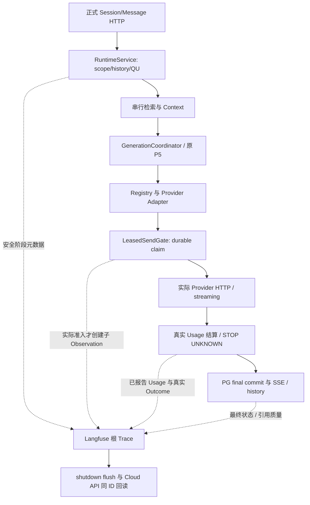

# S8.6.5：Langfuse 可观测性与生成质量对照

> 本文为初始 S8.6.5 阶段的历史报告，保留当时未执行项。2026-10-23 的实际 R7 两题 HTTP、固定 Context A/B/C、Cloud / PG 对账与失败边界见 [R7 最终审计报告](S8_6_5_R_R7_REAL_ACCEPTANCE.md)。R7 审计结论为 FAIL，尚未达到 PASS_REAL_RAG；原始历史结果没有被重分类。

**当前状态：部分实现并完成离线验证；合成 Cloud trace 可读回；真实 RAG HTTP 与 A/B/C 质量对照未运行。整体验收为 `BLOCKED / NOT ACCEPTED`。**

本报告依据原始任务 `d403f59a-4d3f-4146-b248-9783d19c42b7/Pasted text.txt`、只读 ECS/PG 快照、Langfuse 合成 trace 读回、冻结输入包和离线测试日志整理。没有真实生成质量结果，也没有生产部署。

## 状态分层

| 范围 | 当前状态 | 证据与边界 |
|---|---|---|
| 实现 | `IMPLEMENTED_OFFLINE; NOT_DEPLOYED` | S8.6.5 tracing、P1 局部修复与 no-evidence/citation 最终补丁已提交；最终源提交 `9163f0916a60c5ae4ee647ea70816a278e3bf070`。 |
| 离线验证 | `PASS_WITH_SKIPS` | 集成记录为 473 passed、1 skipped；HTTP grant 4 passed、ASGI 2 passed；最新 no-evidence 相关回归 196 passed，tracing quality 52 passed。具体命令与退出码见下表及离线证据。 |
| Langfuse 合成 Cloud | `PASS_SYNTHETIC_ONLY` | 两个零 Provider/零 LLM 的合成 trace 均按 trace ID 读回；不能证明已部署 RAG 请求及其真实模型调用被追踪。 |
| 真实 RAG / HTTP | `NOT_RUN` | 无真实问答、A/B/C 生成、Provider usage、成本或时延数据。十条冻结上下文的 current-source 权限/版本/原文证明因 SSH banner timeout 全部 BLOCKED。 |
| 生产部署 | `NOT_DEPLOYED` | 未构建隔离镜像，未更新或重启 ECS 服务。当前 API/Worker 仍是旧 revision。 |

## Langfuse 根因核查

| 层 | 已核实证据 | 结论 |
|---|---|---|
| 旧调用链 | `backend/app/bootstrap.py` 实例化 `backend/app/adapters/langfuse_tracing.py`；这是旧 `backend.app` 应用组合根。 | 旧适配器接入不代表当前 `weknora_port` 请求链也经过它。 |
| 当前 S8 链路与镜像 | 基线 `db917c8` 的 `deploy/s8/Dockerfile.api` 只复制 `backend/weknora_port`、`eval_center`、`scripts`，不复制 `backend/app`。基线 `deploy/s8/requirements.txt` 不含 Langfuse；虽然根 `pyproject.toml` 锁有 `langfuse==4.15.6`，ECS 镜像构建不以它作为 S8 依赖清单。 | 新链路既没有旧适配器代码，也没有可由根项目依赖声明推断出的 SDK。旧版 Langfuse 不是当前 RAG 可观测性证据。 |
| 当前运行 API / Worker | 只读 ECS 快照显示 API `26ac840c2f71` 和 Worker `85ab3bd0793a` 都在运行相同 image `sha256:80e2f2d84bf67d7d22117d98676049aa9cd3101e69b20f780d5fd9eeaf931a36`，revision `29ecf2f5d3037eed99a4de783546dee272a761bd`；两者 SDK probe 均为 `null`，旧 adapter 均不存在，Langfuse 环境 allowlist 为空；模型云开关为 `false`。见运行快照（原始证据私有保留；位置 SHA256 bf93965153f8e4eb62ad2da6c205a39ffedbe2d87dc59eaaa4901bae0d1d5415）。 | 实际 ECS 上没有 S8.6.5 代码，也没有 Langfuse SDK/运行配置；这是不能看到当前 RAG trace 的直接运行层原因。 |
| 凭据、项目和区域 | 本机隔离进程对 Langfuse Auth 成功；脱敏公钥指纹与 Cloud project scope 匹配；读回 Project ID `cmuido3u800zyad0con8gaqw1`、区域 host `us.cloud.langfuse.com`，Environment 为 `s865-diagnostic`。不记录密钥或完整 key。 | 本地诊断凭据能到达目标项目。ECS 的 allowlist 为空，因此不能由本机成功推断 ECS 配置正确。 |
| Flush、查询与页面筛选 | 对两个唯一 trace ID 使用 Langfuse observations API 查询；均得到 HTTP 200 和同 ID observation。 | 合成 trace 的 flush/入库/查询可用；对这些 trace 来说不是 Cloud UI 筛选导致的不可见。真实 Provider span 对应关系仍未验证。 |
| 原生 Provider HTTP 覆盖 | 当前合成 probe 没有发 Provider 请求。真实 ECS revision 仍旧，S8.6.5 正式服务路径未部署。 | 不声称真实 SiliconFlow/DeepSeek HTTP Transport 已被 Langfuse 观察。需在部署后以授权 HTTP 问答核对真实模型、usage、时延与本地权威账本。 |

原始状态为：`backend/app` 适配器存在但不属于当前镜像复制路径；S8 依赖清单缺 SDK；当前 API/Worker 镜像缺 SDK、适配器与 Langfuse 环境配置；因此旧链路启用状态不能解释当前 S8 查询链没有 trace。当前工作树已将 Langfuse 4.15.6 加入 S8 依赖清单、增加默认关闭的 Compose 配置，并接入新的 `backend/weknora_port/observability.py`。这些变更尚未构建或部署。

## 合成 Cloud 验收

| Probe | 结果 | 读回事实 | 限制 |
|---|---|---|---|
| 初始 standalone SDK probe | `CLOUD_READBACK_PASS`；trace `3faa6260324b80de7de2d71c1b852c80`；Cloud observations API HTTP 200，1 条同 ID observation，input/output 字段存在且均为 null；零 Provider / 零 LLM。 | 首次调用的 stdout 丢失且没有本地 receipt；恢复时没有重发 trace。后续 Auth check 成功、CLI 查询 exit 0；初次发送时 Auth check 为 `NOT_RUN`。证据：脱敏读回（原始证据私有保留；位置 SHA256 39a36ef924c59fb52f2b30982ce0e06104351eb5bbcc695cf06ab9e114de480b）。 | 证明该预先发出的合成 trace 可被检索；不代表 trace 关联了 RAG Provider 调用。 |
| 当前 `weknora_port` adapter probe | `CLOUD_READBACK_PASS`；trace `8d1a34f6b0c15af846fb4379e4756fc8`；SDK 4.15.6；HTTP 200；两条同 trace spans（`weknora.ordinary-turn` → `weknora.context`），原生 parent ancestry / session correlation 有读回；两者 input/output 均为 null；零 Provider / 零 LLM。 | 使用当前 adapter 的隔离进程，验证 Auth、span 结束/flush 与同 trace 查询。脱敏结果见安全 receipt（原始证据私有保留；位置 SHA256 d69db8f8e4c88e9cd68aa45f6f464b14b70828e27ddfa8705209d2d911847c70）和probe provenance（原始证据私有保留；位置 SHA256 6487a540c2f58ac8937d6e97815b7779a1241ba3e5914c693ff9914125e46cfe）。Adapter source SHA256 `4dda226fce31dfcfe4c6e34e07b58557d88e296feb6dc7c805dfb40425859d65`。 | receipt 未保存 CLI 子进程 exit code；只记录 API HTTP 200 和两次 readback attempt。最新 no-evidence 投影修正不属于该 Cloud probe 的覆盖范围，也未由新 probe 验证。 |

完整 CLI 原始 Cloud response 和原始 receipt 未放入归档；归档 manifest 记录排除项及哈希。历史未埋点调用没有补造或导入 Cloud。

## P1 局部修复

1. **结算异常保留已知用量。** Provider 已返回合法 Usage 后，后续结算抛异常时仍传递已知 Usage/Outcome，同时保留 STOP/UNKNOWN、原失败状态和禁止重发。针对四种 reservation/reported-usage 组合的有效 RED 为 4 failed；窄回归 `green-focused.txt` 为 5 passed。此前三文件批次 `green-final.txt` 为 171 passed / 1 failed，失败是 ledger fixture `os.replace` 的 Windows `WinError 5`，不是模型发送；单独重跑失败 fixture 后通过。执行与修复证据见执行范围报告（原始证据私有保留；位置 SHA256 8a41e718b523f8a7bc8a91c7e3d6c254d3e282109b018e3d9bfb1cb0a089eee9）。
2. **短标题匹配。** 以有界字面匹配替代任意 casefold 子串匹配；明确命名/引用仍工作，普通 `A`/`B` 和常用词不再随意选文档，真实歧义仍走原澄清机制。未增加 LLM 识别，也未写已完成 Turn 的 Scope。
3. **引用质量分类与 prompt 候选。** 区分 `VALID`、`INVALID`、`MISSING`、`EVIDENCE_INSUFFICIENT`、`NOT_REQUIRED` 和 `NOT_ASSESSED`。`MISSING` 只作为观测，不新增自动升级规则；证据为空时由服务端已知的 SearchNothing 非歧义回退标记 `EVIDENCE_INSUFFICIENT`，不从模型输出文本推断拒答语义；`semantic_support` 仍为 `NOT_ASSESSED`。最终补丁在离线测试中通过，见下表。它没有 Cloud probe 或真实 RAG 覆盖。

历史 RED/GREEN 及根集成日志保留在离线证据归档（原始证据私有保留；位置 SHA256 5d0174231946040682687f51e93ef7e2eb50f9c300ed336f238be99ad9fddaec）。测试输出中的 WinError、初始断言失败、恢复重跑和跳过的显式 PG 测试均保留，没有将失败记录改成 PASS。

## 固定 A/B/C 输入与结果状态

- 固定包包含 **10 个互不重复的真实历史问题与实际生成 Context**，每题三臂共 30 条纯 wire body：A = Cheap + 当前 Prompt B；B = Cheap + 候选 Prompt；C = Expensive + 与 B 相同的候选 Prompt。输入 manifest SHA256：`0489aecbe70e1dca093dd5e7461a17cf6580e927edc936418f1c80633fa5b143`；wire manifest SHA256：`9f7b364d4291e38ff15a82611bb23b20ca1a6e45a4f3733ee9826211b7cc3664`。输入说明见固定包 README（原始证据私有保留；位置 SHA256 7cfe27cf2d35b376834d0ea361d7e7529e3150f7ab18fac34427c7c38a344936）。
- Gold/评分数据不参与输入加载、检索或 Context 拼接；评分输入独立。历史 request IDs 只作 provenance，绝不复用。没有声明新的 expected chunk ID 时不把空列表当作引用通过。
- 当前租户 332 / 数据库 `weknora_s8` safe PG snapshot revision 3 识别 Cheap `siliconflow / Qwen/Qwen3.5-4B`（model ID `mdlf5350f8b80d8971c14ddaa8524f8a039d414e85c35a657e4271228473b25e`）及 Expensive `deepseek / deepseek-flash`（model ID `mdlfc056bbbf8448d15f3d4f3cd954756be9a34bb7f104e137cde38dc360b749`）。安全配置快照见模型角色 readback（原始证据私有保留；位置 SHA256 cd23e0296b710d0caf4af8edffcee5abc61c29f07dfabe6ff156fdf2a082527f）。这确认配置身份，不代表此刻已向这些模型发送请求。
- Offline prepare/dry-run 渲染 30 个 A/B/C wire body；比较 runner 有 23 个测试通过，exit 0。总 planning envelope 为 **583,988 Tokens**，按 canonical UTF-8 message bytes + 4096 framing allowance + 2048 output + 1024 safety 计算。它不是 tokenizer 测量、实际 usage、额度 reservation、成本估计或发送授权。
- 当前 source proof 的 10 行全部 `BLOCKED`：对固定 manifest 执行 current source readback 前，3 次 pinned strict-host-key SSH 连接（两次 worker attempt、一次 root attempt）都在 SSH banner exchange 超时，exit 255；只读 PG 查询未开始。未能证明当前 KB permission、cloud consent、document/source-version membership 或 plaintext 与冻结 Context 一致。见current source preflight（原始证据私有保留；位置 SHA256 be2f11f7b8c7a7c64e6f438f76311e33611f70aa742f3e35e30307dacb780e23）及SSH 失败证据（原始证据私有保留；位置 SHA256 da05574cad3cb377b10e21f74b17fc981c47450dccfd83c09a41e99b8bf65dbd）。
- 因 current proof 不可用且没有新的执行 grant，真实 A/B/C 没有运行。**核心答案正确率、必要条件完整率、无依据内容比例、引用有效率、真实 Token、费用、端到端延迟、纯生成延迟全部为 null / `NOT_RUN`。** 不给 Cheap/Expensive 的胜负结论，也不建议调整 P5 路由或阈值。

## 验证命令与执行记录

| 验证 | 命令或命令记录 | 结果 |
|---|---|---|
| Langfuse probe guard | `python -B -m py_compile scripts/s8_6_5_langfuse_probe.py` | exit 0。 |
| Langfuse probe tests | `& '[PRIVATE_PATH_SHA256:93f304207981d108266931677a715357031dc85c3b39ddc5dd2052bd6b530794] quention\.venv\Scripts\python.exe' -m pytest -q tests/test_s8_6_5_langfuse_probe.py` | exit 0，4 passed。 |
| P1 generation/citation classification | 命令、RED/GREEN 与结果见 `offline/generation-quality/*.command.txt`, `*.exitcode.txt`, `*.log`。 | 初始分类 13 passed、候选 prompt 6 passed、相邻范围 151 passed / 1 skipped；最终 no-evidence 分类与相邻回归另见下方新记录。失败尝试也保留。 |
| 30-wire compare dry-run | 精确命令见 `offline/generation-quality/compare-final4.command.txt`。 | exit 0，23 passed；复现固定 manifest 和 wire manifest 的 SHA256。无 DB / ECS / Provider 调用。 |
| HTTP grant profile | `& '[PRIVATE_PATH_SHA256:3f0e777b6d25154298a426e2041aad9353abd4b8a5f216668b1d30102d2ac42f] quention/.venv/Scripts/python.exe' -X utf8 -B -m pytest tests/weknora_port/test_s865_http_profile.py -q -p no:cacheprovider --tb=short` | exit 0，4 passed。此前 review-fix 前的 RED 输出保留。 |
| ASGI HTTP preflight | `& '[PRIVATE_PATH_SHA256:3f0e777b6d25154298a426e2041aad9353abd4b8a5f216668b1d30102d2ac42f] quention/.venv/Scripts/python.exe' -X utf8 -B -m pytest tests/weknora_port/test_s862r3_http_preflight.py -k actual_asgi -q -p no:cacheprovider --tb=short` | exit 0，2 passed，4 deselected。 |
| 当前组合离线测试 | 实际集成命令行没有与结果同存；不得推测命令。原始日志：`offline/integration-final.log`。 | exit 0；473 passed，1 skipped（需显式 isolated PostgreSQL DSN 的 PG 测试）。只代表这次离线集成。 |
| Current-source preflight | pinned SSH 只读路径；不记录含密钥参数的命令文本，见 archive SSH stderr/stdout。 | 3 次连接 exit 255，`Connection timed out during banner exchange`；DB 查询 `NOT RUN`，所有 10 rows `BLOCKED`。 |
| No-evidence classification RED | `& '[PRIVATE_PATH_SHA256:3f0e777b6d25154298a426e2041aad9353abd4b8a5f216668b1d30102d2ac42f] quention/.venv/Scripts/python.exe' -X utf8 -B -m pytest -q tests/weknora_port/test_s865_empty_evidence_reason.py tests/weknora_port/test_s865_generation_quality.py --tb=short -p no:cacheprovider` | exit 1；7 failed / 14 passed，修复前预期 RED。原始命令、exit 和日志位于 `docs/evaluation/evidence/s8_6_5/final_addendum/known_empty/known-empty-red.*`。 |
| No-evidence focused GREEN | 同一 pytest 命令，修复后重跑 | exit 0；21 passed。记录：`docs/evaluation/evidence/s8_6_5/final_addendum/known_empty/known-empty-green.*`。 |
| No-evidence adjacent regression | `& '[PRIVATE_PATH_SHA256:3f0e777b6d25154298a426e2041aad9353abd4b8a5f216668b1d30102d2ac42f] quention/.venv/Scripts/python.exe' -X utf8 -B -m pytest -q tests/weknora_port/test_s865_empty_evidence_reason.py tests/weknora_port/test_s865_generation_quality.py tests/weknora_port/test_s851_history_transform_ambiguity.py tests/weknora_port/test_s864_document_scope.py tests/weknora_port/test_service.py tests/weknora_port/test_generation.py tests/weknora_port/test_s865_quality_persistence.py tests/weknora_port/test_generation_visibility.py tests/weknora_port/test_history_storage.py --tb=short -p no:cacheprovider` | exit 0；196 passed。记录：`docs/evaluation/evidence/s8_6_5/final_addendum/known_empty/known-empty-related.*`。 |
| Tracing zero-attempt RED | 精确命令见 root command records（原始证据私有保留；位置 SHA256 f258b8c44272b92b0e2dd9db3ca67957859aa26835dec05145f2b1a2f84bc2db）：`test_s865_observability.py -k zero_attempt`；命令/退出码由主代理工具记录，非日志内嵌。 | exit 1；1 failed / 26 deselected，`KeyError: citation_status`；原始日志已归档。 |
| Tracing final quality GREEN | 同一 command records 中列明 observability、empty-evidence、generation-quality、quality-persistence 四个模块的完整命令。 | exit 0；52 passed；原始日志已归档。 |

此前测试失败、skip、接线前置 RED 和 recovery 记录没有删除。无证据 RED/GREEN 命令与结果原始记录保存在本机 `[PRIVATE_PATH_SHA256:3f0e777b6d25154298a426e2041aad9353abd4b8a5f216668b1d30102d2ac42f] quention/var/reports/s8-6-5/` 下；归档索引见offline manifest（原始证据私有保留；位置 SHA256 5d0174231946040682687f51e93ef7e2eb50f9c300ed336f238be99ad9fddaec）。源码已提交，但没有构建镜像或部署。

## 下一步：唯一的组合条件授权建议

当前没有新模型授权，不发送收费请求，也不重用旧 grant/ledger。恢复 pinned SSH 后，先在本 Goal 已允许的隔离范围构建镜像，补齐 10 个 case 的当前主体、tenant/KB 权限、cloud consent、启用文档与有效 source-version、原文哈希及 Context 匹配；把稳定的 source identity 和上述固定输入/wire/model/prompt manifest 绑定到全新的 owner grant。需将完整镜像身份和 HTTP 请求树补齐后，才提交一次可执行的组合授权申请；目前仅有如下条件计划：

- 最多 **30 次**固定生成（A/B/C × 10）；
- 最多 **2 个**正常 HTTP 代表性问答；
- 最多 **54 次**模型 attempt（按 30 generation calls + 每题最多 12 次实际 Provider 尝试的上限；不包含自动重试，须与执行树及 grant 保持一致）；
- `800,000` 个 **actual reported-token** stop cap 仅为拟议额度上限，不是现有 grant。`583,988` 只是固定生成离线 planning envelope；HTTP request-tree upper bound 当前未闭合，因此还不能证明 800,000 足够或能直接执行。

一个组合包也必须保持分 scope 的次数与 stop accounting、`reported_usage_only_v1`、40 分钟窗口、新 grant、真实来源 proof、精确模型/wire hash 和失败即 STOP/UNKNOWN。没有新模型授权前不发送收费请求，也不将报告称为 production-ready。当前网络阻断使来源及镜像尚不能冻结，本次没有提前提出缺少这些身份的发送审批。

## 版本与结论

- 任务基线：`db917c8a535b13b96ffd9ffbda18669025d5b3b3`；目标分支：`codex/s8-6-adaptive-retrieval-20261021`。
- 最终源提交：`9163f0916a60c5ae4ee647ea70816a278e3bf070`（包含 no-evidence/citation 补丁与 tracing quality 修正）。旧实现提交 `7510b7a2b41485a7f2602cd16f344c5d4b078e4f` 仍可作为前序实现版本参考。
- 本阶段确认了 S8 新旧接线/镜像差异、在隔离进程的 Cloud Auth/合成 trace 查询和离线 P1 实现；没有证据可判断 Cheap 是否足够或 Expensive 是否值得。
- S8.6.5 完成标准尚未满足：真实 ECS 部署、真实 RAG Provider-child trace 对账、current-source proof、A/B/C 生成与评分、真实 HTTP 验收均未完成。当前结论保持 `BLOCKED / NOT ACCEPTED`。

## 最终补充证据与未执行项

- 增量证据清单（原始证据私有保留；位置 SHA256 842bf65d105f9b5bb6394a77f78d02e3a3849966acb92001a60cd5f4dfb98297） SHA256 `7cd58445267ec8132f82e4004448a435e51bf33fc3a7d349b492aa315843ba04`：14 个原始文件精确复制，4 个注明来源的补充记录；旧归档清单没有改写。
- 最终 `observability.py` 文件 SHA256 `fa5b837c75a92bd2adb20dcd9c16b410375a02882ea1f23c16c486fdfc94a565`；Cloud probe 使用的是表内较早的 `4dda...` 文件，之后只增加零 attempt 最终引用质量投影的离线修复，没有重发 Cloud probe。
- 质量状态已保存到现有 `messages.agent_steps`，与答案在同一 scoped final-commit 更新中提交；SSE/history 投影使用同一条真实完成记录。此处 PG 验证使用脚本化 SQL fixture；独立真实 PG 集成未运行，不把 mock 当作数据库验收。
- 固定包包含官方原答案与历史项目复核；复核不等于本轮 Owner 人工批准。新 A/B/C 逐题答案和所有质量指标在机器结果中显式为 `null / NOT_RUN`。
- 正式 HTTP 候选问题仅为 MML0434 和辐射避难所，各新 Session 单次提交；profile SHA256 `c300f8ba6ed7e109541e8bf18d7196e0a923959acb02f24811f12ab273dc7b54`。候选 Prompt 仅进入本轮 test-only profile/固定生成；生产默认 Prompt 没有切换。
- 预计费用为 `UNPRICED`，实际账单为 `NOT_RUN`。已查询 [SiliconFlow 官方定价](http[PRIVATE_PATH_SHA256:9e5dce7fbef86e9859caa2e187b77bc99925e8a0197b404f76ac15ef6b4c343f])与 [DeepSeek 官方定价](http[PRIVATE_PATH_SHA256:09063ccc3eb4b5e81273c1c2bfa850303789fbc2818a881ad4481dcd910d433b])；未取得适用的 Qwen3.5-4B 精确定价，且缓存命中/真实响应模型尚无本轮数据，因此不编造整批金额。583,988 是字节法保守规划值，不是预计真实消耗。
- 尚无新镜像 ID；SSH 恢复后须用精确源码构建独立镜像并记录 ID，不能沿用旧诊断镜像作为本轮源码证明。当前没有生产更新、Push、Tag、索引重建或新的 UNKNOWN。

## 实际接线与后续验收路径

代码路径和离线 fixture 已验证；该图中的真实 Provider、PG/SSE 与 Cloud 联合对账尚未执行。固定 A/B/C 路径直接复用相同的 Registry/Adapter/SendGate/LocalExecution 进行最终生成，不重复检索，也不逐题生成中间答案。真实对照数据不足，下一阶段保留 P5 阈值与模型选择，暂不能给出类别路由或 Cheap/Expensive 胜负建议。

公开衍生说明：原始 S8.6.5 证据包私有保留，本分支仅公开源码、脱敏汇总及哈希清单。原历史执行结果不因公开整理而成为新的验收结果。
