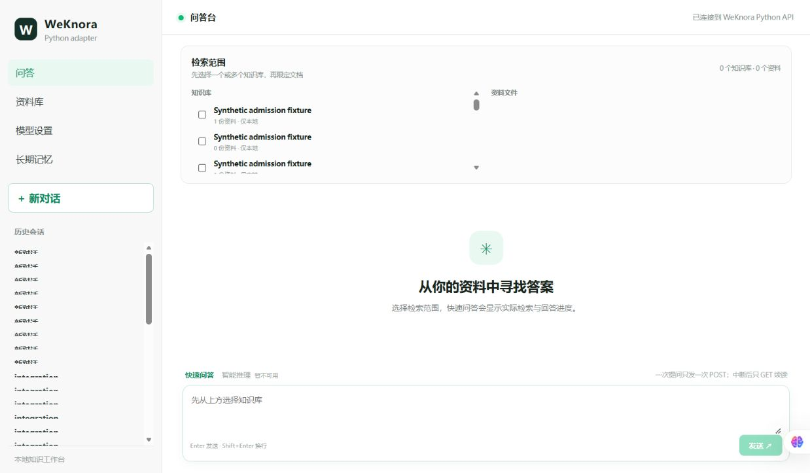

# P8.1 旧入口退役与运行环境收敛

状态：**P8_1_ENTRYPOINT_COMPLETE（非破坏性范围完成；容器删除另待 Owner 对具体对象批准）**。本轮云模型调用 0，新增模型 Token 0，新增 UNKNOWN 0。

M3.4 前置已完成：`28a17f12340d08cf87467aef1926edc815a685ef`（MinerU 本地主路径、Omni 矩阵布局及正常上传已验收；见 M3 报告，未作为本轮新增成绩）。本轮实现提交：`083fdbf8b3af9992b16add22b3c1cb36865783ef`。分支：`codex/weknora-python-port-integrate-image-20261014`。本报告为其后的纯证据提交；交付提交完整 SHA 在最终答复及本机 `E:\WK\run\p81-retirement-20261018\delivery-commit.json` 中记录，避免自引用提交哈希。

## 1. 正式运行链和入口

`React WeKnoraPythonApp → backend.weknora_port.entrypoint → backend.weknora_port.worker → PG/Redis`。API/Worker/React 为主机进程；Docker `eviroute-rag` 只含数据依赖。

唯一日常入口为 `wk.ps1 start|stop|status|check -Config <D/E 盘显式 JSON>`。实际可复现配置：`E:\WK\run\p81-retirement-20261018\local.json`，当前云端开关关闭。完整命令、变量及无密钥模板见 [开发说明](../WEKNORA_DEVELOPMENT.md) 和 [模板](../local-runtime.example.json)。

- `scripts/local_runtime.py`：核实固定容器完整 ID、Compose project/service、镜像、卷及绑定端口，再只读验证 PG物理ID/DB、Redis当前run ID、已有local principal、密钥文件长度及MinerU路径。只启动已存在容器，既不重建也不迁移。
- API通过 `/api/v1/runtime` 身份检查后启动Worker和React。日志/临时文件在D/E盘；端口占用拒绝替换。stop只处理PID、exe、创建时间和命令哈希均匹配的已记录进程，数据容器保持运行。
- `scripts/start_backend.py` 已失去旧API加载行为，仅打印退役提示并退出1。新入口不加载旧dotenv，不调用旧Compose或旧Worker。
- `scripts/eviroute-rag-dependencies.ps1` 维护工具由Compose `up`改为已有容器的`start`，避免意外重建；日常仍用wk.ps1。

## 2. 局部代码处理

| 范围 | 实际修改与保留理由 |
|---|---|
| 前端 | `src/main.tsx`只渲染WeKnoraPythonApp；`weknora_port/api.ts`缺少API地址/身份异常明确拒绝；`vite.config.ts`无隐式旧服务代理；对应环境类型、Playwright配置及缺地址反例同步。原App源码、旧测试留存，无正常选择分支。 |
| DTO依赖 | 8个纯文档值类型迁至`backend/weknora_port/ingestion/types.py`，`mineru.py`改用新路径，`pyproject.toml`排除旧domain包；旧`backend/app/domain/models.py`继续导出同一类以兼容历史调用。新链导入MinerU不加载backend.app。 |
| 原P8候选 | 已读取原retirement inventory；旧domain及旧API/检索/账本代码仍有历史调用者，不做目录级删除。历史Gold/UNKNOWN/迁移/原件/索引和旧回滚材料保留。 |
| 文档与入口 | README、WEKNORA_DEVELOPMENT、LEGACY_ENTRYPOINTS更新到当前事实；新增本地运行控制器、配置模板及11项离线安全测试。 |

没有删除旧运行源文件：`start_backend.py`保留为拒绝启动的兼容提示。没有修改模型角色、业务Schema、Rerank/路由参数、OCR规则或历史数据。全部23个实现文件见同名results.json的`source_files`。

## 3. 真实运行资源与待删除对象

盘点保留34个容器、23个卷元信息、7个Compose项目和36个TCP监听记录。完整Compose归属、镜像ID/标签、端口、网络、挂载、状态和脱敏进程信息见 [初始完整清单](evidence/p81-entrypoint-20261018/runtime-inventory.json)。名称不是判据。初次用不存在的默认postgres角色检查失败也保留；随后用已有正常连接只读核实了PG真实物理ID。

| 当前资源 | 已验证身份 |
|---|---|
| PG | `127.0.0.1:56423`，库`weknora_python_port_20261013`，system ID `7696088403504697382`；容器`89c5cb748e2ec7aca3b1e3b181dfe936a4054137ddb4de5c4e8689e86387e720` |
| Redis | `127.0.0.1:56424/15`，本轮run ID `dcff9d65a25725574ba0cfbc743d409fac211ef0`；容器`15fe772fab7d9ac5b6023ff2075ebb5e12ccee80e274f91b16fe612e8748e897`；应用/解析试验各用唯一前缀 |
| external volumes | `weknora-python-resume-pg-20261013`、`weknora-python-resume-redis-20261013`均保留 |
| 主机进程 | 由入口实际启动API/Worker/React；PID/exe/创建时间/命令哈希见running-processes.json；API56425、React56426、测试API56427均已释放 |

以下8个旧API/Worker全部原本已退出、restart=no、无宿主机发布端口。本轮无需再stop/update，实际容器删除为0；**表格不是删除授权**。新主链没有对它们的启动、网络或挂载依赖。

| Compose项目 / 服务 | 完整容器ID | 运行身份依据 |
|---|---|---|
| raglocalfirst0930 / worker | `5aeef69378f354ee4592912227da64cba544069b9e8bf0bd4dcd098373993400` | 旧backend.app.workers.ingestion |
| raglocalfirst0930 / api | `db29f9707d27d1616e74382b8e16ac4868395cad97051ea05eeb79e942cefe35` | ordinary_verification_fence:create_app |
| ragv1final0927 / api | `c788a7f9a2c3af8b4535eb046af6015dd38427dee99b9eb8929593d2ac3d3ea8` | 旧backend.app.main + Alembic启动命令 |
| ragv1final0927 / worker | `fa1f8b0bc9f53fd1a23ad41bf94215a1649d5ff8462f1f52716cfa1b08408e47` | 旧backend.app.workers.ingestion |
| v1reviewfinal0927 / api | `c00025e807fb6c71f2d4e12b4955b54030ef4bdb3955178418e5a5483a5be700` | 旧backend.app.main + Alembic启动命令 |
| v1reviewfinal0927 / worker | `2d97164a06f142e1ba58d46d56d08de995162623430af7848b81fcf0f75abf6b` | 旧backend.app.workers.ingestion |
| v1review0927 / api | `3eaf7afb7aa65ad47cfc4b90dcc7cf1e4b07314f129e9f74509ae55977ee82e4` | 旧backend.app.main + Alembic启动命令 |
| v1review0927 / worker | `13eb81278a26e66b81b45056dfa88d6be96471032841449ab9e4a7e6166eac03` | 旧backend.app.workers.ingestion |

同四个旧项目的4个nginx前端也已退出且restart=no，完整ID及来源见results.json的`retained_old_frontend`，仍保留。上游Go WeKnora分组及其运行Redis、其他项目/未知用途容器未操作；旧25438本轮无监听，未连接旧业务库。所有卷和旧数据库均未删除；未执行compose down/prune/DROP。

## 4. 实际验收

| 检查 | 结果 / 退出码 |
|---|---|
| wk.ps1 check / start / status / stop / 最后status | 均0。真实PG/Redis、新API身份、3个主机进程存活；最终仅停止本轮进程，依赖仍运行 |
| 重复start、旧start_backend.py | 均1，预期拒绝；没有替换正在运行的进程或进入旧API |
| 定向后端 | 83 passed / 0：local_runtime、development_entry、MinerU、M3.4 routing、HTTP、streaming、history；API/SSE离线部分为明确合成服务 |
| 前端adapter + 缺地址反例 | 10+1 passed / 0；API由Playwright mock，含错误旧身份拒绝、缺配置零API发送；没有启动旧服务冒充实测 |
| npm run build | 0，TypeScript + Vite构建通过 |
| 真实用户Edge | 原Edge profile打开56426，页面显示“已连接到WeKnora Python API”；控制台warn/error为空；截图如下。未提问 |
| 单次真实图片上传 | 0；新隔离KB，正常HTTP→MinerU Basic→PG Chunk→关键词索引→源文回读。无API业务mock；server-side现有配置注入为空模型/关键词only以保持零云调用 |
| git diff --cached --check | 最终0。初次发现测试文件EOF空行已修正，旧失败日志保留 |
| wheel构建 | NOT RUN：已核实的运行环境缺setuptools/wheel/build；未安装或联网。新DTO独立导入及包发现TOML规则检查通过，不能替代wheel构建 |

准确命令、退出码、测试属性和文件清单见同名results.json的`commands`；原始stdout及SHA清单在[evidence目录](evidence/p81-entrypoint-20261018/manifest.json)。原始日志（含早期测试环境/断言失败）完整保存在 `E:\WK\run\p81-retirement-20261018`。**未实现的命令不得报告通过。**

新图片验收：KB `2efe0d9b-1b23-4fad-b5a3-75019e8bb124`；文档 `8970929a-e1f8-4bff-9c67-66d69798d60e`；版本 `281ab94d-9909-48a7-b307-2ea375a159f8`；一次上传、一个Chunk、一条dimension=0/embedding=NULL关键词索引；源文HTTP200，版本及locator范围正确。MinerU一次本地解析10.963秒，Provider构造0次。主入口使用已有local slot（本实例tenant1）；隔离解析测试明确使用既有tenant332及新KB，未混淆两种身份。没有把关键词索引称为真实Embedding或回答质量验收。

## 5. 保留问题与结束状态

- 全局Provider记录245→245，新增云调用/Token/UNKNOWN均0。14个相关新旧容器状态和restart策略与初始记录一致；原有8个未提交路径逐字节SHA一致。数据库仅增加本轮新隔离KB/文档/Chunk/关键词索引，无历史覆盖。
- stop使用Windows进程终止，未新增优雅排空协议；在空闲后停止，处理中断依然依赖现有持久化和UNKNOWN合同。
- MinerU支持单帧PNG/JPEG/BMP/WebP/TIFF及纯扫描PDF；普通文字PDF原生提取保留。混合PDF的扫描页自动OCR、GIF/SVG/多帧/加密格式未新增支持；无Tesseract回退。
- wheel打包验证缺现成构建工具，作为明确NOT RUN交付；本任务实际本机启动和正常解析导入已验证。无新增普通主链阻断证据。
- 容器删除/卷删除/旧库清理仍须Owner分别批准具体对象。本轮只完成安全入口收敛，不擅自执行清理；不Push、部署、合并或Tag。后续最小事项是Owner审查8个旧API/Worker容器清单，决定是否批准删除；无需重新测评六套数据集。
